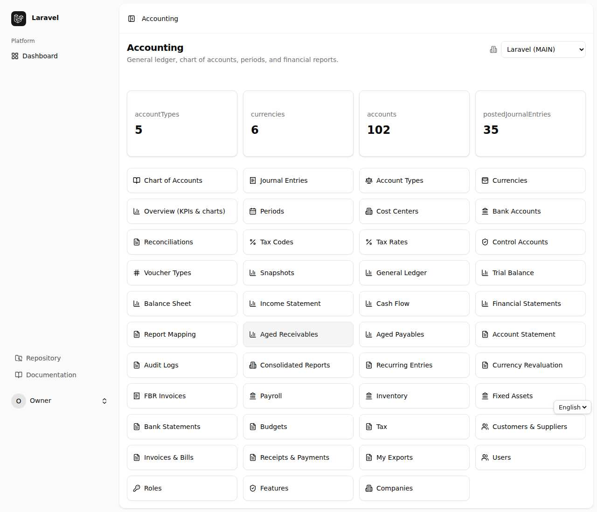
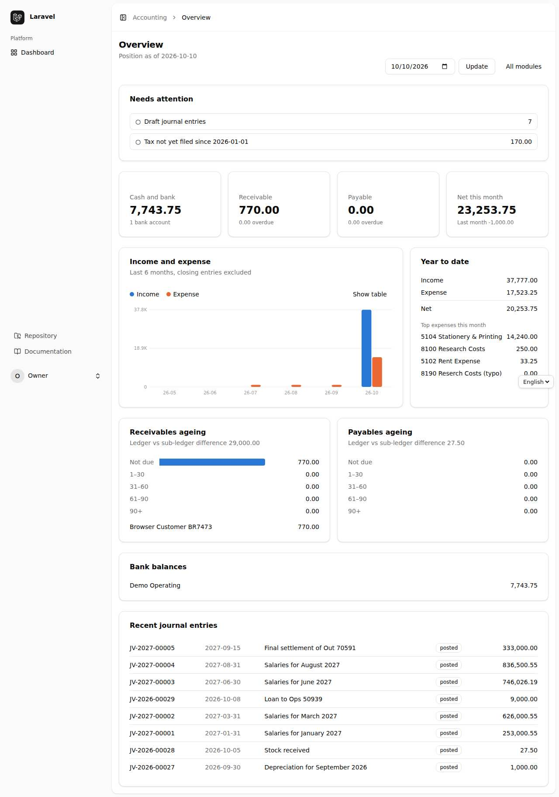
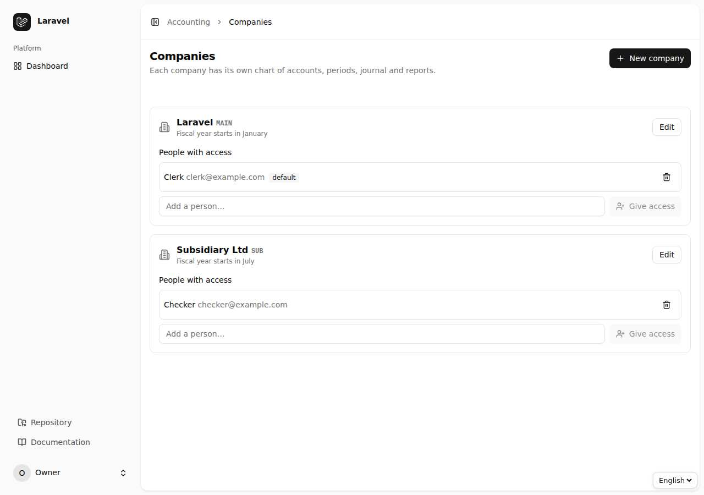

# باب 1: شروعات — لاگ اِن، مینو، زبان اور رولز

[← فہرست](README.md) · [اگلا باب: بنیادی ڈیٹا →](02-buniyadi.md)

اس باب میں آپ سیکھیں گے کہ سسٹم میں داخل کیسے ہوں، مرکزی صفحہ (Dashboard) کیسے پڑھیں، زبان اردو/انگریزی کیسے بدلیں اور کس صارف کو کیا اختیار ملتا ہے۔

> **ضروری نوٹ:** اسکرین شاٹس انگریزی انٹرفیس کے ہیں۔ بٹنوں اور فیلڈز کے انگریزی نام اس گائیڈ میں `اس طرح` لکھے گئے ہیں تاکہ آپ انہیں اسکرین پر آسانی سے پہچان سکیں۔

## 1.1 لاگ اِن اور مرکزی صفحہ

1. اپنے براؤزر میں سسٹم کا پتہ کھولیں، مثلاً `https://your-app.test/accounting`۔
2. اگر آپ لاگ اِن نہیں ہیں تو سسٹم آپ کو `Login` صفحے پر لے جائے گا۔ اپنا ای میل اور پاس ورڈ لکھیں۔
3. لاگ اِن کے بعد **Accounting** کا مرکزی صفحہ کھلتا ہے۔ اسی کو *Dashboard* کہتے ہیں۔

مرکزی صفحے پر ہر ماڈیول کا ایک لنک ہوتا ہے: Chart of Accounts، Journal Entries، Reports، Payroll، Inventory وغیرہ۔ آپ کو صرف وہی لنک نظر آتے ہیں جن کی اجازت (Permission) آپ کے پاس ہے اور جو **Features** میں آن ہیں (دیکھیں باب 10)۔

## 1.2 Overview — کاروبار کی ایک نظر

`Overview` صفحہ نقدی، وصولیاں، ادائیگیاں، آمدنی و اخراجات کے چارٹ اور انتباہات (مثلاً منظوری کے منتظر واؤچرز، بجٹ سے تجاوز) ایک جگہ دکھاتا ہے۔ کسی بھی انتباہ پر کلک کریں تو متعلقہ فہرست کھل جاتی ہے۔

## 1.3 زبان: اردو (دائیں سے بائیں) اور انگریزی

صفحے کے اوپر دائیں/بائیں کونے میں **English** لکھا ایک زبان منتخب کرنے والا مینو ہے۔ اس میں سے `اردو` منتخب کریں:

- پورا صفحہ دائیں سے بائیں (RTL) ہو جاتا ہے۔
- مینو، بٹن، فارم کے لیبل اور پیغامات اردو میں آ جاتے ہیں۔
- آپ کی پسند محفوظ رہتی ہے، اگلی بار دوبارہ منتخب کرنے کی ضرورت نہیں۔
- اعداد، کوڈ، ای میل اور انگریزی ناموں (مثلاً `JV-2026-00001`) کی سمت درست رہتی ہے۔

## 1.4 کمپنی تبدیل کرنا (Multi-company)

اگر آپ کے ادارے میں ایک سے زیادہ کمپنیاں ہیں تو مرکزی صفحے پر **Company** کا مینو ہوتا ہے۔ کمپنی بدلتے ہی تمام فہرستیں، رپورٹیں اور واؤچر اسی کمپنی کے ہو جاتے ہیں۔ ایک کمپنی کا ڈیٹا دوسری کمپنی کو کبھی نظر نہیں آتا۔

نئی کمپنی بنانے اور صارفین کو کمپنی تک رسائی دینے کے لیے `Companies` صفحہ استعمال کریں (صرف `companies.manage` کی اجازت والے صارفین)۔

## 1.5 رولز (Roles) — کون کیا کر سکتا ہے

سسٹم میں اختیارات کی تقسیم اس اصول پر ہے کہ **ایک ہی شخص واؤچر بنا بھی نہ سکے اور خود منظور بھی نہ کر سکے**۔

| رول (Role) | کیا کر سکتا ہے |
|---|---|
| `super-admin` | سب کچھ؛ پھر بھی اپنا بنایا ہوا واؤچر خود منظور نہیں کر سکتا |
| `admin` | صارفین، رولز اور اجازتیں سنبھالتا ہے؛ حسابات میں کچھ نہیں لکھتا |
| `accountant` | واؤچر بناتا، پوسٹ کرتا، پیرو کلوز کرتا ہے؛ پے رول تیار اور جمع (Submit) کرتا ہے |
| `approver` | منظور/مسترد کرتا ہے؛ پے رول منظور (Approve)، پوسٹ اور ادا کرتا ہے؛ خود واؤچر نہیں بناتا |
| `auditor` | سب کچھ صرف پڑھ سکتا ہے، بشمول Audit Log |
| `viewer` | صرف رپورٹیں اور فہرستیں دیکھ سکتا ہے |

جس عمل کی اجازت نہ ہو، اس پر سسٹم **403 Forbidden** دیتا ہے اور بٹن عموماً نظر ہی نہیں آتا۔ رولز اور اجازتوں کی تفصیل باب 10 میں ہے۔

## 1.6 عام اصول جو ہر اسکرین پر لاگو ہیں

- **Draft اور Posted:** واؤچر پہلے *Draft* ہوتا ہے (تبدیلی ممکن)، `Post` کرنے کے بعد وہ کھاتوں میں درج ہو جاتا ہے اور تبدیل نہیں ہو سکتا؛ غلطی ہو تو `Reverse` (الٹ) کیا جاتا ہے۔
- **بند پیرئیڈ:** بند مدت میں کوئی نیا واؤچر پوسٹ نہیں ہو سکتا۔
- **فلٹر اور ترتیب:** فہرستوں کے اوپر فلٹر کے خانے ہوتے ہیں؛ خانہ بھر کر `Filter`/`Search` دبائیں، `Reset` سے فلٹر ہٹائیں۔
- **ایکسپورٹ:** رپورٹوں اور کئی فہرستوں پر `CSV`، `Excel`، `PDF` کے بٹن ہوتے ہیں۔
- **آڈٹ:** ہر اہم تبدیلی (کس نے، کب، کیا بدلا) Audit Log میں محفوظ ہوتی ہے۔

