

# باب 2: بنیادی ڈیٹا — کھاتوں کا چارٹ، کرنسی، پیرئیڈ اور دیگر

[← پچھلا باب](01-shuru.md) · [فہرست](README.md) · [اگلا باب: جرنل واؤچر →](03-voucher.md)

کوئی بھی لین دین درج کرنے سے پہلے یہ بنیادی چیزیں طے ہونی چاہئیں۔ اس باب کی ہر اسکرین کا ایک ہی انداز ہے: **فہرست** (Index) ← `Create` ← **تفصیل** (Show) ← `Edit`۔

## 2.1 کھاتوں کا چارٹ (Chart of Accounts)

یہ آپ کے حسابات کی بنیاد ہے: ہر کھاتے کا ایک کوڈ (مثلاً `1101` Cash In Hand)، نام، قسم (Asset/Liability/Equity/Income/Expense) اور والدین (Parent) ہوتا ہے۔

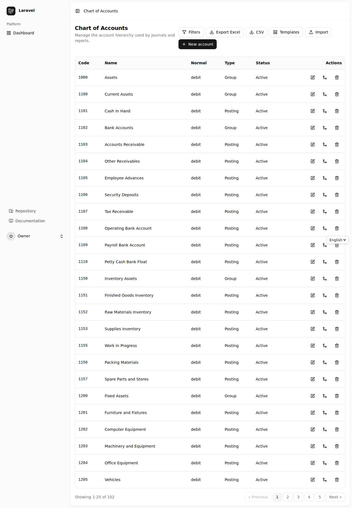

**نیا کھاتہ بنانے کے مراحل**

1. `Chart of Accounts` ← `Create` دبائیں۔
2. `Account Code` اور `Account Name` لکھیں۔
3. `Account Type` منتخب کریں (Asset، Liability وغیرہ)۔
4. اگر یہ کسی گروپ کے نیچے ہے تو `Parent` منتخب کریں۔ **گروپ** (Group) کھاتے میں براہ راست واؤچر نہیں لکھا جاتا، صرف **پتّے** (Leaf) کھاتوں میں۔
5. `Save` دبائیں۔

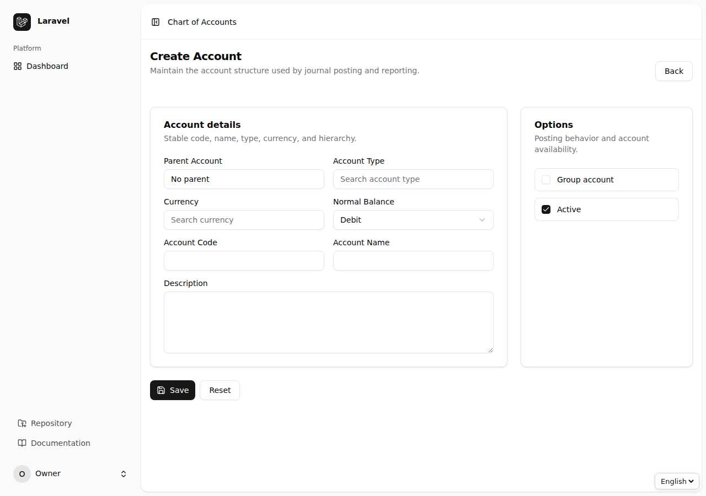

**ٹری (Tree) منظر:** `Tree` لنک سے پورا چارٹ درخت کی شکل میں کھلتا ہے، ہر شاخ کھولی/بند کی جا سکتی ہے۔

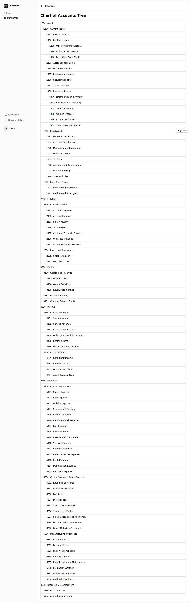

سسٹم ڈیٹا بیس کی سطح پر چارٹ کے اصول نافذ کرتا ہے: کوڈ منفرد، ہر کھاتے کی قسم لازمی، گروپ میں واؤچر ممنوع، اور جس کھاتے میں واؤچر ہو چکے ہوں اس کی قسم نہیں بدلی جا سکتی۔

### چارٹ امپورٹ / ایکسپورٹ

بڑا چارٹ ہاتھ سے بنانے کے بجائے CSV یا Excel سے لوڈ کریں:

1. `Import` دبائیں، پھر `Template` سے نمونہ فائل ڈاؤن لوڈ کریں۔
2. فائل بھر کر اپ لوڈ کریں۔ سسٹم پہلے **جانچ (Dry-run)** دکھاتا ہے: کون سی قطاریں درست ہیں اور کن میں کیا غلطی ہے۔
3. غلطیاں ٹھیک کر کے `Import` کی توثیق کریں۔

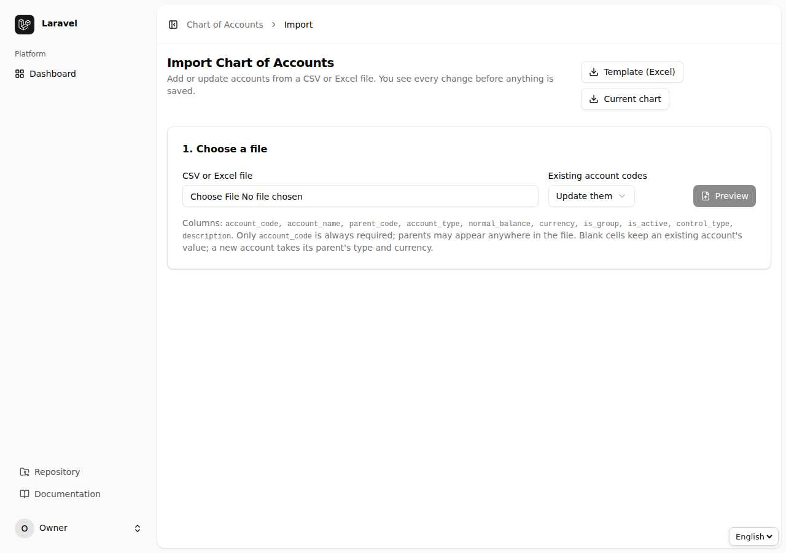

### کھاتے ضم کرنا اور کوڈ بدلنا (Restructure)

کسی کھاتے کے صفحے سے `Restructure` کھولیں۔ یہاں آپ (1) کوڈ بدل سکتے ہیں، (2) دو ایک جیسے کھاتوں کو **ضم** (Merge) کر سکتے ہیں — پہلے کھاتے کے تمام واؤچر دوسرے میں منتقل ہو جاتے ہیں — اور (3) شاخ کو نئے والدین کے نیچے لے جا سکتے ہیں۔ ہر کارروائی Audit Log میں درج ہوتی ہے۔

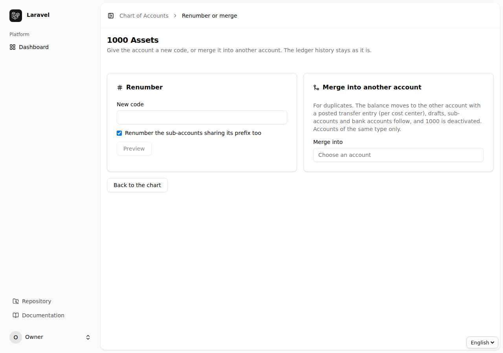

### صنعتی ٹیمپلیٹس (Chart Templates)

نیا ادارہ شروع کر رہے ہوں تو `Chart Templates` سے اپنی صنعت کا تیار چارٹ لگا لیں: Trading، Manufacturing، Services، School، NGO، Healthcare۔

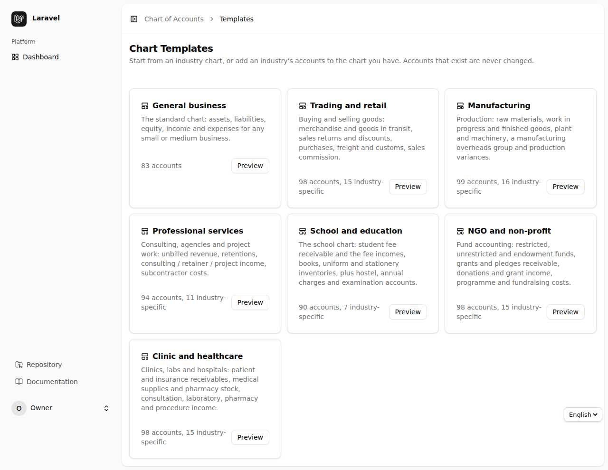

## 2.2 اکاؤنٹ ٹائپس (Account Types)

یہ پانچ بنیادی اقسام ہیں جن پر پورا حسابی نظام کھڑا ہے۔ عام طور پر انہیں بدلنے کی ضرورت نہیں پڑتی۔

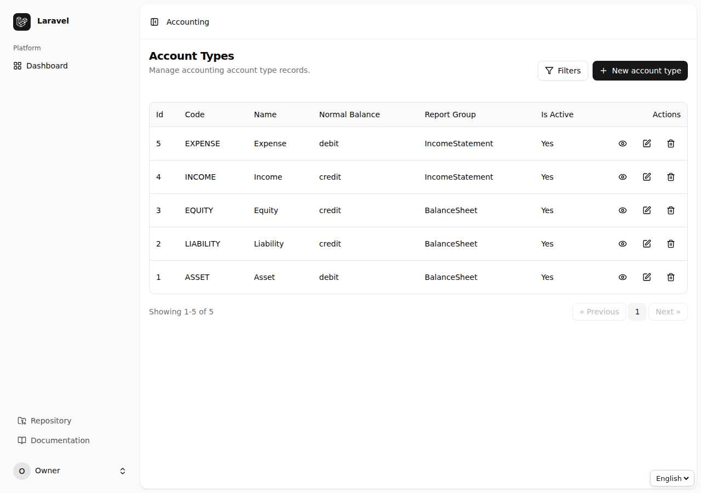

## 2.3 کرنسیاں اور شرحِ تبادلہ (Currencies)

ایک کرنسی **بنیادی کرنسی** (Base) ہوتی ہے (مثلاً PKR)؛ باقی غیر ملکی۔ ہر غیر ملکی کرنسی کی شرح (`Exchange Rate`) تاریخ کے ساتھ درج کی جاتی ہے۔ غیر ملکی کرنسی کا واؤچر لکھتے وقت سسٹم اس تاریخ کی شرح لگا کر بنیادی کرنسی کی رقم نکال لیتا ہے۔

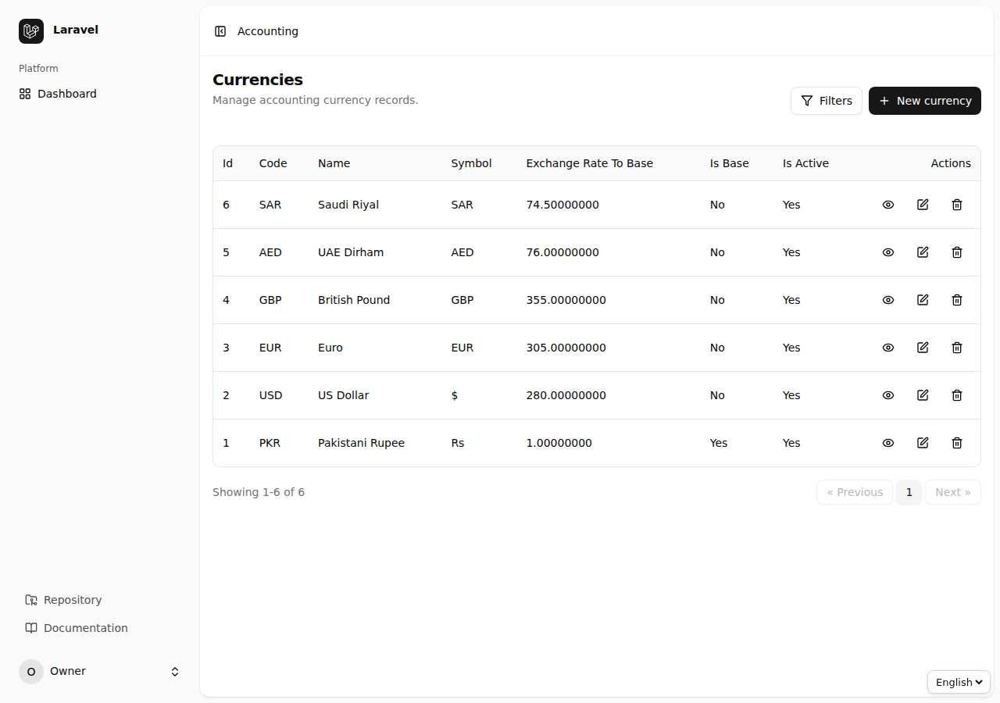

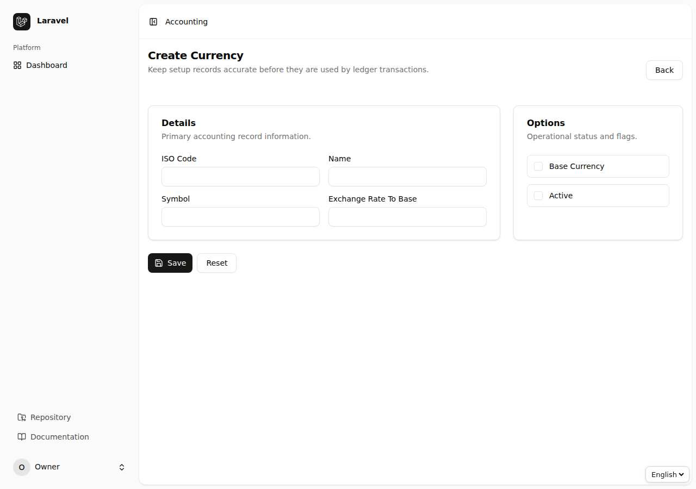

## 2.4 مالی مدتیں اور کلوزنگ (Periods)

ہر مالی سال کی مہینہ وار **مدتیں** (Periods) بنائی جاتی ہیں۔ `Generate monthly` سے پورے سال کی مدتیں ایک بار میں بن جاتی ہیں۔

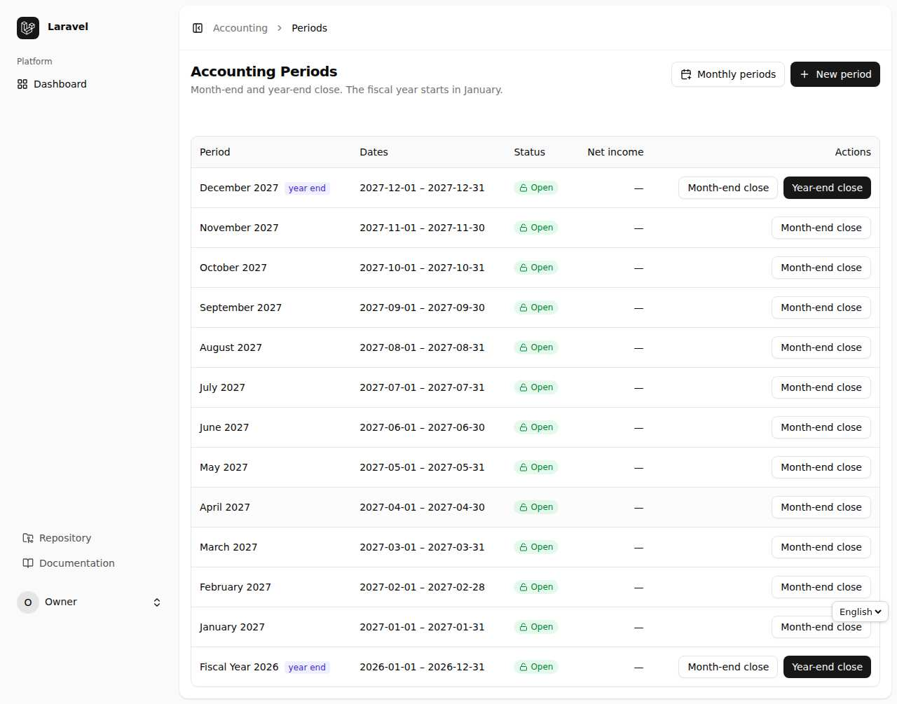

**مہینے کے اختتام کی کلوزنگ:** مدت کے صفحے سے `Close` کھولیں۔ سسٹم **چیک لسٹ** دکھاتا ہے (کوئی Draft واؤچر باقی تو نہیں، منظوری کے منتظر واؤچر، ٹرائل بیلنس برابر ہے یا نہیں)۔ سب ٹھیک ہو تو مدت بند ہو جاتی ہے اور اس کے اختتامی بیلنس کا **اسنیپ شاٹ** محفوظ ہو جاتا ہے۔ غلطی کی صورت میں مدت دوبارہ کھولی جا سکتی ہے۔

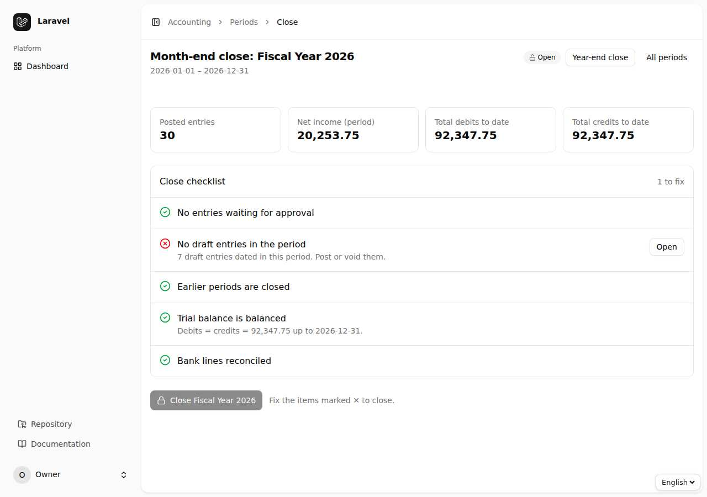

**سال کے اختتام:** آخری مدت بند کرنے پر سالانہ کلوزنگ ہوتی ہے: آمدنی و اخراجات صفر ہو کر منافع/نقصان `Retained Earnings` میں منتقل ہوتا ہے۔

## 2.5 لاگت کے مراکز (Cost Centers)

اخراجات و آمدنی کو شعبوں/منصوبوں کے حساب سے الگ دیکھنے کے لیے۔ واؤچر کی ہر لائن پر ایک Cost Center چنا جا سکتا ہے، اور بجٹ و پے رول رپورٹیں انہی کے حساب سے بنتی ہیں۔

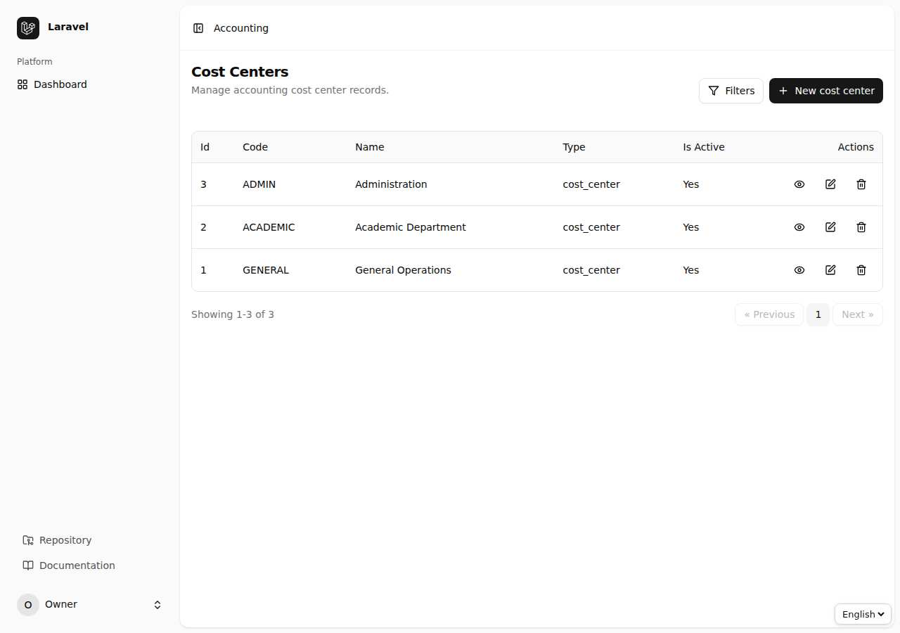

## 2.6 واؤچر کی اقسام اور نمبرنگ (Voucher Types)

ہر قسم (JV، Cash Payment، Bank Receipt وغیرہ) کا اپنا **بلا خلا** (gapless) نمبر ہوتا ہے، مثلاً `JV-2026-00001`۔ نمبر کی ترتیب (Prefix، سال، لمبائی، سالانہ ری سیٹ) یہاں سے طے ہوتی ہے۔ نمبر **پوسٹ** کرتے وقت ملتا ہے، Draft پر نہیں۔

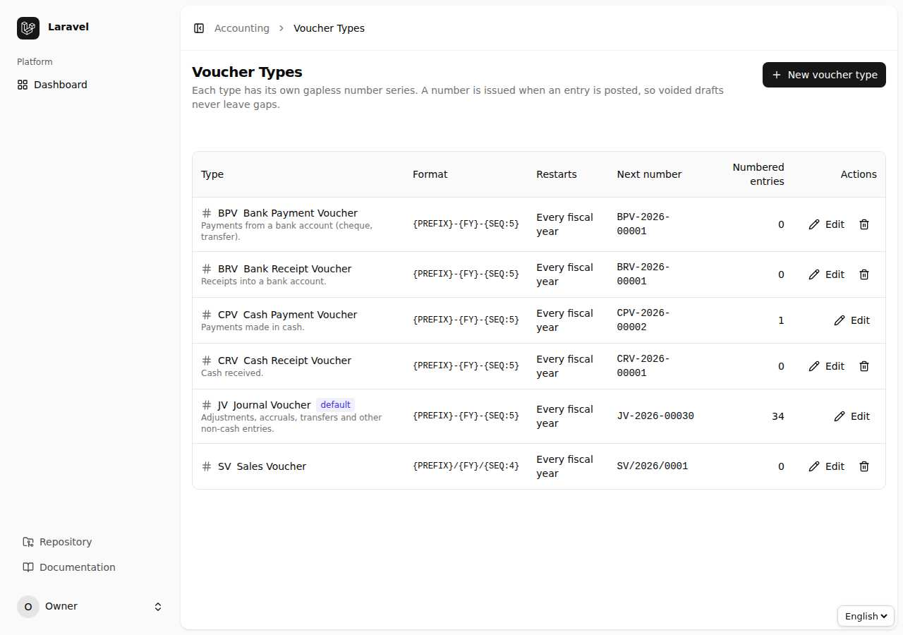

## 2.7 کنٹرول اکاؤنٹس (Control Accounts)

کسٹمر/سپلائر (Receivable/Payable) جیسے کھاتے **کنٹرول کھاتے** ہوتے ہیں: ان کی تفصیل ذیلی کھاتوں (Parties) میں ہوتی ہے۔ ان میں ہاتھ سے جرنل واؤچر لکھنا خطرناک ہے کیونکہ ذیلی کھاتہ اور کنٹرول کھاتہ ہم آہنگ نہیں رہتے۔ اس صفحے پر آپ سفارش کردہ کنٹرول کھاتے نشان زد کرتے ہیں اور دیکھتے ہیں کہ کن میں ہاتھ سے پوسٹنگ ہوئی۔

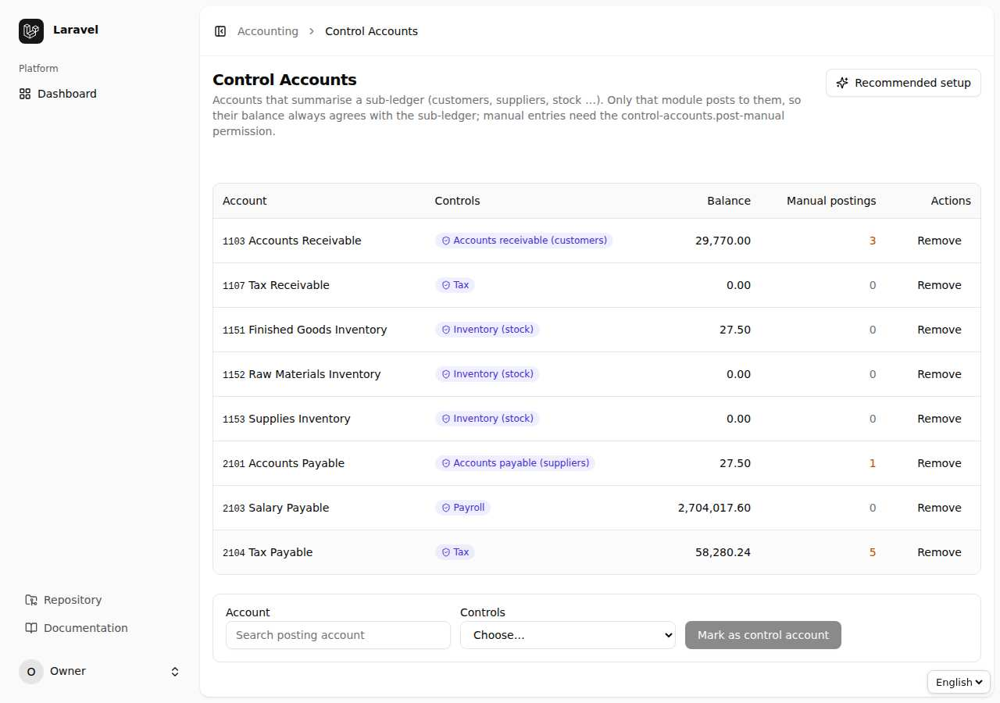

## 2.8 بیلنس اسنیپ شاٹس

ہر مدت بند ہونے پر ہر کھاتے کا اختتامی بیلنس محفوظ ہوتا ہے تاکہ بڑی رپورٹیں تیز چلیں۔

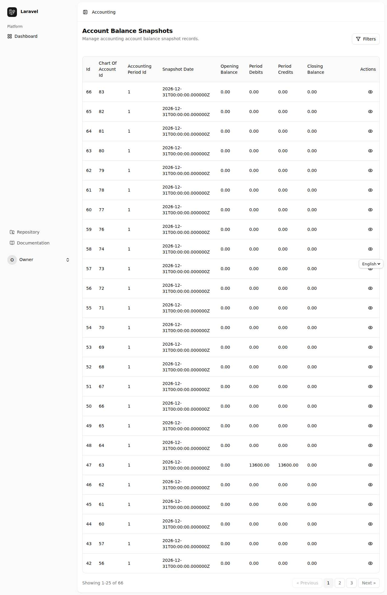

## 2.9 ہر ماسٹر ڈیٹا کی عمومی اسکرینیں

Account Types، Currencies، Periods، Cost Centers، Bank Accounts، Tax Codes، Tax Rates — سب میں یہی چار اسکرینیں ہوتی ہیں: **فہرست**، **نیا**، **تفصیل**، **ترمیم**۔ مثال کے طور پر Cost Center:

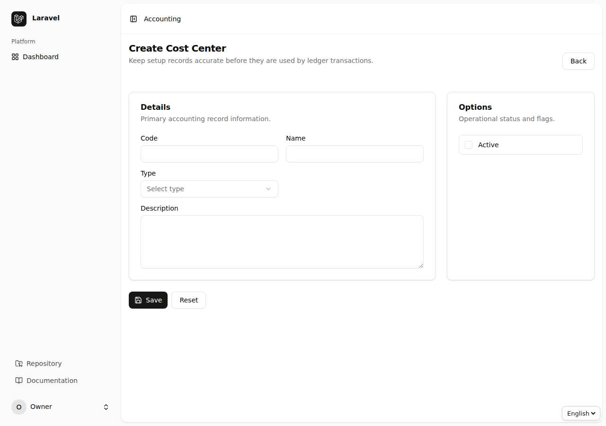

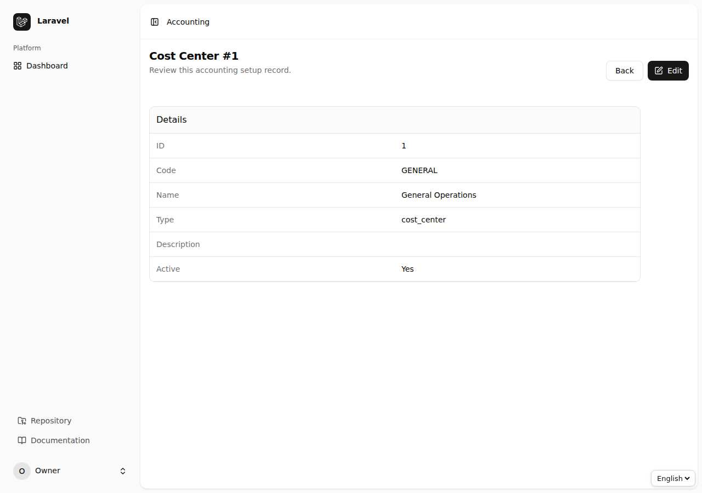

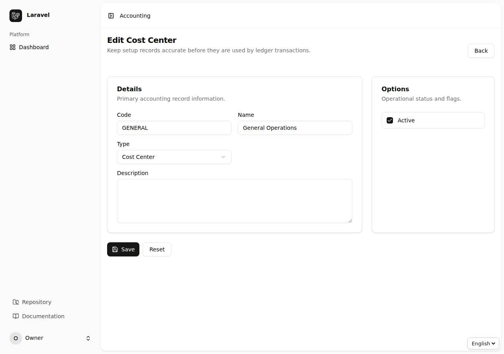

