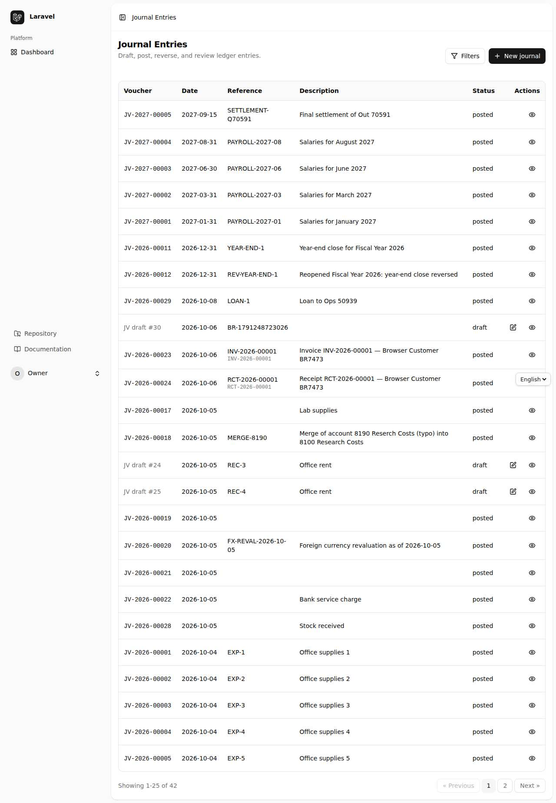
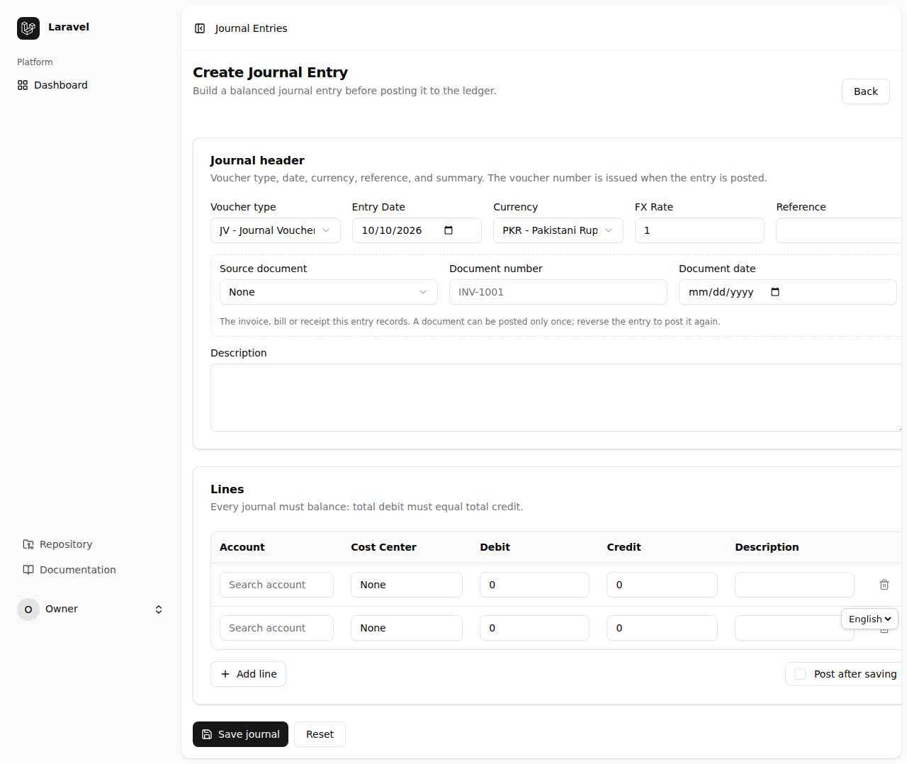
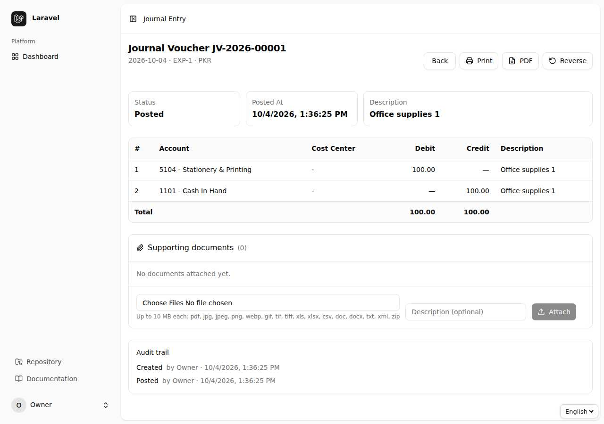
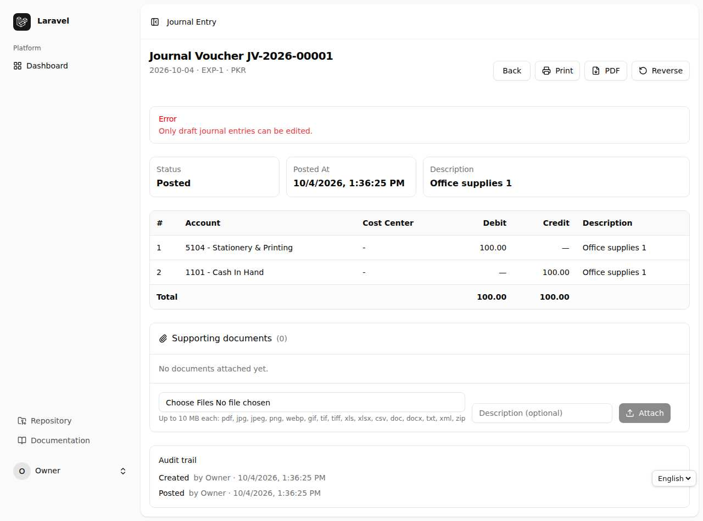
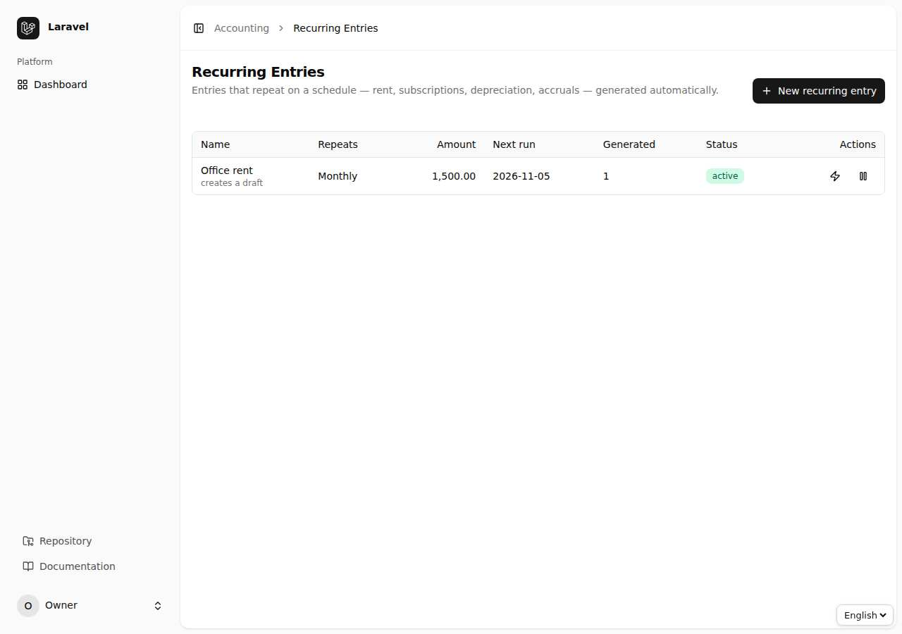
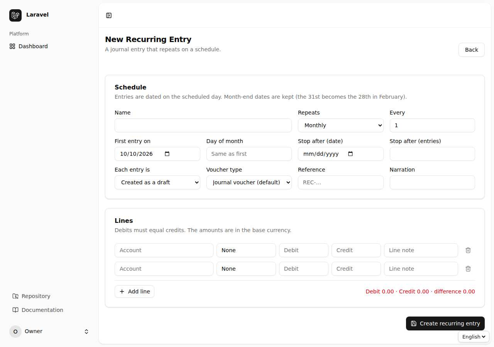
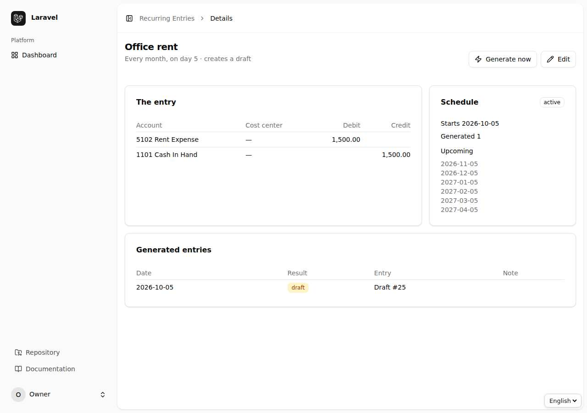
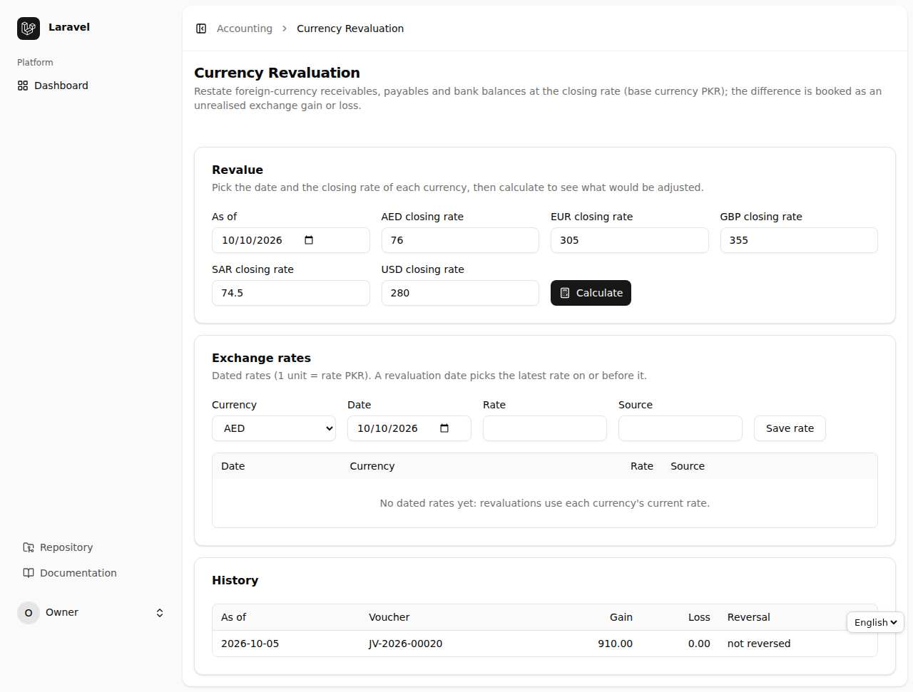
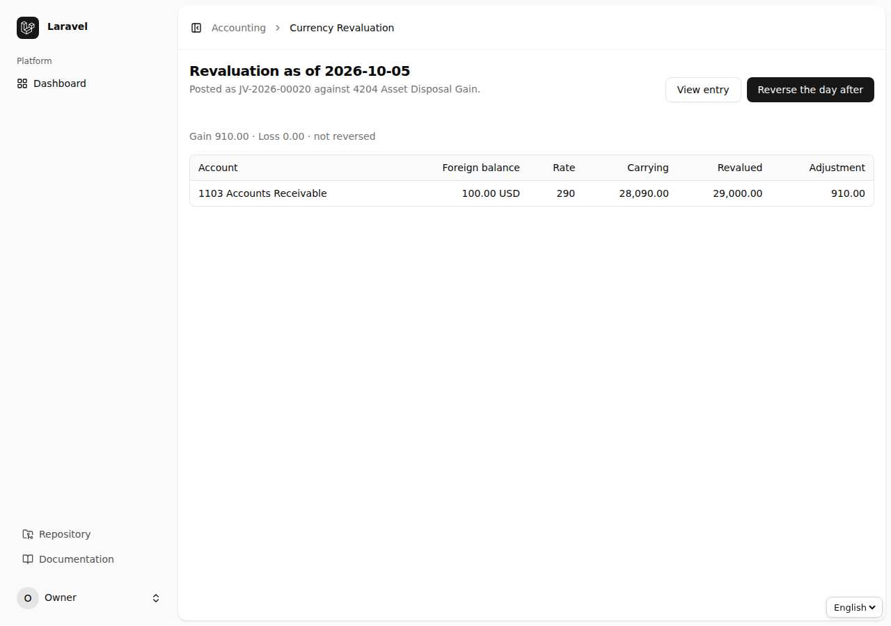

# باب 3: جرنل واؤچر — بنانا، پوسٹ کرنا، منظوری اور پرنٹ

[← پچھلا باب](02-buniyadi.md) · [فہرست](README.md) · [اگلا باب: رپورٹیں →](04-reports.md)

ہر لین دین **دو طرفہ اندراج** (Double entry) ہے: کل `Debit` = کل `Credit`۔ اگر دونوں برابر نہ ہوں تو سسٹم واؤچر محفوظ ہی نہیں کرتا۔

## 3.1 واؤچروں کی فہرست

`Journal Entries` میں تمام واؤچر ہیں۔ اوپر فلٹر سے آپ حیثیت (Draft/Posted/Void)، منظوری کی حیثیت، واؤچر نمبر، تاریخ، قسم اور ماخذ دستاویز (Source document) کے حساب سے تلاش کر سکتے ہیں۔

## 3.2 نیا واؤچر بنانا

1. `Journal Entries` ← `New` / `Create`۔
2. **Journal header** میں `Voucher type`، تاریخ، `Reference` اور وضاحت لکھیں۔ غیر ملکی کرنسی ہو تو `Currency` چنیں۔
3. **Lines** میں ہر لائن کے لیے `Account`، `Debit` یا `Credit`، اختیاری `Cost Center` اور `Description` لکھیں۔ کم از کم دو لائنیں چاہئیں۔
4. نیچے کل Debit اور کل Credit نظر آتے ہیں۔ فرق صفر ہونا چاہیے۔
5. `Save` دبائیں — واؤچر **Draft** بن جاتا ہے۔

> **Source document:** اگر یہ واؤچر کسی بل/رسید سے متعلق ہے تو اس کی قسم اور نمبر لکھیں۔ ایک ہی دستاویز کا دوسرا واؤچر بن ہی نہیں سکتا — اس طرح دوہری اندراج رک جاتی ہے۔

## 3.3 واؤچر کی تفصیل اور کارروائیاں

واؤچر کھولیں تو سب لائنیں، رقوم، نمبر، دستاویزات اور ہسٹری نظر آتی ہے۔ اوپر کے بٹن حیثیت کے مطابق بدلتے ہیں:

| بٹن | کب نظر آتا ہے | نتیجہ |
|---|---|---|
| `Edit` | صرف Draft | لائنیں بدلنا |
| `Post` | Draft، اور مدت کھلی ہو | کھاتوں میں درج، واؤچر نمبر ملتا ہے |
| `Submit for approval` | منظوری کا نظام آن ہو اور رقم حد سے زیادہ ہو | منظوری کے لیے بھیجنا |
| `Approve & post` | صرف approver، اور اس نے خود نہ بنایا ہو | منظور کر کے پوسٹ |
| `Reject` | approver | وجہ لکھ کر واپس |
| `Reverse` | Posted | الٹا واؤچر بن کر اثر ختم |
| `Void` | صرف Draft | منسوخ |

**Posted واؤچر کبھی ایڈٹ یا ڈیلیٹ نہیں ہوتا۔** غلطی ہو تو `Reverse` کریں اور درست واؤچر نیا بنائیں؛ پورا ریکارڈ آڈٹ کے لیے محفوظ رہتا ہے۔

## 3.4 منظوری کا نظام (Maker–Checker)

یہ ادارے کی پالیسی ہے، جو ترتیب (config) میں آن/آف ہوتی ہے (`ACCOUNTING_APPROVALS_ENABLED`)۔ آن ہو تو مقررہ رقم سے اوپر کے واؤچر براہ راست پوسٹ نہیں ہوتے:

1. Accountant `Submit for approval` دبائے۔ واؤچر پر **Awaiting approval** لکھا آتا ہے۔
2. Approver کی فہرست میں اسے `approval_status = pending` فلٹر سے دیکھا جا سکتا ہے۔
3. Approver `Approve & post` یا وجہ لکھ کر `Reject` کرتا ہے۔
4. **اصول:** جس نے واؤچر بنایا وہ خود اسے منظور نہیں کر سکتا۔

## 3.5 دستاویزات منسلک کرنا (Attachments)

Draft واؤچر کے صفحے پر **Attachments** کا خانہ ہے۔ بل، رسید یا معاہدے کی PDF/تصویر `Upload` کریں۔ فائل کی قسم اور سائز کی جانچ ہوتی ہے۔ دستاویز ڈاؤن لوڈ کی جا سکتی ہے؛ صرف Draft کی دستاویز ہٹائی جا سکتی ہے۔

## 3.6 واؤچر پرنٹ اور PDF

واؤچر کے صفحے سے `Print` (پرنٹ کے قابل صفحہ) یا `PDF` منتخب کریں۔ پرنٹ میں کمپنی کا نام، واؤچر نمبر، لائنیں، رقم الفاظ میں، اور تیار کنندہ/منظور کنندہ کے دستخط کی جگہ ہوتی ہے۔ PDF کے لیے `dompdf` پیکیج انسٹال ہونا چاہیے۔

## 3.7 دہرائے جانے والے واؤچر (Recurring Entries)

کرایہ، تنخواہ کی پیشگی، انشورنس جیسے مسلسل واؤچر کے لیے `Recurring Entries` میں ٹیمپلیٹ بنائیں: تکرار (روزانہ/ہفتہ وار/ماہانہ/سالانہ)، آغاز اور اختتامی تاریخ یا تعداد، اور موڈ — واؤچر **Draft** بنے (آپ خود دیکھ کر پوسٹ کریں) یا **خود بخود پوسٹ** ہو جائے۔ سسٹم روزانہ شیڈولر کے ذریعے مقررہ واؤچر بنا دیتا ہے۔ جو واؤچر پوسٹ نہ ہو سکا (مثلاً مدت بند تھی) وہ وجہ کے ساتھ Draft میں رہ جاتا ہے۔

> شیڈولر چلانے کے لیے سرور پر `php artisan schedule:run` ہر منٹ چلنا چاہیے، یا ہاتھ سے `php artisan accounting:run-recurring`۔ اگر `Recurring entries` فیچر بند ہو (باب 10) تو یہ کمانڈ کچھ نہیں کرتی۔

## 3.8 غیر ملکی کرنسی کی از سر نو قدر (FX Revaluation)

غیر ملکی کرنسی میں وصولیاں، ادائیگیاں اور بینک بیلنس مدت کے اختتام پر **اختتامی شرح** پر دوبارہ ناپے جاتے ہیں؛ فرق **غیر حقیقی تبادلہ نفع/نقصان** کے طور پر درج ہوتا ہے:

1. `Currency Revaluation` کھولیں، `As of` تاریخ اور ہر کرنسی کی اختتامی شرح لکھیں۔
2. `Preview` سے ہر کھاتے کا فرق دیکھیں۔
3. `Post` سے واؤچر بنتا ہے؛ اگلی مدت کی پہلی تاریخ پر اس کا الٹ خود بخود بن سکتا ہے (`Reversal`)۔

