

# باب 4: رپورٹیں اور ایکسپورٹ

[← پچھلا باب](03-voucher.md) · [فہرست](README.md) · [اگلا باب: بینک →](05-bank.md)

تمام رپورٹیں صرف **Posted** واؤچروں سے بنتی ہیں؛ Draft اور Void شامل نہیں ہوتے۔ ہر رپورٹ کے اوپر تاریخ/کھاتے/Cost Center کے فلٹر ہوتے ہیں، اور نیچے `CSV`، `Excel`، `PDF` ایکسپورٹ۔ بڑی ایکسپورٹ پس منظر (background) میں تیار ہو کر **My exports** میں آ جاتی ہے۔

## 4.1 ٹرائل بیلنس (Trial Balance)

ہر کھاتے کا ابتدائی بیلنس، مدت کی حرکت اور اختتامی بیلنس۔ کل Debit = کل Credit ہونا چاہیے؛ نہ ہو تو کہیں سنگین مسئلہ ہے۔

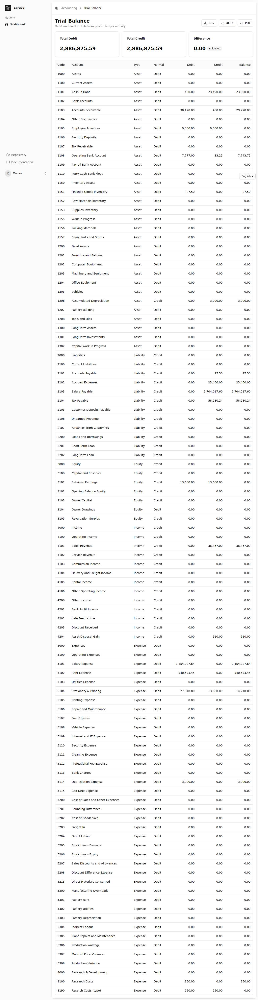

## 4.2 جنرل لیجر (General Ledger)

کسی کھاتے/تاریخ کی حد کی ایک ایک اندراج، چلتے بیلنس کے ساتھ۔ صفحہ بندی (pagination) ہے اور کل رقوم **پورے فلٹر** کی ہوتی ہیں، صرف موجودہ صفحے کی نہیں۔

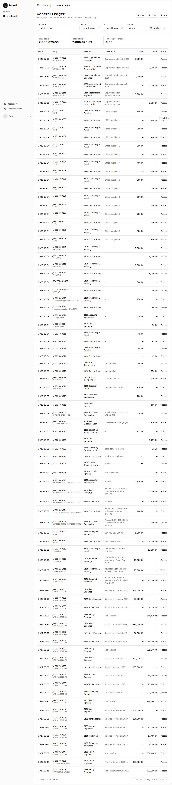

## 4.3 اکاؤنٹ اسٹیٹمنٹ (Account Statement)

ایک کھاتے کا بینک اسٹیٹمنٹ جیسا گوشوارہ: ابتدائی بیلنس، ہر اندراج پر چلتا بیلنس، اختتامی بیلنس۔ پہلے `Account` منتخب کریں، تب ہی ڈیٹا لوڈ ہوتا ہے۔

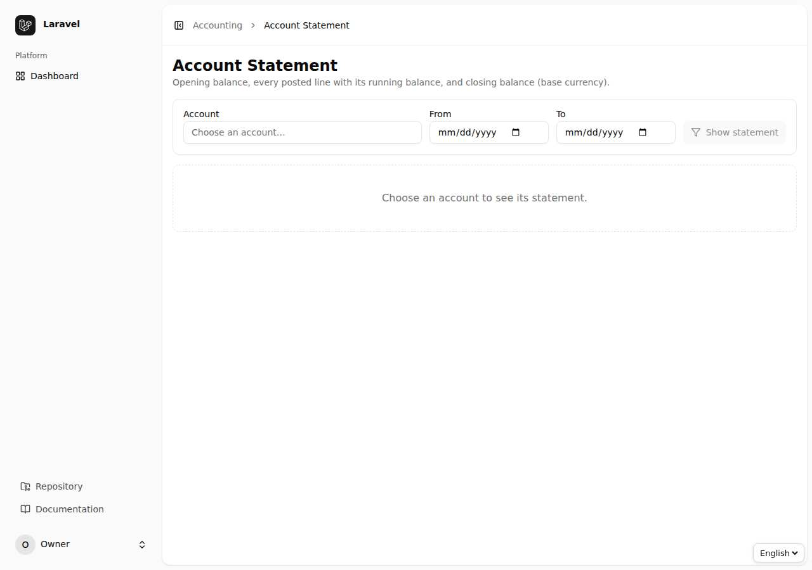

## 4.4 بیلنس شیٹ (Balance Sheet)

کسی تاریخ تک اثاثے، واجبات اور ملکیت۔ سال کے اختتام سے پہلے بھی یہ متوازن رہتی ہے کیونکہ جاری سال کا منافع `Unclosed earnings` کے طور پر ملکیت میں آتا ہے۔

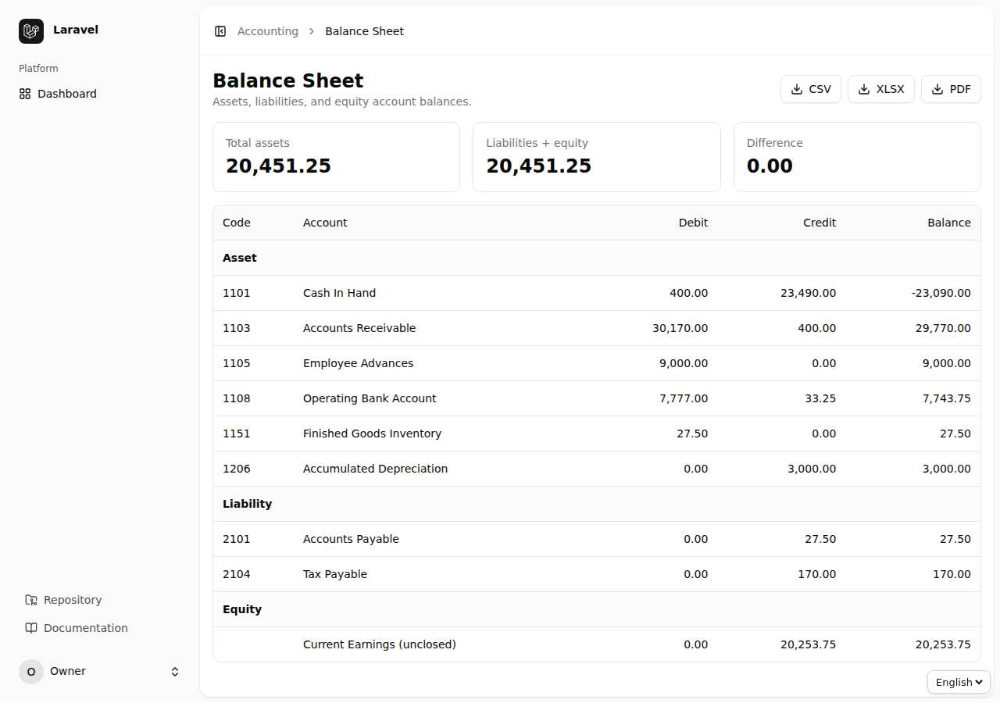

## 4.5 آمدنی کا گوشوارہ (Income Statement)

مدت کی آمدنی، اخراجات اور خالص منافع/نقصان۔

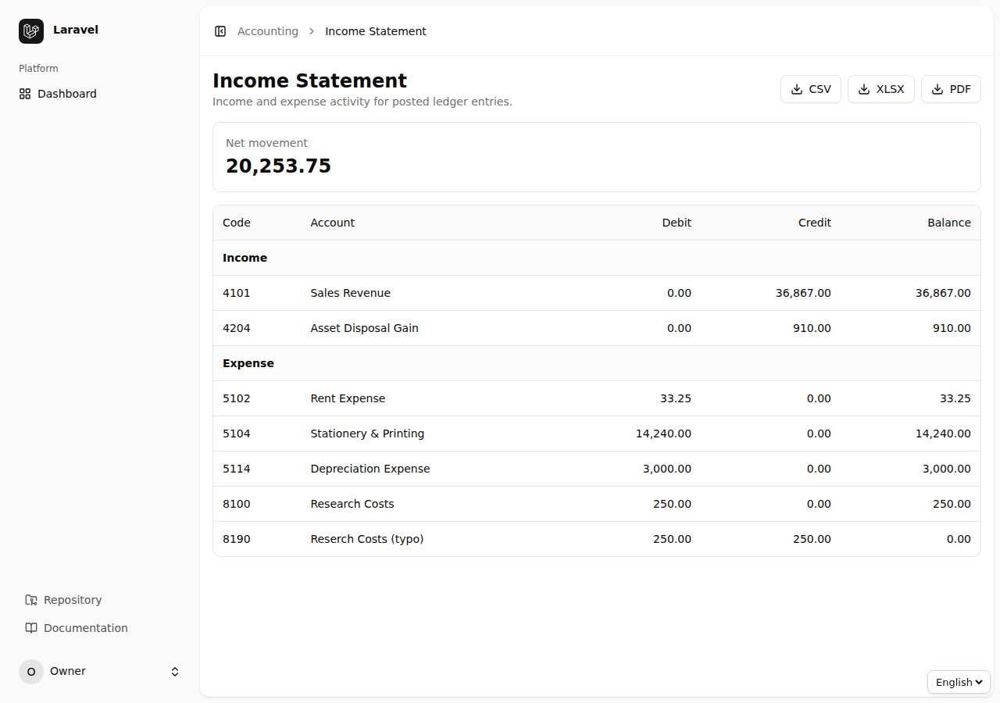

## 4.6 نقدی کا بہاؤ (Cash Flow)

مدت میں نقدی کہاں سے آئی اور کہاں گئی: آپریٹنگ، سرمایہ کاری اور مالیاتی سرگرمیاں۔ بالواسطہ (Indirect) طریقے کی لائنیں `Report Mapping` میں اپنی مرضی سے بنائی جا سکتی ہیں۔

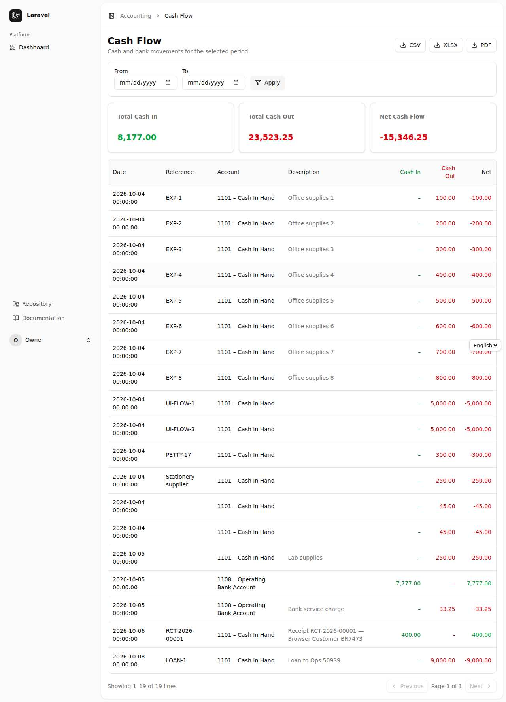

## 4.7 بینک بُک اور کیش بُک

نقدی/بینک کھاتوں کی روزانہ حرکت۔ ذیلی بینک کھاتے خود شامل ہو جاتے ہیں۔

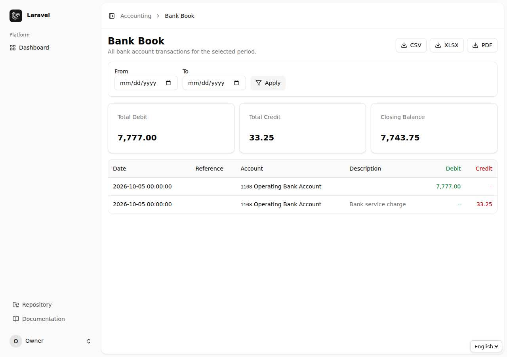

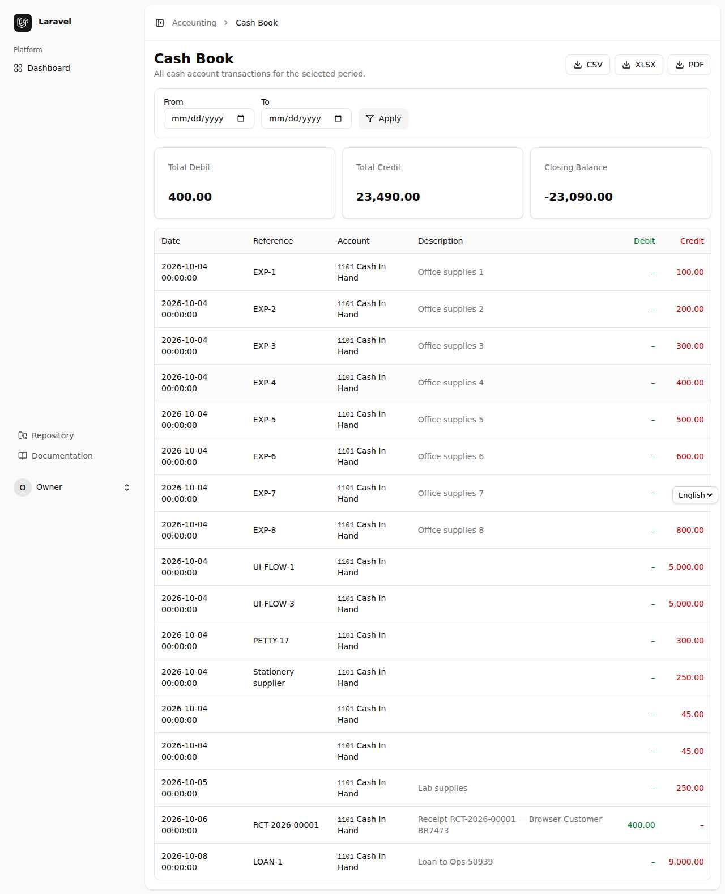

## 4.8 وصولیوں/ادائیگیوں کی عمر (Aged Receivables / Payables)

کون سا گاہک/سپلائر کتنے دن سے رقم روکے بیٹھا ہے: Current، 1–30، 31–60، 61–90، 90+ دن کے خانے، جن کا مجموعہ کل بقایا کے برابر ہوتا ہے۔

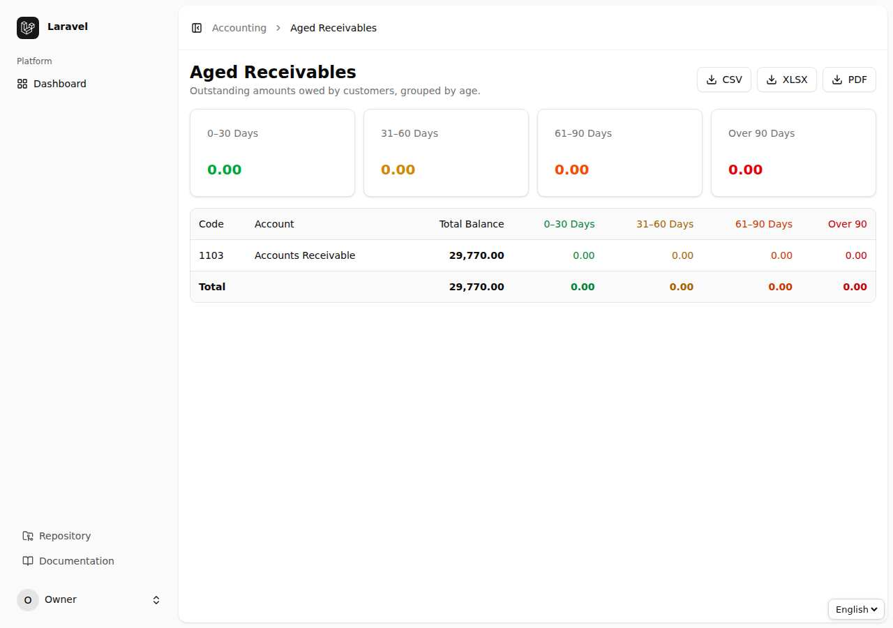

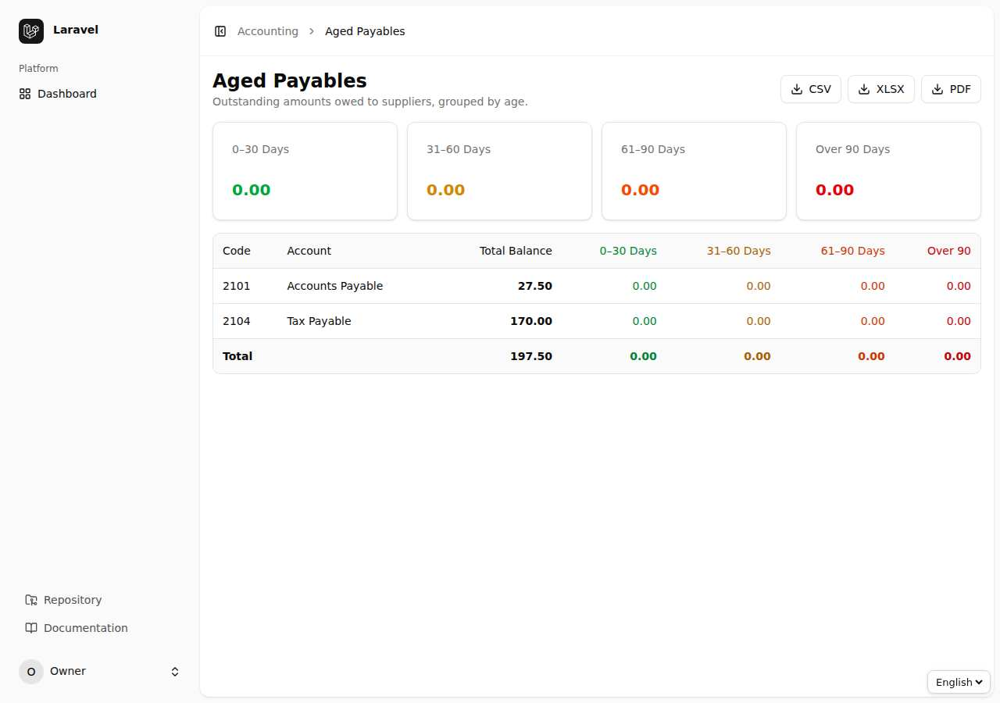

## 4.9 مالیاتی گوشوارے اور رپورٹ میپنگ

`Financial Statements` میں گوشواروں کی ترتیب (مثلاً "Current Assets" کے ذیل میں کون سے کھاتے) آپ کی مرضی کے مطابق بنتی ہے۔ ترتیب `Report Mapping` میں طے ہوتی ہے: ہر کھاتے کو ایک **لائن** سے جوڑیں؛ اور Cash Flow کی لائنیں بھی یہیں بنتی ہیں۔

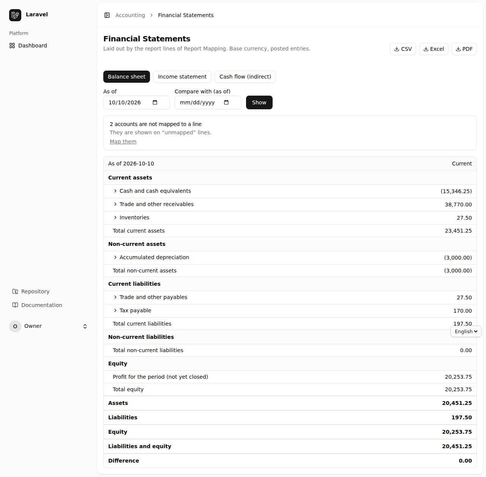

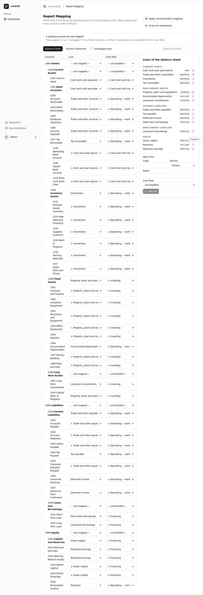

## 4.10 مجموعی رپورٹ (Consolidated)

اگر ایک سے زیادہ کمپنیاں ہوں تو `Consolidated Reports` میں ٹرائل بیلنس وغیرہ سب کمپنیوں کا مجموعہ نکلتا ہے (صرف ان کمپنیوں کا جن تک آپ کی رسائی ہے)۔

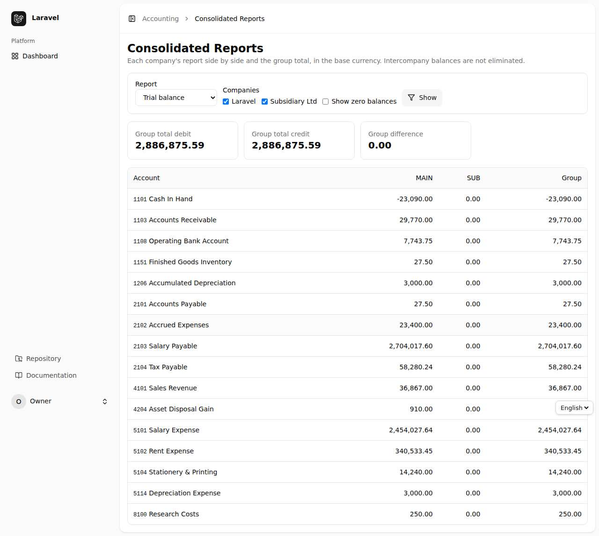

## 4.11 My Exports — پس منظر کی ایکسپورٹ

بڑی رپورٹ (ہزاروں قطاریں) کی Excel/PDF فوراً نہیں بنتی؛ سسٹم اسے قطار (queue) میں ڈالتا ہے اور تیار ہونے پر `My exports` میں `Download` کا لنک آ جاتا ہے۔ صرف ایکسپورٹ کرنے والا اپنی فائل دیکھ/ڈاؤن لوڈ/ڈیلیٹ کر سکتا ہے۔ پرانی فائلیں `php artisan accounting:prune-exports` سے صاف ہوتی ہیں۔

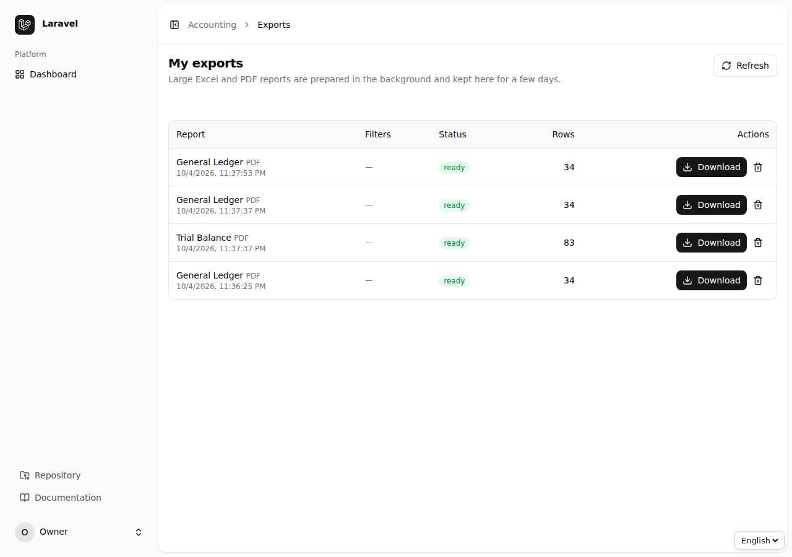

