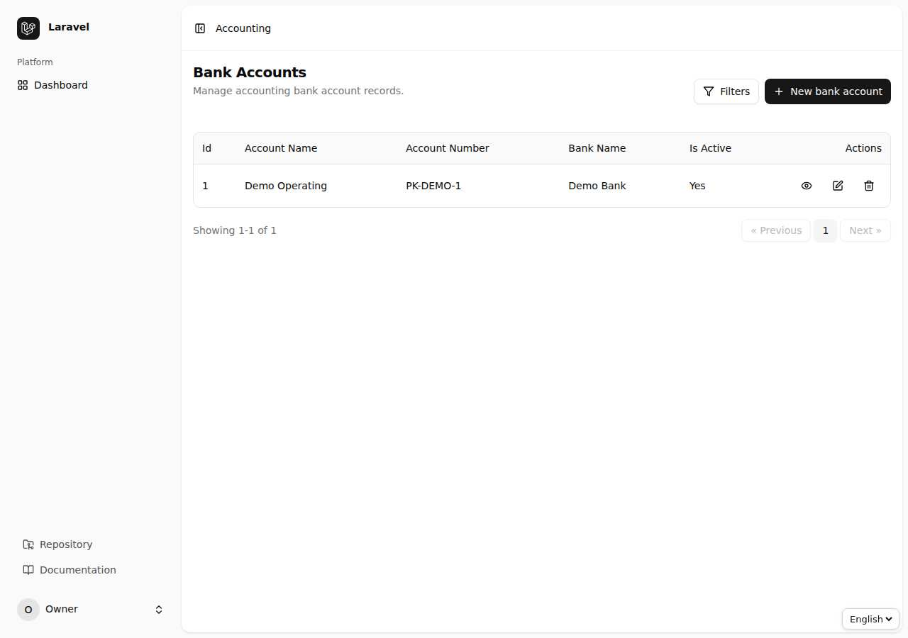
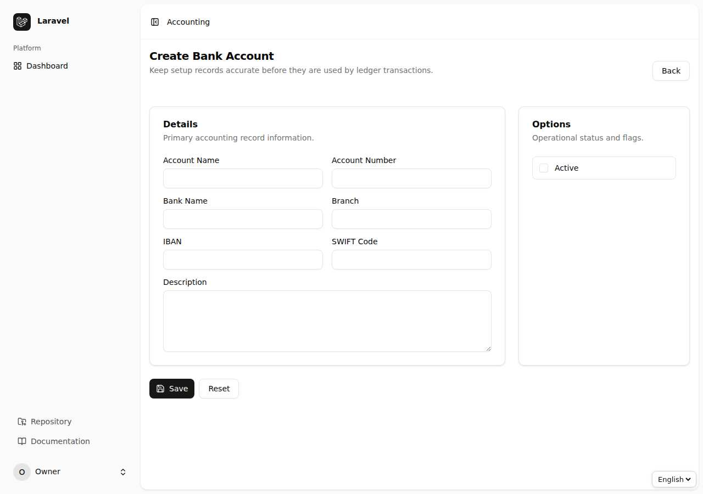
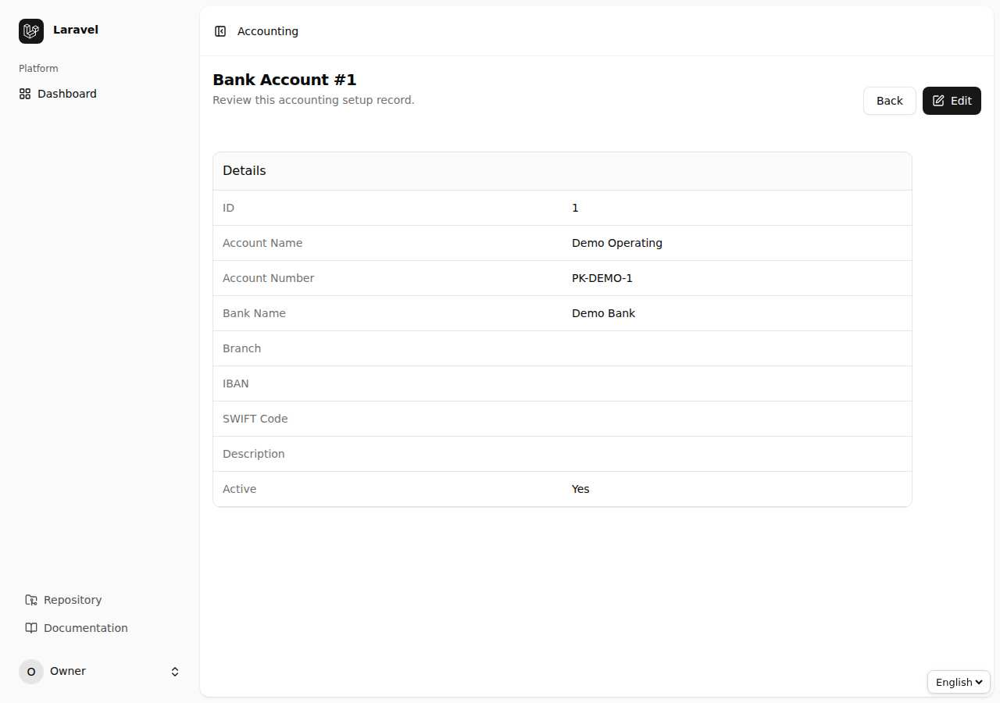
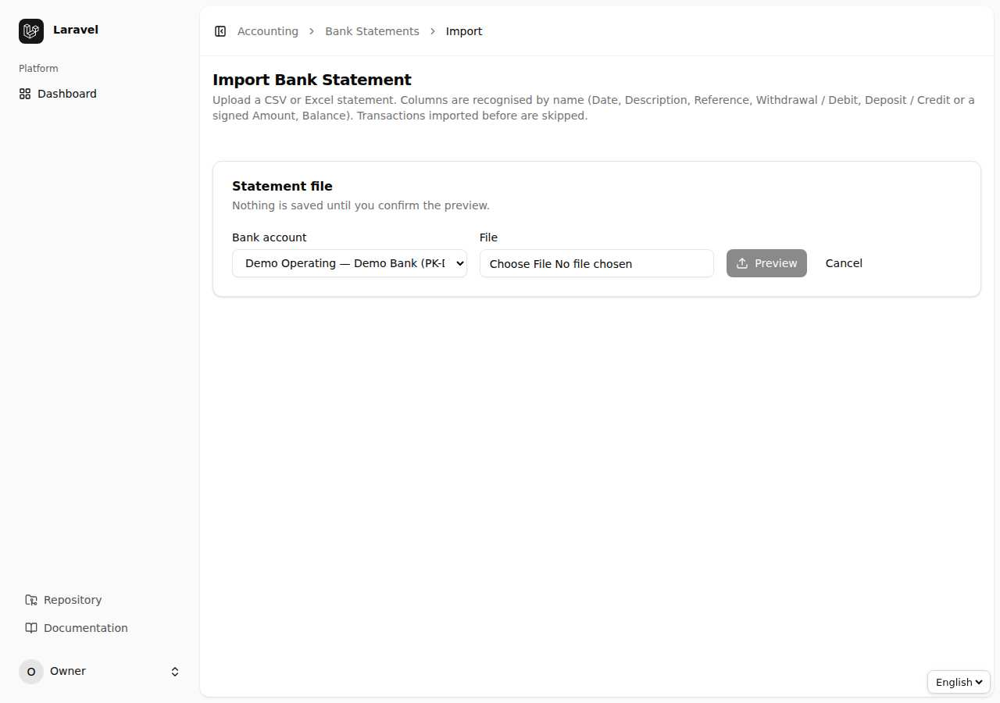
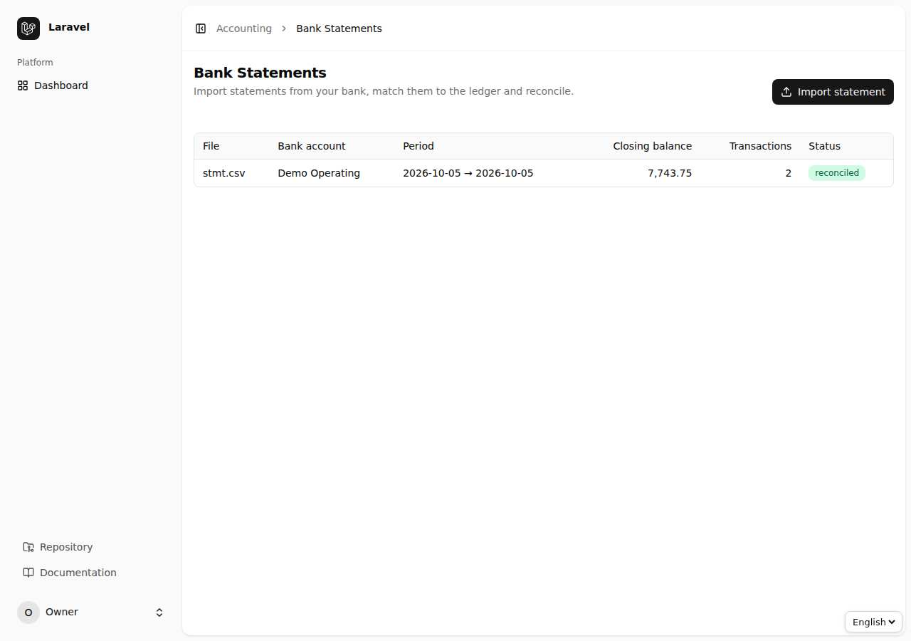
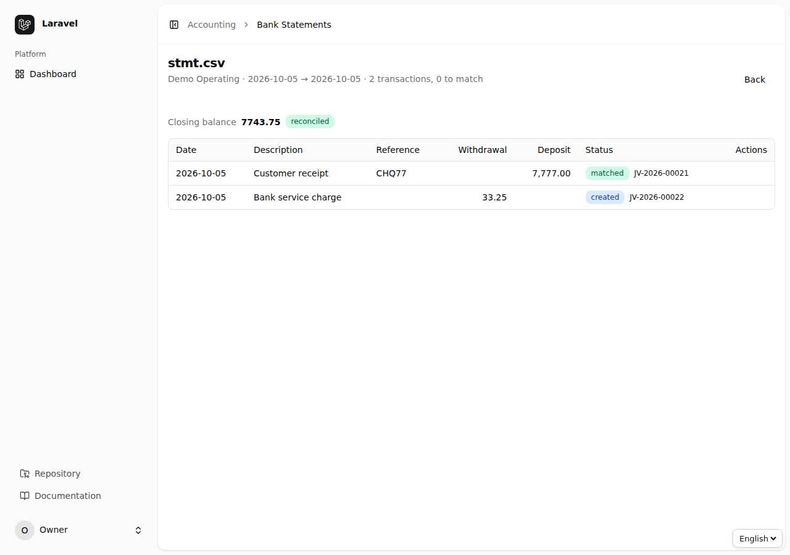
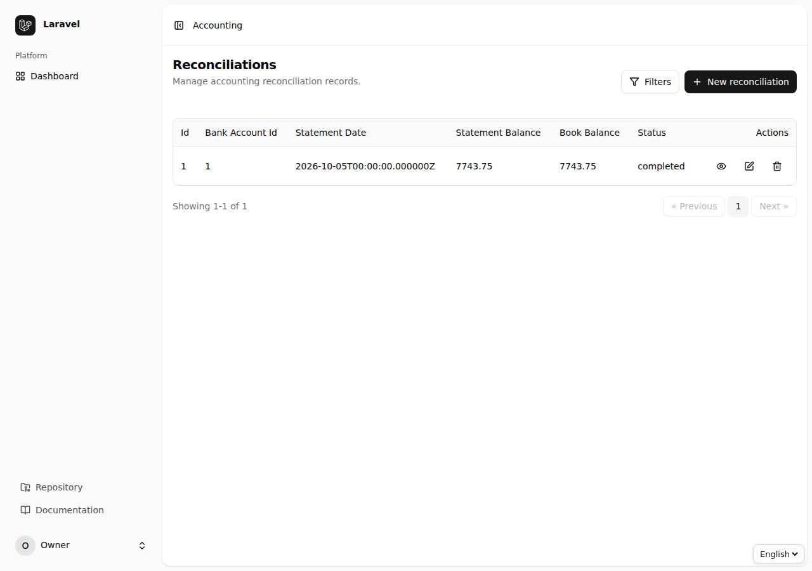
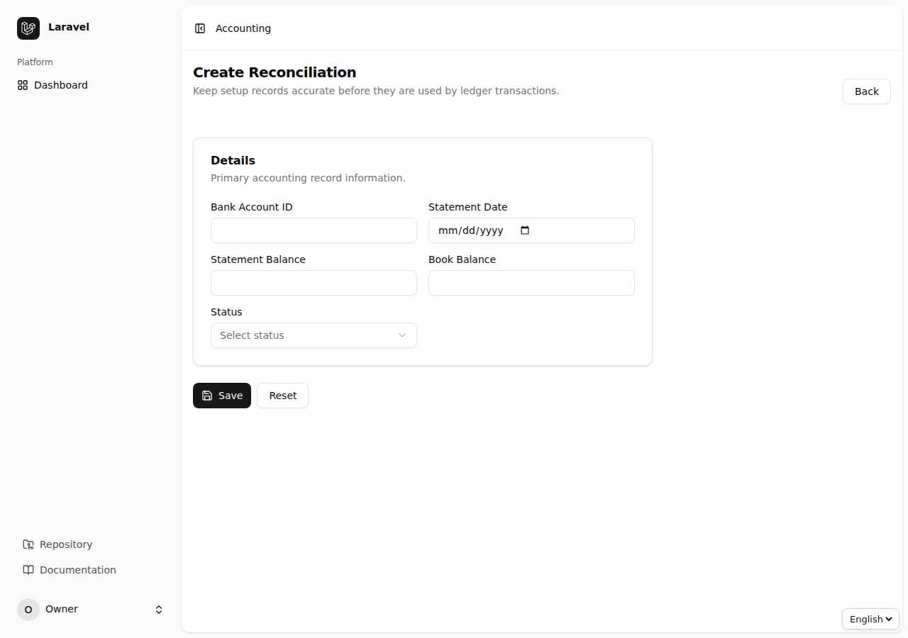
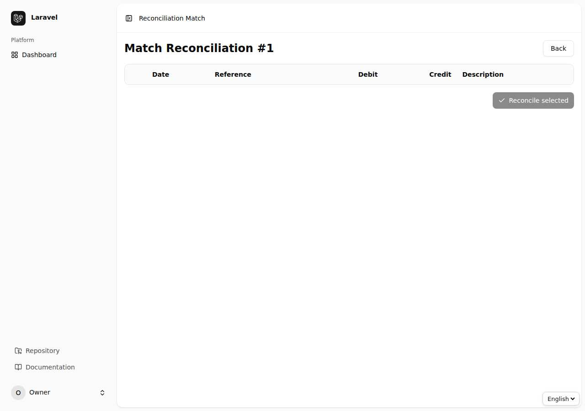
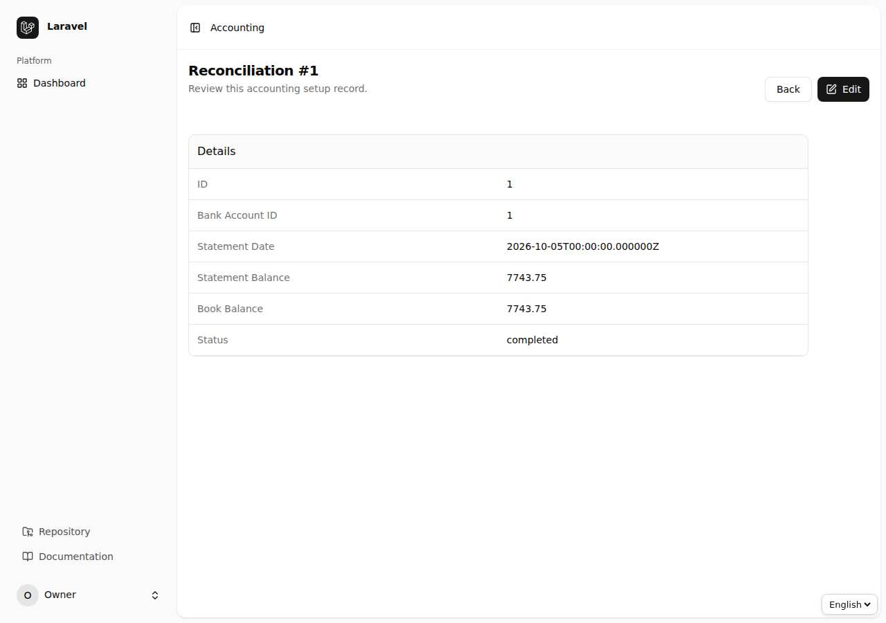

# باب 5: بینک — بینک کھاتے، اسٹیٹمنٹ امپورٹ اور مفاہمت

[← پچھلا باب](04-reports.md) · [فہرست](README.md) · [اگلا باب: گاہک و سپلائر →](06-parties.md)

## 5.1 بینک اکاؤنٹس (Bank Accounts)

ہر حقیقی بینک کھاتے کو چارٹ کے ایک Asset کھاتے سے جوڑیں۔ بینک کا نام، اکاؤنٹ نمبر اور IBAN یہاں لکھیں۔

## 5.2 بینک اسٹیٹمنٹ امپورٹ (Bank Statements)

بینک سے ملنے والی اسٹیٹمنٹ (CSV/Excel) کو سسٹم میں لا کر اپنی کتابوں سے ملانے کا تیز طریقہ:

1. `Bank Statements` ← `Import`۔
2. بینک کھاتہ منتخب کریں اور فائل اپ لوڈ کریں۔ سسٹم کالم (تاریخ، تفصیل، Debit/Credit یا رقم، بیلنس) خود پہچان لیتا ہے۔
3. ایک ہی فائل دوبارہ اپ لوڈ ہو جائے تو سسٹم ڈپلیکیٹ قطاریں رد کر دیتا ہے۔

## 5.3 خودکار مماثلت (Matching)

امپورٹ کے بعد اسٹیٹمنٹ کھولیں۔

1. `Auto-match` دبائیں: سسٹم رقم، تاریخ کی قربت اور حوالہ نمبر کے حساب سے مماثل اندراج خود جوڑ دیتا ہے۔
2. جو قطاریں رہ جائیں ان کے سامنے `Match / book` کھولیں: یا تو فہرست میں سے **موجودہ اندراج** چنیں، یا وہیں نیا اندراج **بُک** کریں (مثلاً بینک چارجز یا منافع)۔
3. جس قطار کا آپ کے حسابات سے تعلق نہیں اسے `Ignore` کریں؛ غلطی ہو تو `Restore`۔
4. غلط مماثلت کو `Unmatch` کر کے دوبارہ کریں۔
5. جب کوئی قطار غیر مماثل نہ رہے تو `Reconcile` کا بٹن چالو ہو جاتا ہے؛ اسے دبا کر اسٹیٹمنٹ مکمل کریں۔
6. غلط فائل اپ لوڈ ہو گئی ہو تو `Delete` — اس کی مماثلتیں آزاد ہو جاتی ہیں۔

## 5.4 مفاہمت (Reconciliations)

مفاہمت کا مطلب ہے بینک کی اسٹیٹمنٹ اور آپ کی کتابوں کا ایک تاریخ پر برابر ہونا:

1. `Reconciliations` ← `Create`: بینک کھاتہ، اسٹیٹمنٹ کی تاریخ اور اسٹیٹمنٹ کا اختتامی بیلنس لکھیں۔
2. `Match` کھولیں اور کتابوں کے وہ اندراجات نشان زد کریں جو بینک میں کلیئر ہو چکے۔
3. **فرق صفر** ہو جائے تو مفاہمت مکمل کریں۔

