

# باب 6: گاہک، سپلائر، انوائس، بل اور ادائیگیاں

[← پچھلا باب](05-bank.md) · [فہرست](README.md) · [اگلا باب: ٹیکس اور FBR →](07-tax-fbr.md)

یہ ماڈیول **ادھار کی فروخت اور خریداری** سنبھالتا ہے۔ ہر انوائس/بل/رسید خود بخود صحیح کنٹرول کھاتوں میں واؤچر بنا دیتی ہے؛ آپ کو ہاتھ سے جرنل نہیں لکھنا پڑتا۔

## 6.1 گاہک اور سپلائر (Parties)

ایک *Party* گاہک بھی ہو سکتی ہے، سپلائر بھی، یا دونوں (`both`)۔ ہر Party کا کوڈ، نام، رابطہ، ادائیگی کی مدت (Credit days) اور حد (Credit limit) ہوتی ہے۔

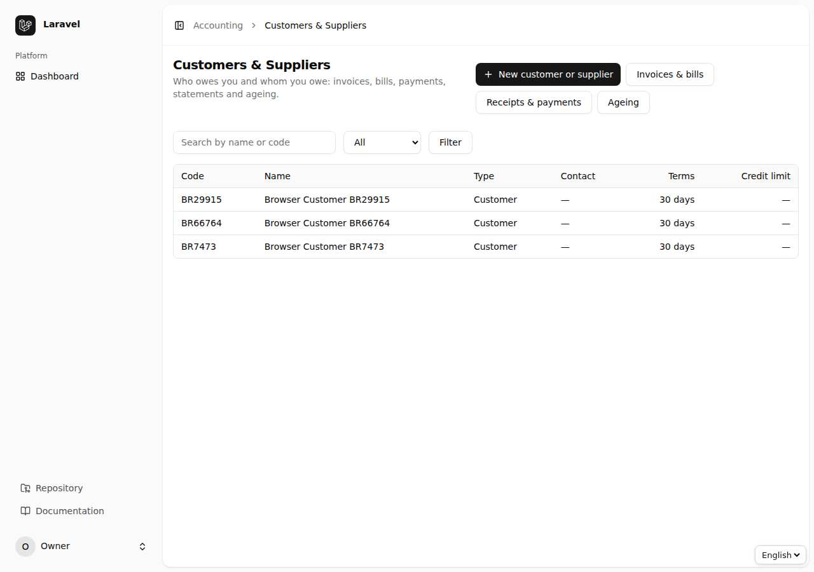

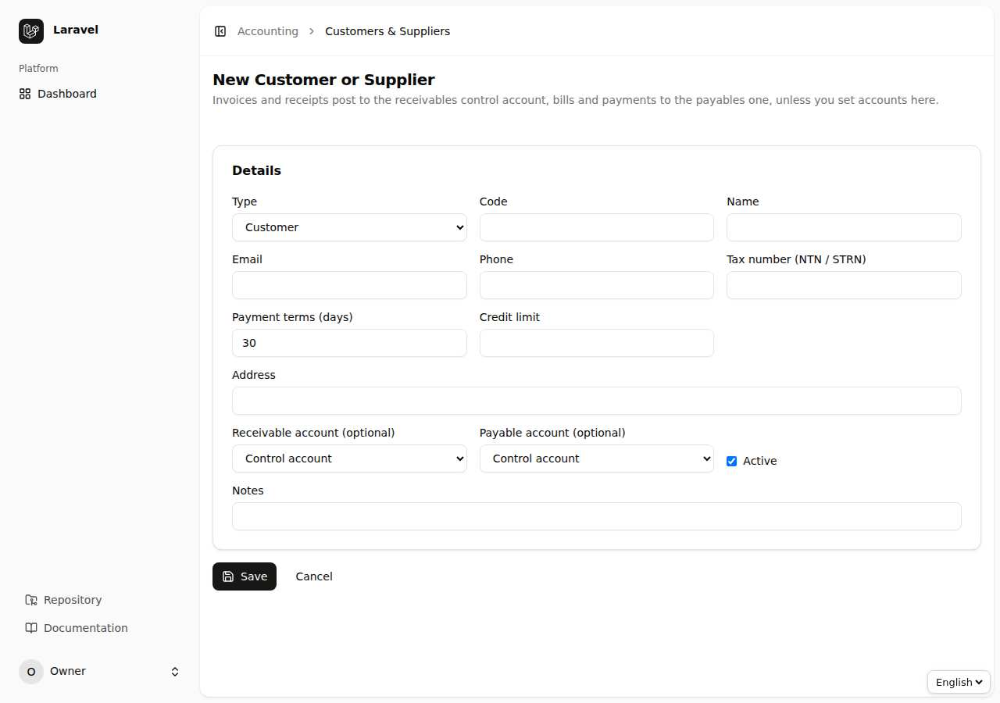

Party کی تفصیل میں **اسٹیٹمنٹ** (کس نے کتنا دینا/لینا ہے)، کھلے بل اور ادائیگیاں ایک ساتھ نظر آتی ہیں:

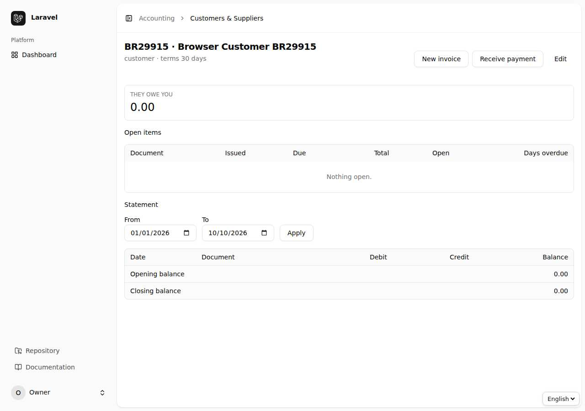

## 6.2 انوائس اور بل (Invoices & Bills)

اقسام: `Invoice` (فروخت)، `Bill` (خریداری)، `Credit note` اور `Debit note`۔

1. `Invoices & Bills` ← `New`۔
2. Party، تاریخ اور **آخری تاریخ ادائیگی** (Due date) لکھیں۔
3. لائنیں: بیان، مقدار، قیمت، **ٹیکس کوڈ** اور کھاتہ (آمدنی/خرچ)۔ ٹیکس خود حساب ہوتا ہے۔
4. `Save` — دستاویز Draft رہتی ہے۔ `Post` کرنے پر واؤچر بنتا ہے: Debit Receivable، Credit Revenue اور Tax۔

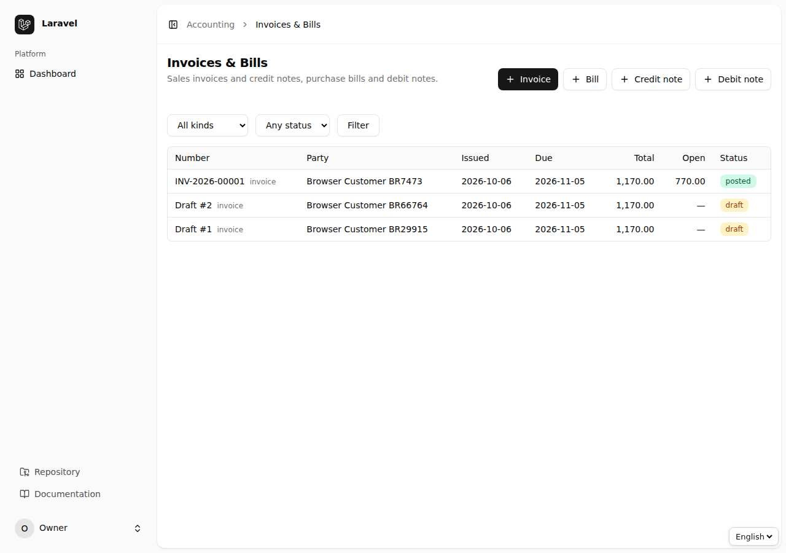

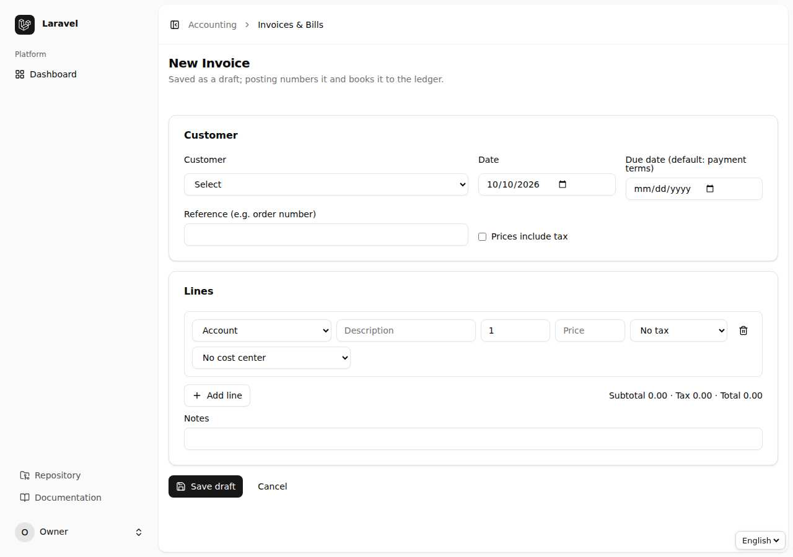

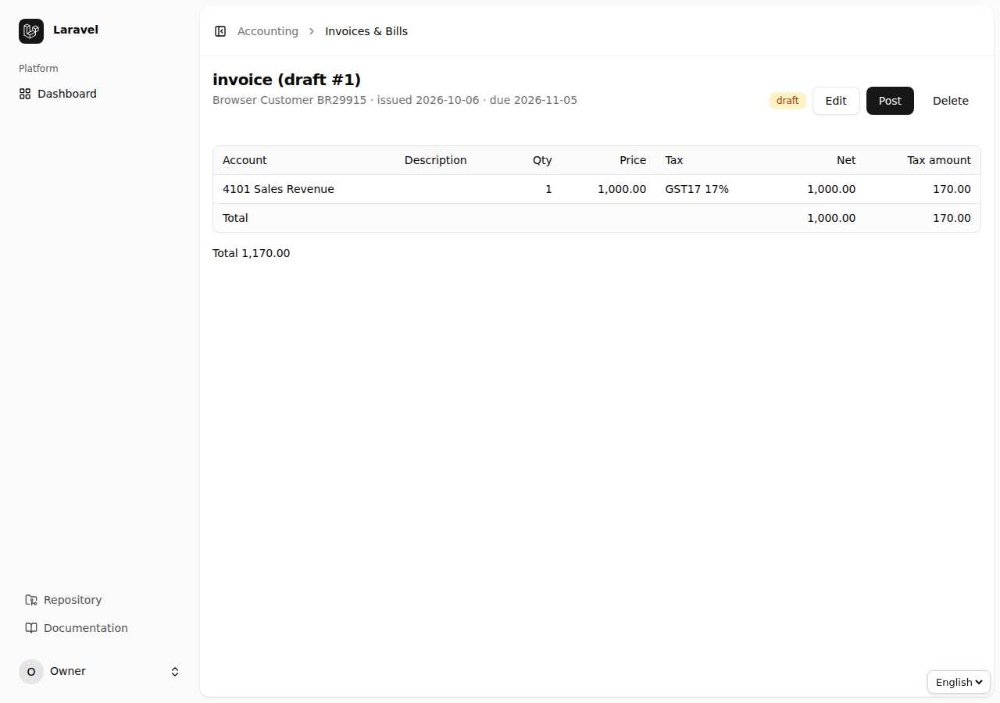

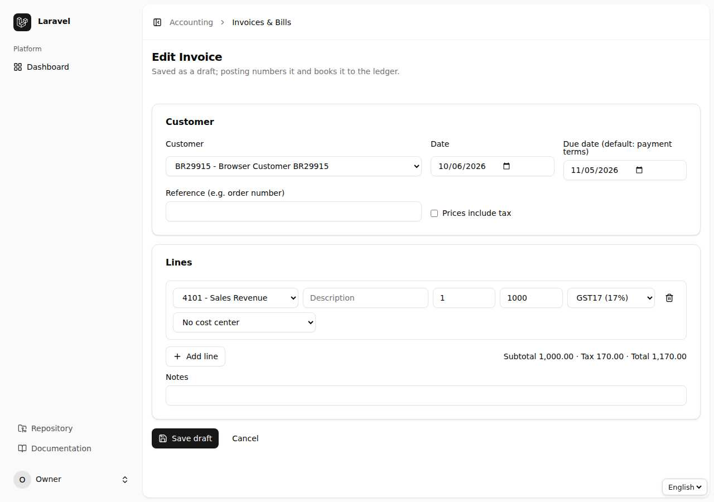

## 6.3 وصولی اور ادائیگی (Receipts & Payments)

1. `Receipts & Payments` ← `Receive Payment` (گاہک سے) یا `Make Payment` (سپلائر کو)۔
2. Party، رقم، تاریخ اور رقم جس کھاتے (کیش/بینک) میں آئی/گئی اسے منتخب کریں۔
3. **تخصیص (Allocation):** رقم کو ایک یا کئی کھلی دستاویزات پر بانٹیں۔ بچی ہوئی رقم **پیشگی** (Advance) بن کر Party کے کھاتے میں رہتی ہے اور بعد میں کسی نئی انوائس پر لگ سکتی ہے۔

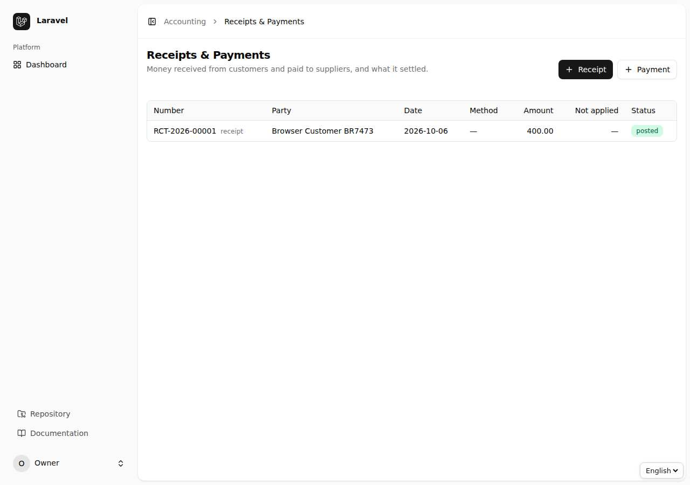

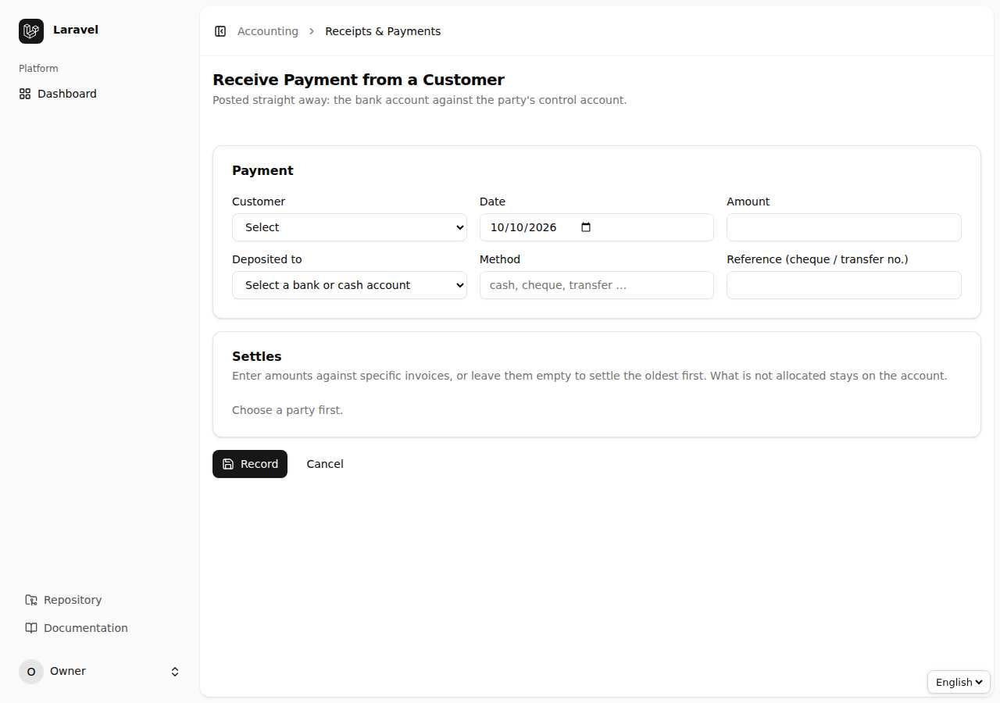

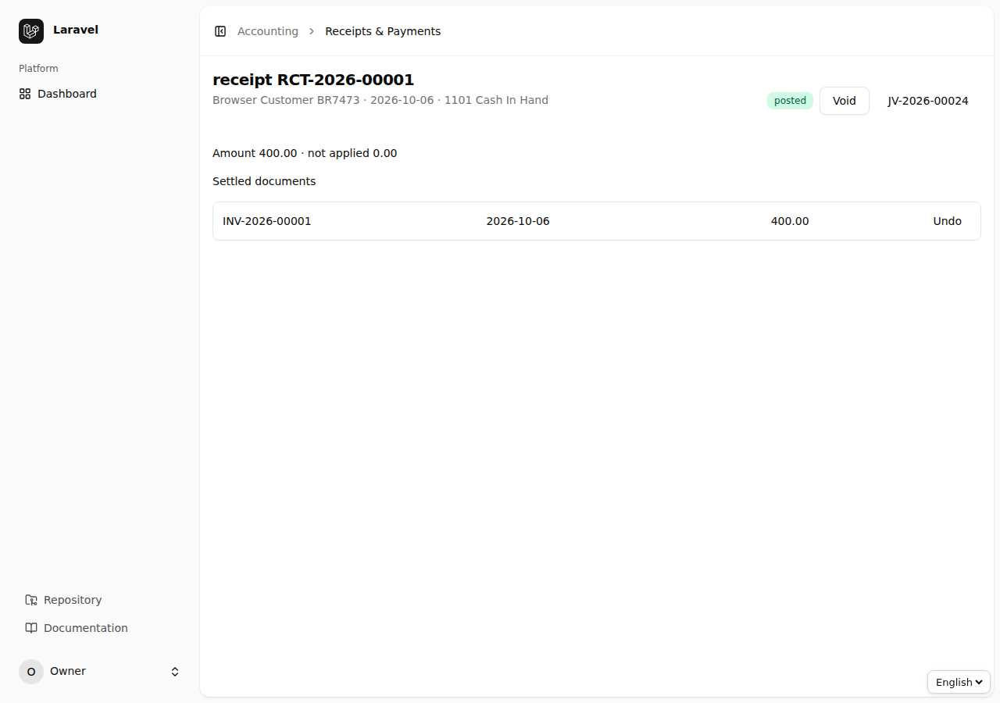

## 6.4 عمر کا تجزیہ (Ageing)

`Receivables aging` ہر گاہک کے بقایا کو عمر کے خانوں میں بانٹ کر دکھاتا ہے۔ ریکوری کی ترجیح یہیں سے طے کریں؛ CSV ایکسپورٹ بھی ہے۔

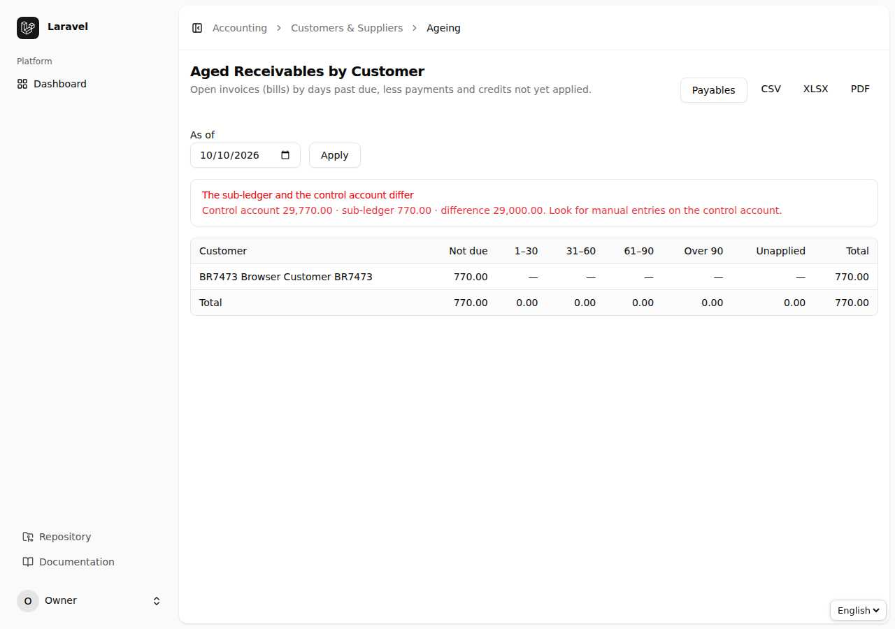

