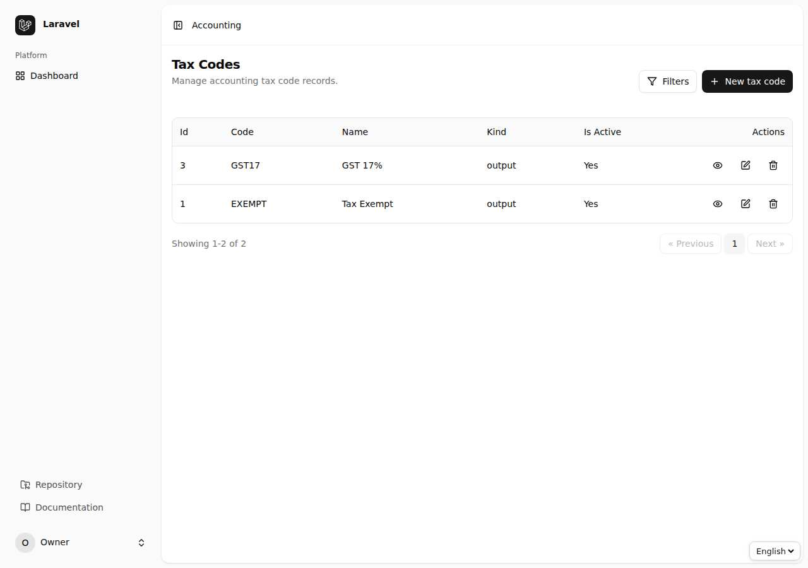
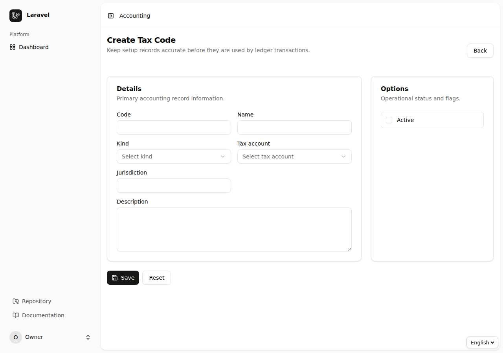
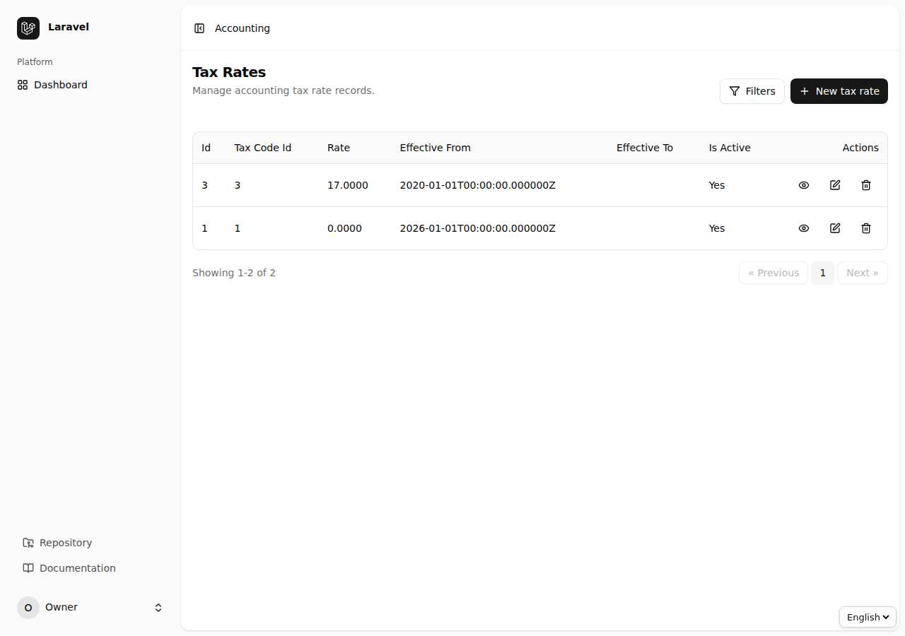
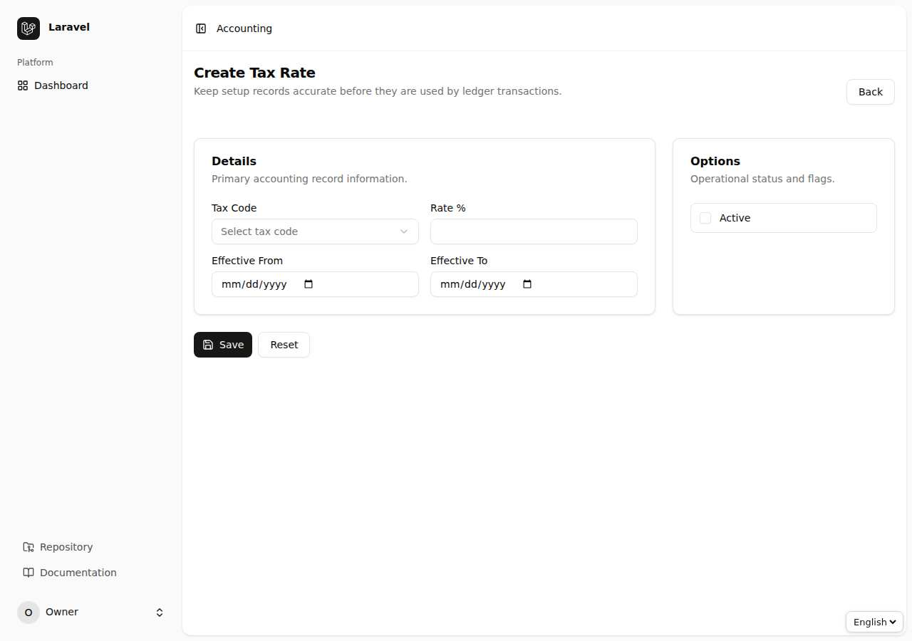
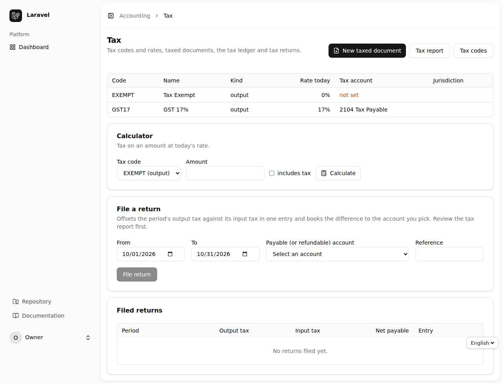
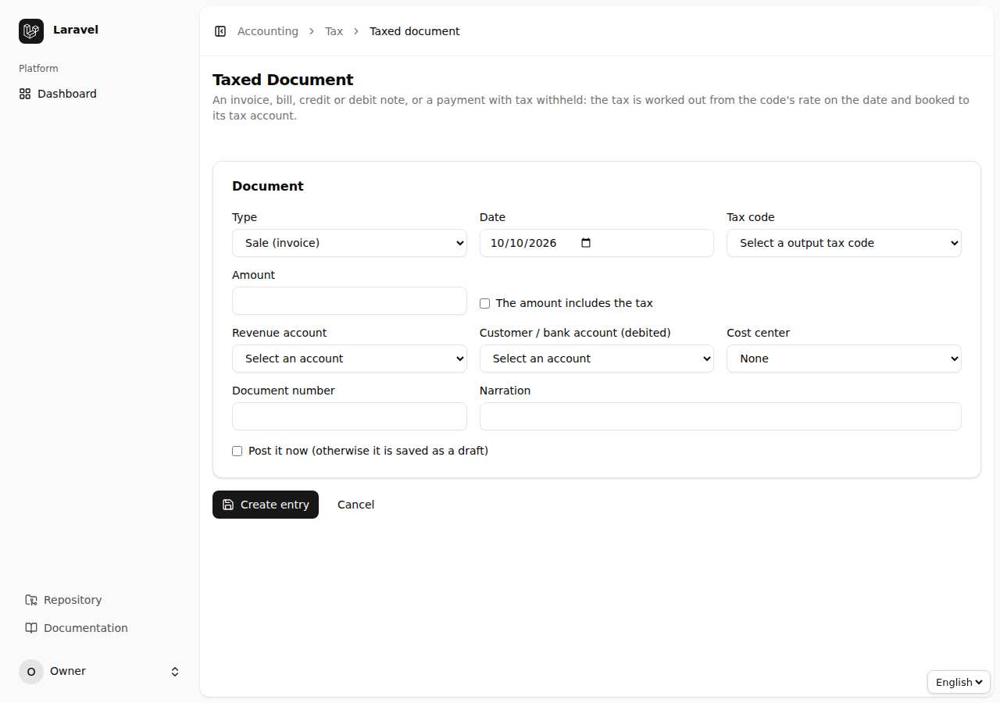
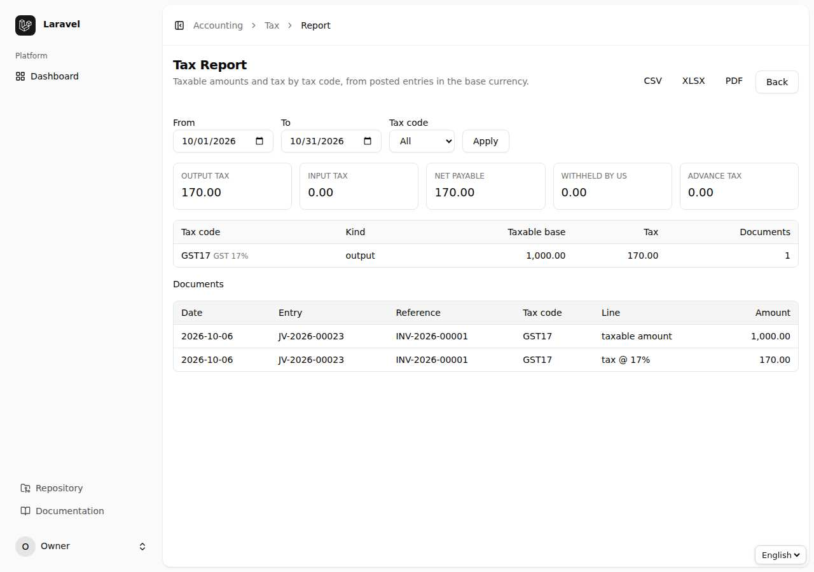
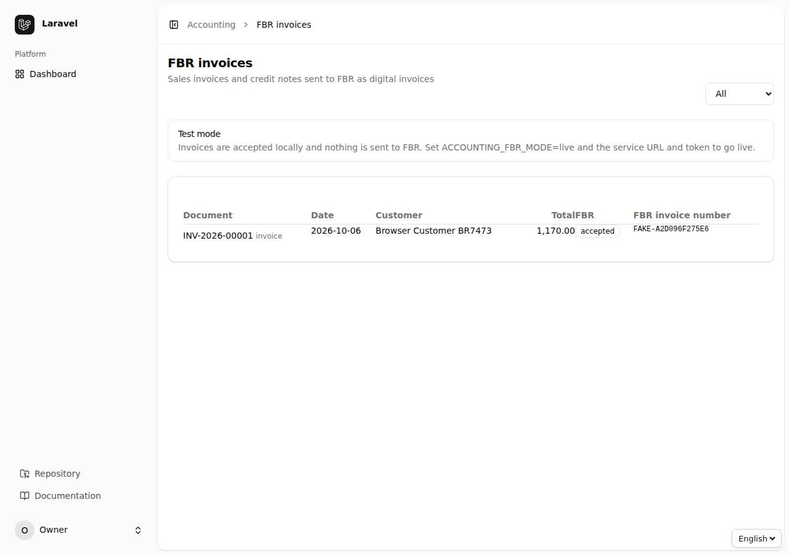

# باب 7: ٹیکس اور FBR

[← پچھلا باب](06-parties.md) · [فہرست](README.md) · [اگلا باب: منصوبہ بندی →](08-planning.md)

## 7.1 ٹیکس کوڈ اور شرحیں

**Tax Code** ٹیکس کی قسم ہے (مثلاً `GST17` سیلز ٹیکس، Withholding)؛ ہر کوڈ کی **Tax Rate** تاریخ کے ساتھ درج ہوتی ہے تاکہ شرح بدلنے پر پرانے لین دین پرانی شرح ہی پر رہیں۔ کوڈ کی نوعیت: Output (فروخت پر واجب)، Input (خریداری پر قابل واپسی)، Withheld (کٹوتی) اور Advance (پیشگی ٹیکس)۔

## 7.2 ٹیکس والا اندراج (Taxed Document)

انوائس/بل کے بغیر بھی فوری ٹیکس والا اندراج بن سکتا ہے: `Tax` ← `Taxed Document`۔ قسم (Sale، Purchase، Credit/Debit Note، Withholding) منتخب کریں؛ رقم ٹیکس **شامل** (inclusive) یا **علاوہ** (exclusive) لکھیں؛ سسٹم Base، Tax اور Total الگ کر کے واؤچر بنا دیتا ہے (پیسے تک درست، کوئی فرق نہیں)۔

## 7.3 ٹیکس رپورٹ اور ریٹرن

`Tax Report` کسی مدت کا Output ٹیکس، Input ٹیکس، کٹوتی شدہ ٹیکس اور **خالص قابل ادائیگی** دکھاتا ہے۔ ریٹرن تیار ہونے پر `Return` بنا کر ٹیکس کھاتے کو سرکاری ادائیگی کے کھاتے میں منتقل کیا جاتا ہے؛ ایک مدت کا ریٹرن دوبارہ نہیں بنتا۔

## 7.4 FBR سیلز ٹیکس انوائسنگ

پوسٹ شدہ سیلز انوائس/کریڈٹ نوٹ FBR کو بھیجے جاتے ہیں اور FBR کا انوائس نمبر واپس درج ہوتا ہے۔

- **ترتیب:** `ACCOUNTING_FBR_ENABLED=true`، موڈ `fake` (آزمائش)، `live` (اصلی) یا اپنا gateway؛ URL **لازماً https** ہو، ٹوکن کبھی سادہ http پر نہیں جاتا۔
- **استعمال:** `FBR invoices` کھولیں، انوائس کے سامنے `Submit` دبائیں۔ نتیجہ: `accepted` (FBR نمبر کے ساتھ) یا `failed` (وجہ کے ساتھ؛ دوبارہ کوشش ممکن)۔
- اس فیچر کو **Features** سے بند بھی کیا جا سکتا ہے (باب 10)۔

