

# باب 8: بجٹ، مستقل اثاثے اور انوینٹری

[← پچھلا باب](07-tax-fbr.md) · [فہرست](README.md) · [اگلا باب: پے رول →](09-payroll.md)

## 8.1 بجٹ (Budgets)

بجٹ آمدنی اور اخراجات کی منصوبہ بندی **کھاتے** (اور اختیاری **Cost Center**) اور **مہینے** کے حساب سے کرتا ہے، پھر اصل (Actual) نتائج سے موازنہ دکھاتا ہے۔

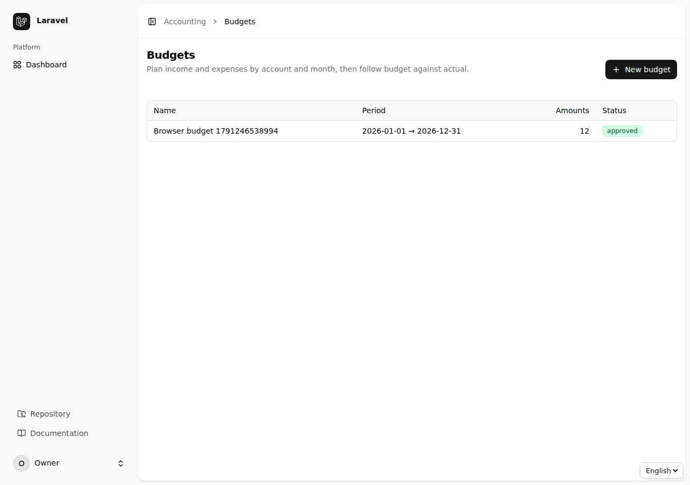

**نیا بجٹ بنانے کے مراحل**

1. `Budgets` ← `New budget`۔
2. بجٹ کا نام، پہلا اور آخری مہینہ (زیادہ سے زیادہ 24 ماہ) لکھیں۔
3. `Add account` سے ہر کھاتے کی لائن بنائیں: یا **سالانہ رقم** (جو مہینوں میں برابر بٹتی ہے) یا **ماہانہ رقوم** الگ الگ۔
4. `Save` — بجٹ **Draft** ہے۔ پچھلے سال کے اصل نتائج کی بنیاد پر بنانے کے لیے "Build from last year" (فیصد کمی/اضافے کے ساتھ) استعمال کریں۔

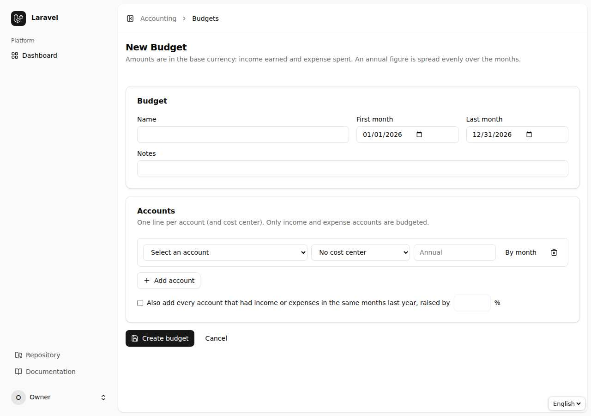

**منظوری:** Accountant منصوبہ بناتا ہے اور `budgets.approve` رکھنے والا صارف `Approve` کرتا ہے۔ ایک مہینے پر صرف ایک منظور شدہ بجٹ لاگو ہو سکتا ہے۔ ضرورت پر `Close` / `Reopen` اور اگلے سال کے لیے `Copy budget` (فیصد تبدیلی کے ساتھ)۔

**Budget vs Actual:** بجٹ کا صفحہ ہر کھاتے کے لیے بجٹ، اصل، **فرق** (Variance)، استعمال کا فیصد اور حالت دکھاتا ہے: `ok`، `warning` (خرچ بجٹ کے 90% پر)، `over` (بجٹ سے زیادہ)، `behind` (آمدنی منصوبے سے کم)، `unbudgeted` (بغیر بجٹ والا خرچ)۔ کسی قطار پر کلک سے مہینہ وار تفصیل کھلتی ہے۔ `Apply` سے مہینوں کی حد/Cost Center کا فلٹر لگتا ہے؛ CSV/Excel/PDF ایکسپورٹ ہے۔

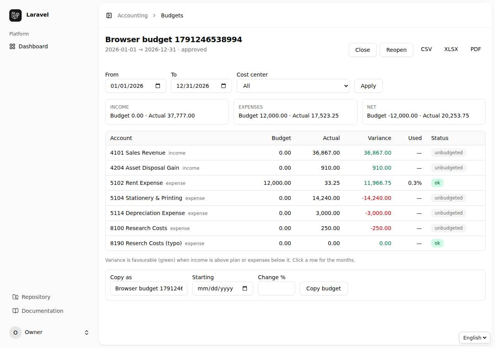

> **اختیاری روک:** ترتیب `ACCOUNTING_BUDGET_CONTROL=block` ہو تو منظور شدہ بجٹ سے زیادہ کا خرچ پوسٹ ہی نہیں ہوتا (جمع شدہ ماہانہ بجٹ تک)۔ `budgets.override` کی اجازت والے صارفین پھر بھی پوسٹ کر سکتے ہیں۔ ڈیفالٹ: `off`۔

## 8.2 مستقل اثاثے (Fixed Assets)

اثاثوں کا رجسٹر: کوڈ، لاگت، بچی ہوئی قدر (Salvage)، کارآمد عمر، فرسودگی کا طریقہ (سیدھی لکیر یا گھٹتا توازن) اور تین کھاتے — اثاثہ، جمع شدہ فرسودگی، فرسودگی کا خرچ۔

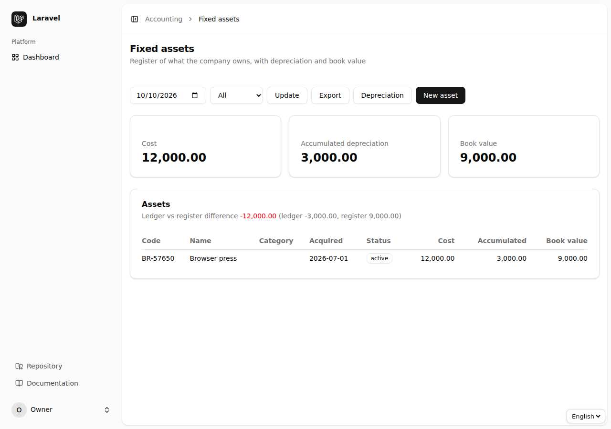

**اثاثہ رجسٹر کرنا**

1. `Fixed assets` ← `New asset`۔
2. کوڈ، نام، خریداری کی تاریخ، سروس میں آنے کی تاریخ، لاگت، Salvage، عمر (مہینوں میں)، طریقہ اور تینوں کھاتے لکھیں۔
3. **Offset account** (کیش/بینک/سپلائر) دیں تو خریداری کا واؤچر بھی خود بن جاتا ہے۔

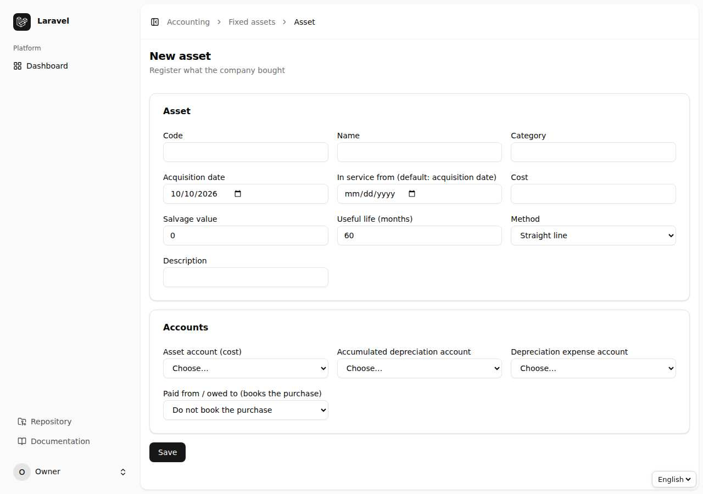

**ماہانہ فرسودگی (Depreciation):** `Depreciation` کھولیں، مہینہ منتخب کریں، `Preview` سے دیکھیں کہ کس اثاثے پر کتنی فرسودگی بنتی ہے، پھر بُک کریں۔ ہر مہینے کا ایک واؤچر، مہینے کی آخری تاریخ کے ساتھ۔ ایک مہینہ ایک اثاثے پر ایک ہی بار بُک ہوتا ہے، اس لیے دوبارہ چلانے سے نقصان نہیں؛ چھوٹے ہوئے مہینے ترتیب سے پورے ہو جاتے ہیں۔

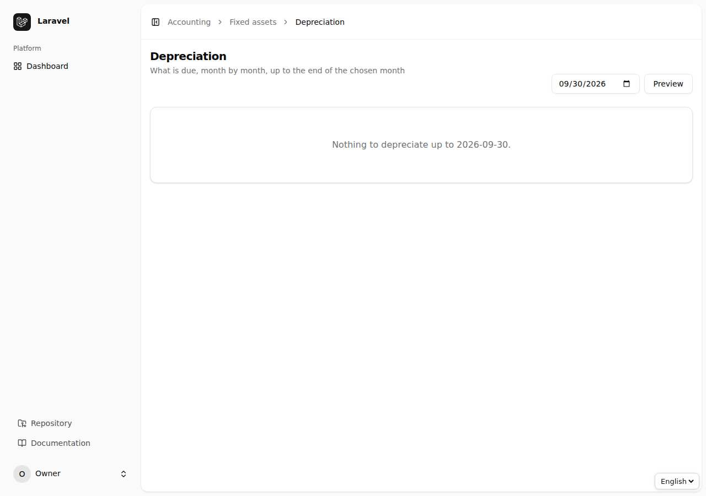

**فروخت یا اسکریپ:** اثاثے کے صفحے سے `Sell or scrap` / `Dispose`: فرسودگی تصرف کی تاریخ سے ایک مہینہ پہلے تک پوری کی جاتی ہے، لاگت اور جمع شدہ فرسودگی ہٹتی ہے، وصولی منتخب کھاتے میں آتی ہے اور نفع/نقصان منتخب کھاتے میں۔

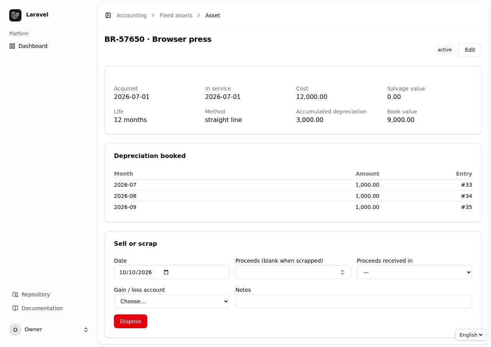

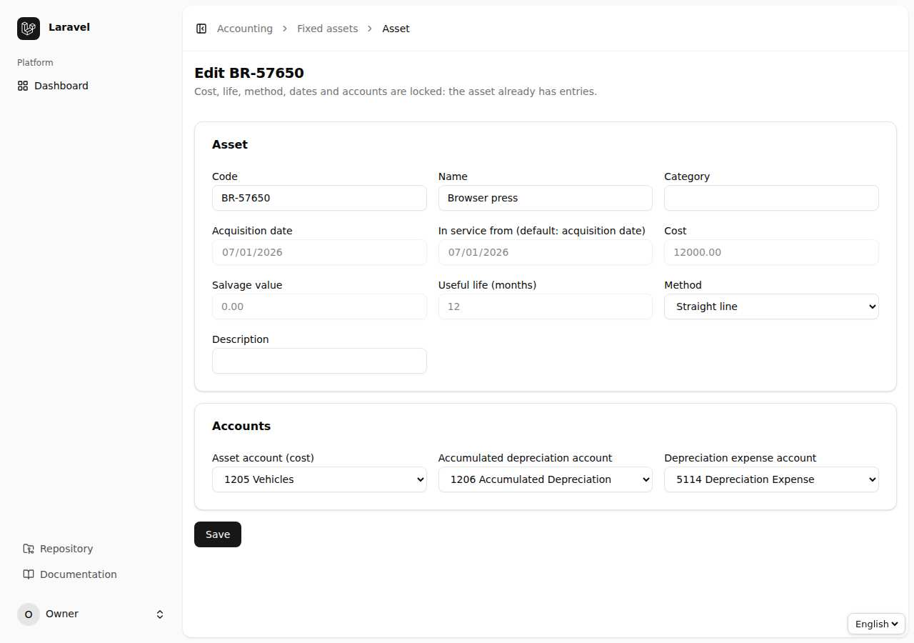

> رجسٹر کا مجموعہ اور چارٹ کا بیلنس کا فرق صفر ہونا چاہیے؛ صفحہ یہ فرق دکھاتا ہے۔ جس اثاثے پر خریداری یا فرسودگی کا اندراج ہو چکا ہو اس کی لاگت، عمر، طریقہ اور کھاتے مقفل ہو جاتے ہیں۔

## 8.3 انوینٹری (Inventory)

اسٹاک اور اس کی قدر **حرکتی اوسط لاگت** (Moving Average Cost) پر۔

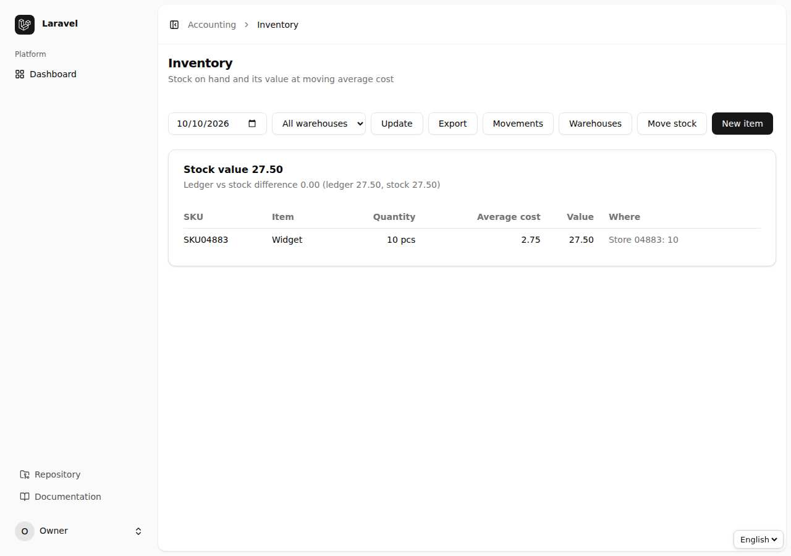

**آئٹم بنانا:** `New item` — SKU، نام، اکائی، انوینٹری کھاتہ، Cost of Goods Sold کھاتہ اور Reorder level۔

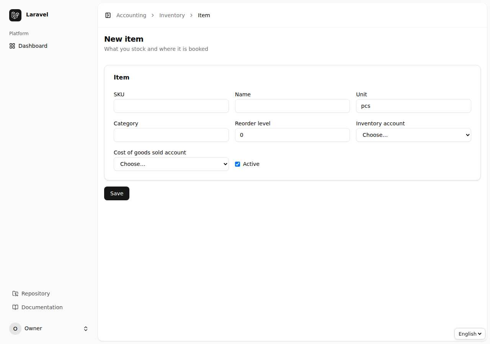

**گودام (Warehouses):** ایک یا زیادہ گودام بنائیں؛ اسٹاک ہر گودام میں الگ گنا جاتا ہے۔

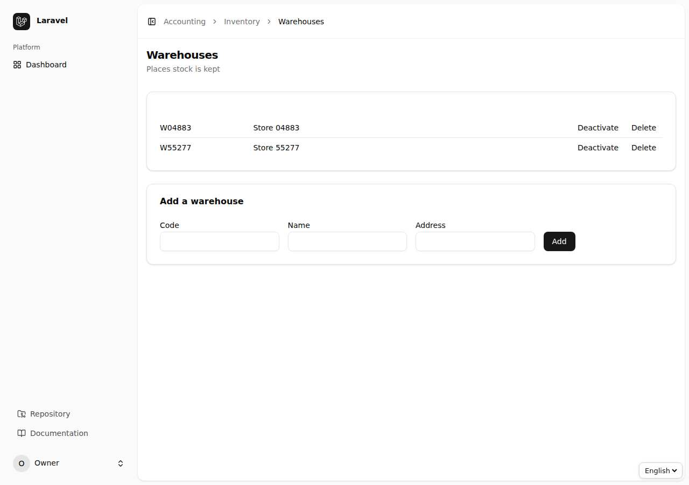

**اسٹاک کی حرکت (`Move stock`)** — چار اقسام:

| قسم | کام |
|---|---|
| `Receive` | مال آیا: مقدار، فی اکائی لاگت اور ادائیگی/واجب کا کھاتہ؛ انوینٹری Debit ہوتی ہے |
| `Issue` | مال گیا: موجودہ اوسط لاگت پر نکلتا ہے اور Cost of Goods Sold Debit ہوتا ہے |
| `Adjust` | گنتی کا فرق: زیادتی اوسط لاگت پر، کمی نفع/نقصان کھاتے میں |
| `Transfer` | ایک گودام سے دوسرے میں؛ صرف مقدار منتقل، قدر نہیں بدلتی |

ہر حرکت اور اس کا واؤچر ایک ہی لین دین میں بنتے ہیں؛ بند مدت میں حرکت نہیں ہو سکتی؛ اسٹاک **منفی** نہیں ہو سکتا۔

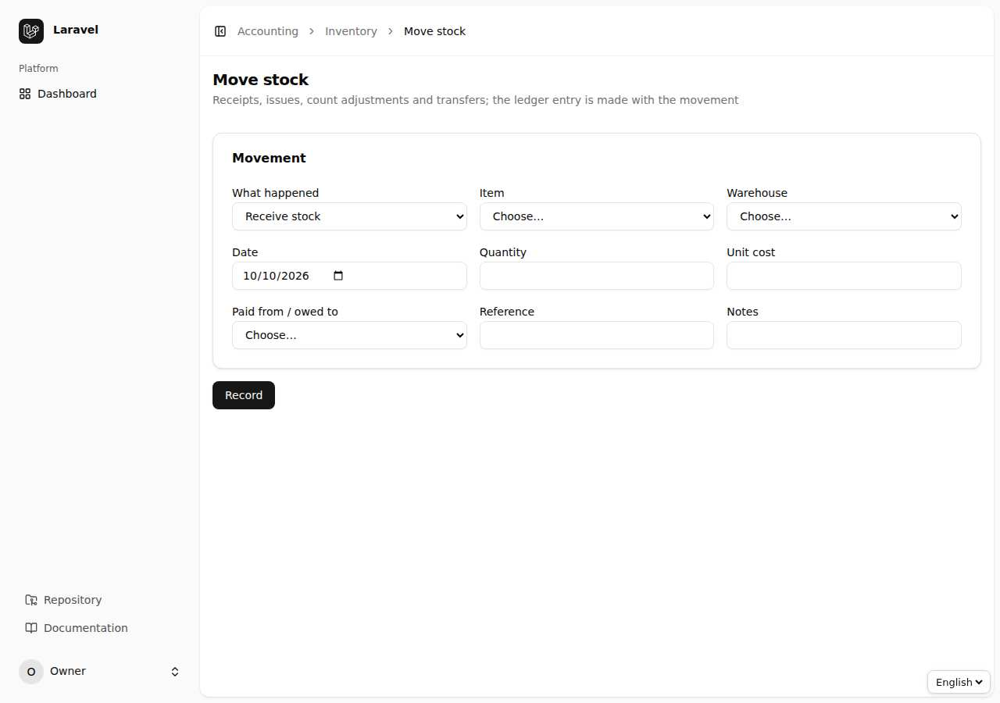

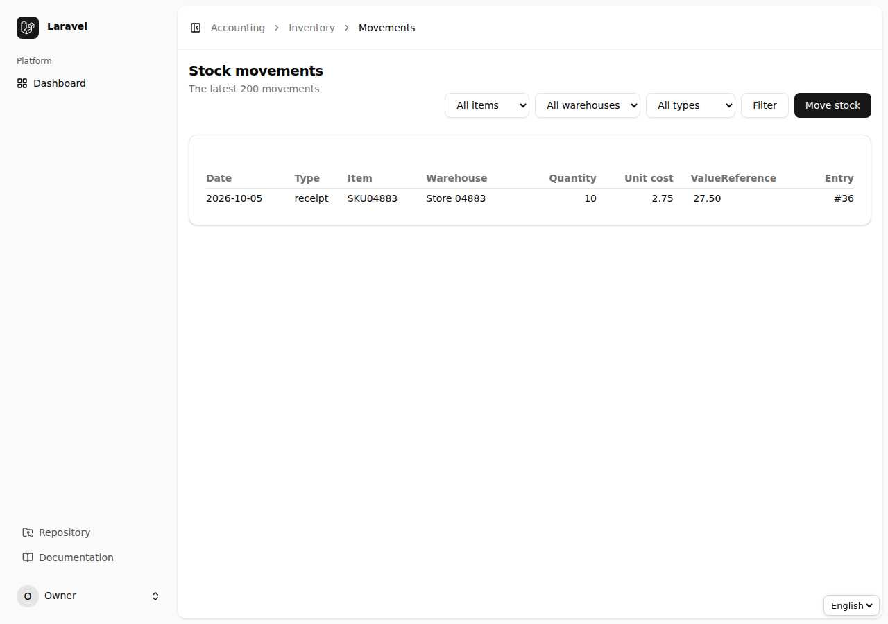

**آئٹم کا اسٹاک کارڈ:** آئٹم کے صفحے پر ہر حرکت اور چلتا بیلنس۔ مرکزی صفحہ ہر آئٹم/گودام کی مقدار، اوسط لاگت اور قدر کسی بھی تاریخ تک دکھاتا ہے، Reorder level پر یا اس سے نیچے والے آئٹم نشان زد ہوتے ہیں اور اسٹاک بہی کا انوینٹری کھاتوں سے موازنہ بھی ہوتا ہے؛ `Export` سے CSV/Excel/PDF۔

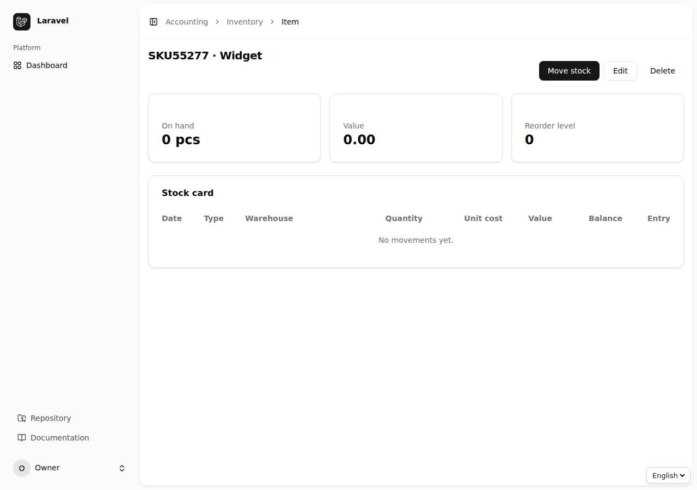

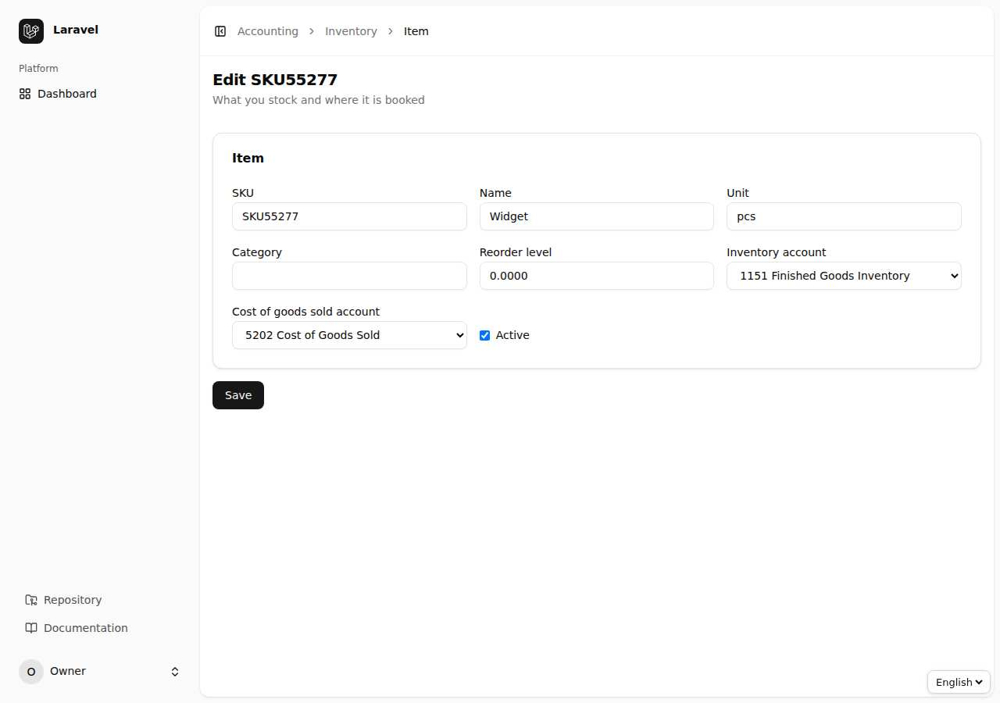

