

# باب 9: پے رول — ملازمین، تنخواہ، بقایا جات، چھٹی، قرض، ٹیکس اور تصفیہ

[← پچھلا باب](08-planning.md) · [فہرست](README.md) · [اگلا باب: انتظامی ٹولز →](10-admin.md)

یہ باب سب سے بڑا ہے کیونکہ پے رول میں سب سے زیادہ کام ہوتا ہے۔ پہلے **ہر ماہ کا مختصر طریقہ** دیکھیں، پھر ہر اسکرین کی تفصیل۔

## 9.0 ہر ماہ کا طریقہ — ایک نظر میں

1. **حاضری درج کریں** (`Attendance`): غیر حاضر دن، اوور ٹائم گھنٹے۔ چھٹیاں `Leave` میں۔
2. **ایک بار کی ادائیگیاں** (`Bonuses`): بونس، جرمانہ وغیرہ۔
3. **Run بنائیں**: `Payroll` ← مہینہ لکھ کر `Calculate`۔ ہر ملازم کی پے سلپ خود بن جاتی ہے۔
4. جانچیں: ہر پے سلپ کھول کر رقوم دیکھیں؛ غلطی ہو تو ملازم/حاضری درست کر کے `Recalculate`۔
5. (اگر منظوری کا نظام آن ہے) `Submit for approval` ← فنانس `Approve`۔
6. `Post` — حسابات میں اندراج۔ (approver)
7. `Pay` — بینک/کیش سے ادائیگی؛ اور `Bank salary file` بینک کو بھیجیں۔
8. پے سلپس ای میل کریں (`E-mail payslips`)۔
9. مہینے کے آخر میں `Reports` اور سال کے آخر میں `Tax` دیکھیں۔

## 9.1 مرکزی صفحہ — Payroll

صفحے پر سال بھر کے مہینہ وار جمع (Gross، Tax، Net) اور تمام Runs کی فہرست ہے۔ اوپر کے بٹن ہر ذیلی صفحے تک لے جاتے ہیں: `Employees`، `Allowances & deductions`، `Grades`، `Bulk changes`، `Arrears`، `Attendance`، `Leave`، `Loans`، `Contributions`، `Bonuses`، `Settlements`، `Reports`، `Tax`۔ جو فیچر **Features** میں بند ہو اس کا بٹن نظر نہیں آتا۔

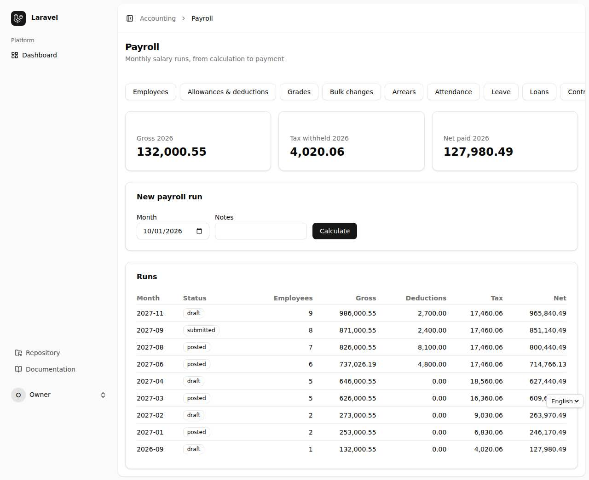

## 9.2 ملازمین (Employees)

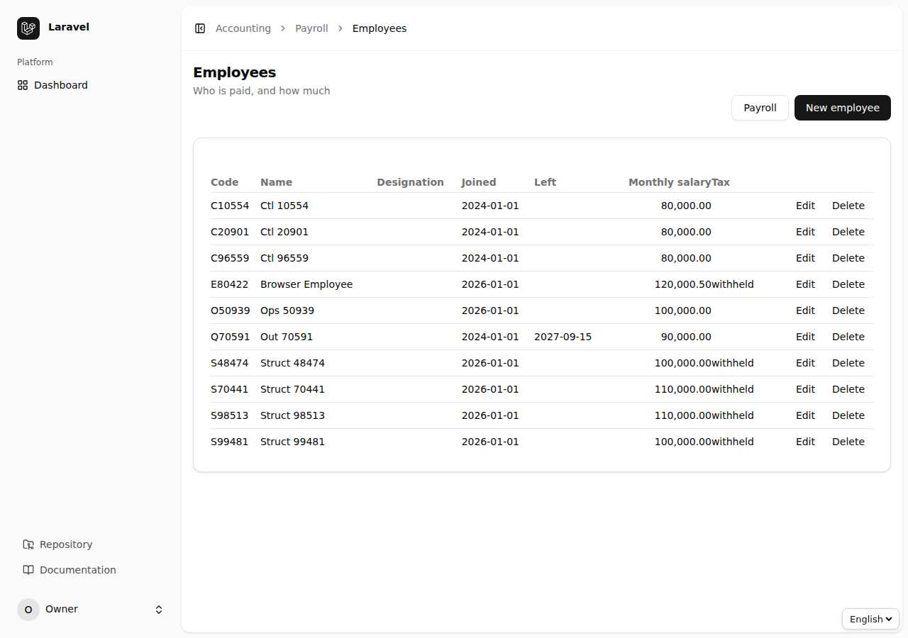

**نیا ملازم:** `Employees` ← `New employee`:

| فیلڈ | مطلب |
|---|---|
| `Code`، `Name` | شناخت |
| `National ID` | شناختی کارڈ نمبر (ٹیکس سرٹیفکیٹ میں آتا ہے) |
| `E-mail` | یہاں پے سلپ بھیجی جاتی ہے |
| `Designation`، `Cost center` | عہدہ اور لاگت کا مرکز |
| `Joined` / `Left` | شمولیت/علیحدگی کی تاریخ؛ نئے آنے/جانے والے کو صرف ملازمت کے دنوں کی تنخواہ ملتی ہے |
| `Monthly basic salary` | بنیادی ماہانہ تنخواہ (Grade دی ہو تو خالی چھوڑ سکتے ہیں) |
| `Bank`، `Bank account` | تنخواہ کی ادائیگی کی فائل کے لیے |
| `Salary grade` | گریڈ؛ ملازم گریڈ کے الاؤنس خود لے لیتا ہے |
| `Withhold income tax` | انکم ٹیکس کاٹا جائے یا نہیں |
| `Paid overtime` | اوور ٹائم کا مستحق ہے |
| الاؤنس/کٹوتیاں | ملازم کے اپنے الاؤنس؛ گریڈ والے کو یہ اوور رائیڈ کرتے ہیں |

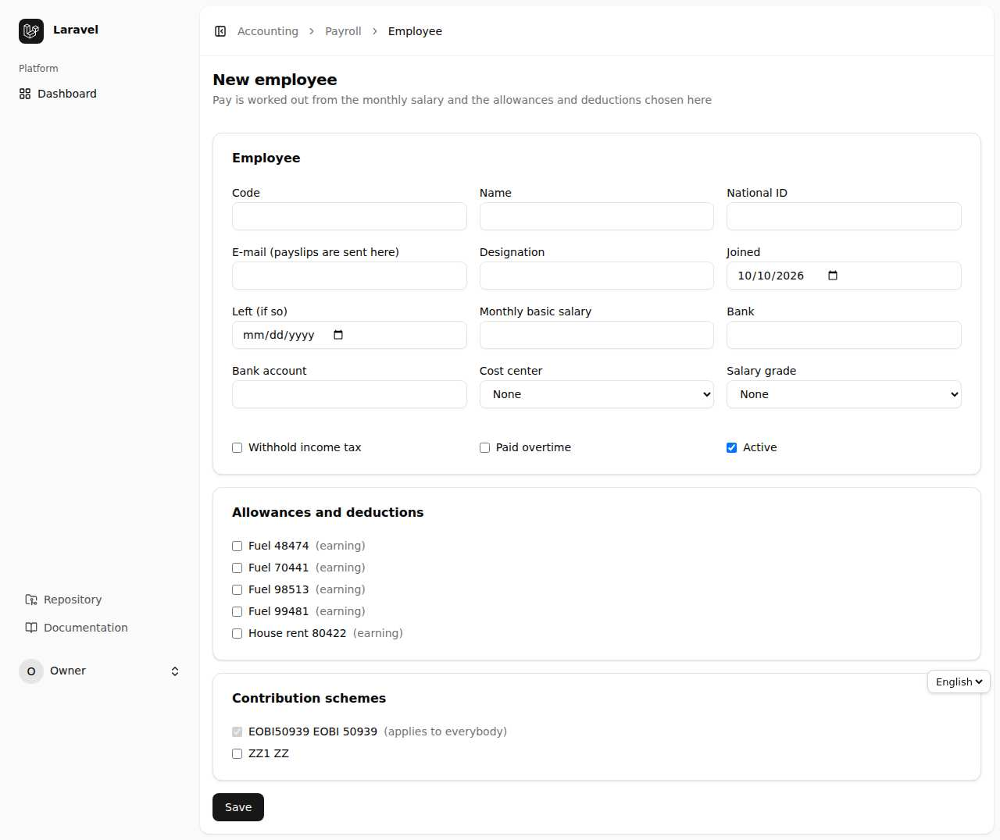

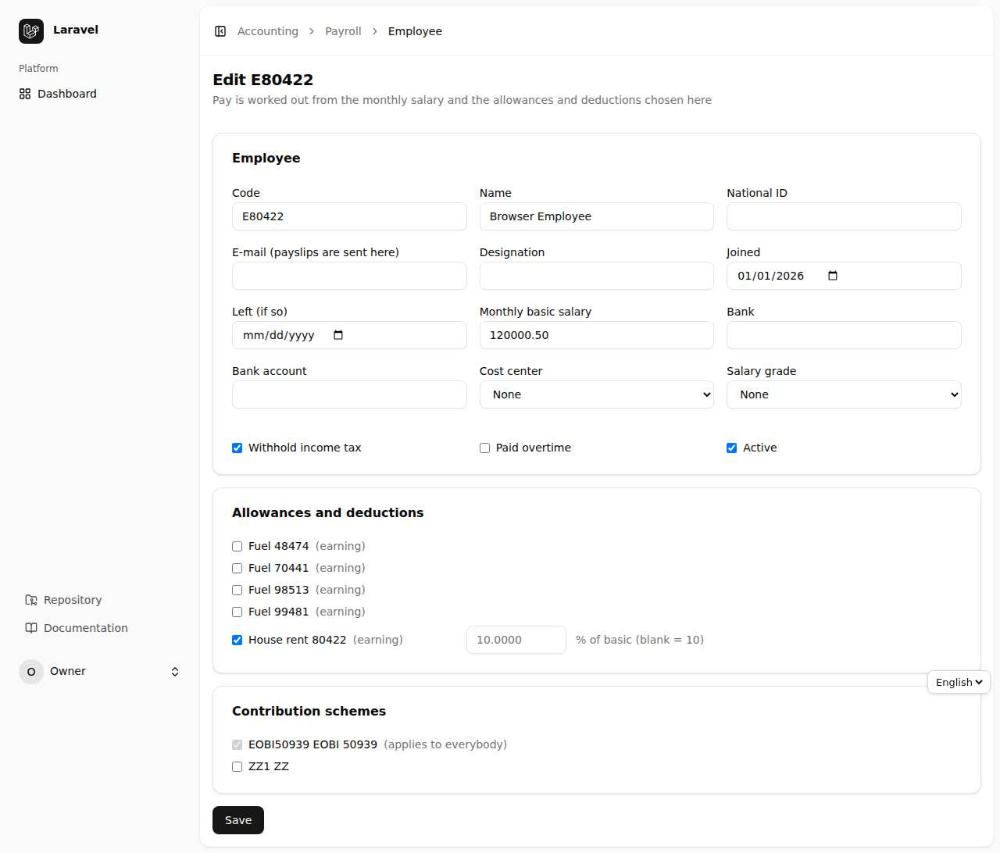

## 9.3 الاؤنس اور کٹوتیاں (Components)

ہر **Component** ایک کمائی (Earning) یا کٹوتی (Deduction) ہے: مثلاً House Rent، Conveyance، Fuel، Medical، Advance Tax۔

| طریقہ (Method) | مثال |
|---|---|
| `fixed` — مقررہ رقم | Conveyance = 3,100 |
| `percent_of_basic` — بنیادی تنخواہ کا فیصد | House Rent = 10% |
| `quantity_rate` — مقدار × نرخ | Fuel = 75 لٹر × 280 روپے |

- **Quantity × Rate:** نرخ Component پر محفوظ ہوتا ہے اور مقدار ہر ملازم کے لیے۔ پٹرول کا نرخ ایک جگہ بدلیں تو اگلی تنخواہ پر **سب** ملازمین کی رقم خود بدل جاتی ہے۔
- کمائی ایک **خرچ کھاتے** میں جاتی ہے؛ کٹوتی اس **واجب کھاتے** میں جس کو رقم دینی ہے۔
- `Taxable` نشان لگا ہو تو یہ رقم انکم ٹیکس کے حساب میں شامل ہوتی ہے۔

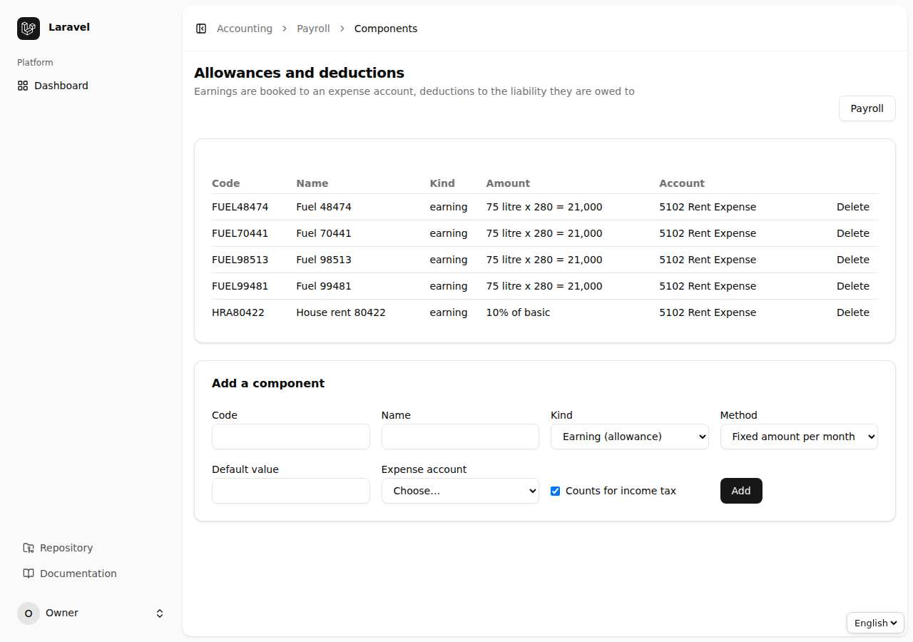

## 9.4 سیلری گریڈ (Grades)

گریڈ = ایک بنیادی تنخواہ اور اس کے الاؤنس/کٹوتیوں کا پیکج (مثلاً "Grade 17")۔ جو ملازم اس گریڈ پر ہوں وہ گریڈ کے ساتھ چلتے ہیں: گریڈ کا کوئی الاؤنس بدلیں تو اگلی بار سب کو نئی رقم ملتی ہے۔ ملازم کا اپنا الاؤنس/رقم گریڈ پر غالب رہتی ہے۔

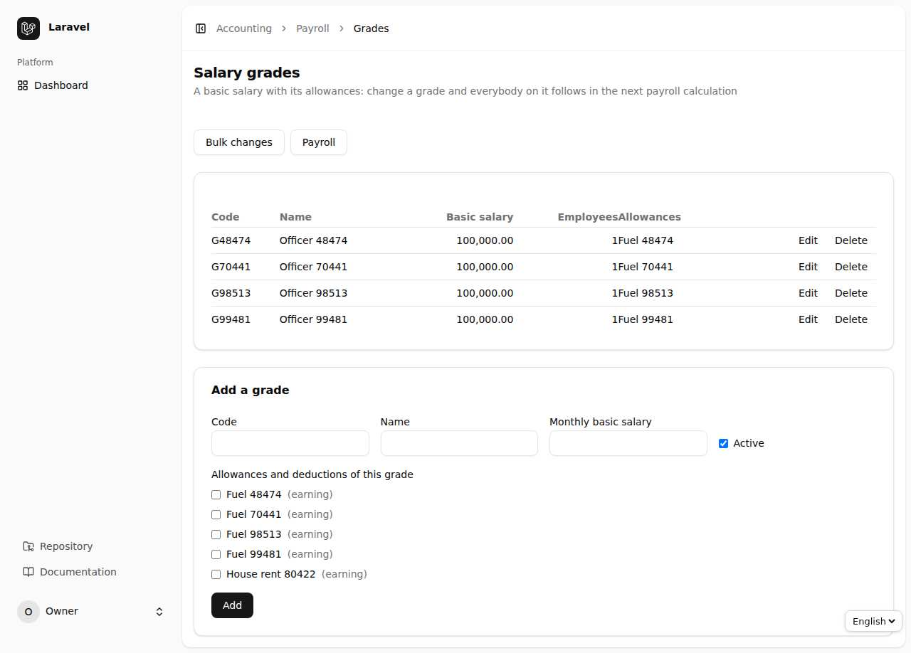

## 9.5 اجتماعی تبدیلیاں (Bulk changes)

بہت سے ملازمین پر ایک ساتھ تبدیلی — پہلے **پیش نظارہ** (Preview)، پھر اطلاق (Apply):

- کوئی Component سب کو دینا یا سب سے ہٹانا؛
- ملازمین کا گروپ ایک Grade میں منتقل کرنا (اختیاری طور پر ان کی تنخواہ بھی)؛
- **تنخواہ میں اضافہ**: فیصد کے حساب سے، مقررہ رقم سے، یا ایک نئی رقم مقرر کر کے؛ رقم کو رائونڈ کرنے کا اختیار بھی؛
- کس پر لاگو ہو: منتخب ملازمین، ورنہ گریڈ کے سب ملازمین، ورنہ تمام فعال ملازمین۔

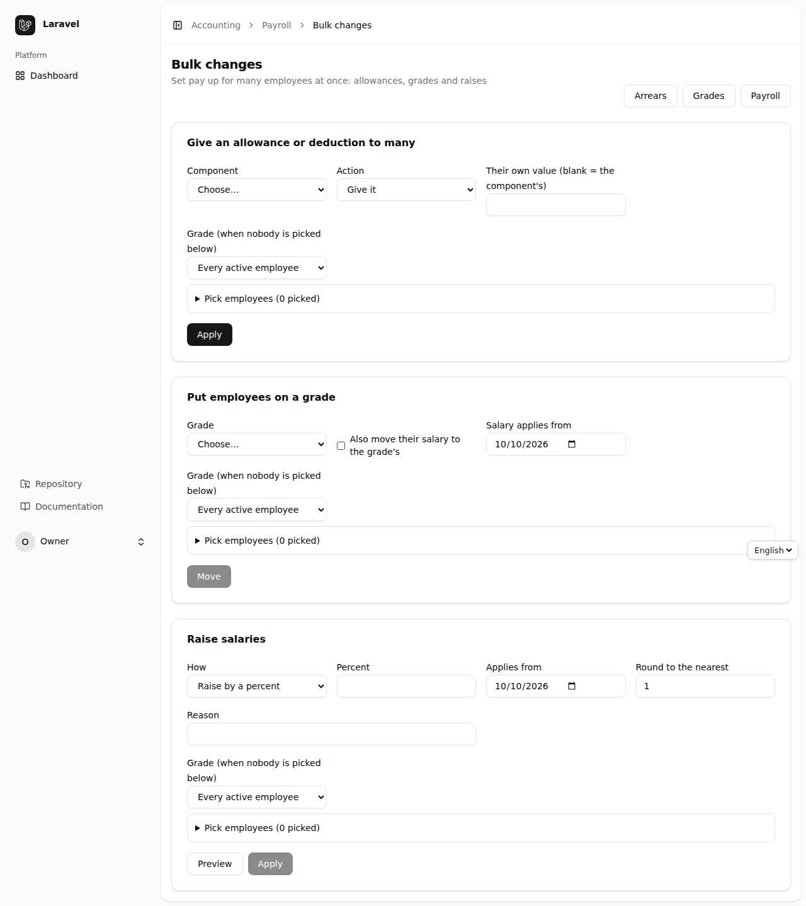

## 9.5.1 تنخواہ کی تاریخ (Salary history)

ملازم کی ہر تنخواہ تبدیلی ایک **ریویژن** ہے: تاریخ جس سے لاگو ہو اور وجہ۔ مہینے کے بیچ میں اضافہ ہو تو پرانی تنخواہ اس سے پہلے کے دنوں کی اور نئی اس دن سے آگے کی ادا ہوتی ہے۔

## 9.6 بقایا جات (Arrears)

**مسئلہ:** 100 ملازمین کی تنخواہ جنوری سے بڑھی، لیکن اضافہ اکتوبر میں لاگو ہوا۔ جنوری تا ستمبر کا فرق ادا کرنا ہے۔

**حل — `Arrears` اسکرین:**

1. `Preview`: **From month** (جنوری) اور **Payment month** (جس ماہ ادائیگی ہوگی) لکھیں۔ سسٹم پوسٹ شدہ پے سلپوں اور تنخواہ کی تاریخ کا فرق مہینہ بہ مہینہ نکال کر ہر ملازم کی رقم دکھاتا ہے (فیصد والے الاؤنس کا فرق بھی)۔
2. درست ہو تو **Create** سے مسودے (Drafts) بنائیں۔
3. approver `Approve` (یا `Approve all`) کرے۔
4. ادائیگی کے مہینے کا Payroll Run انہیں **Arrears** کی الگ لائن کے طور پر خود شامل کر لیتا ہے۔

**ٹیکس:** بقایا پر ٹیکس یوں نکلتا ہے گویا یہ انہی مہینوں میں ملا ہوتا، تاکہ ایک مہینے میں بڑی رقم ملنے سے ملازم اونچے سلیب میں نہ چلا جائے؛ یہ "Income tax on arrears" کی الگ لائن میں آتا ہے۔ ایک مہینہ دو بار کلیم نہیں ہوتا؛ جس مہینے ملازم کو زیادہ ادا ہوا ہو وہ واپس نہیں لیا جاتا۔ Run حذف/Void ہو تو بقایا منظور شدہ قطار میں واپس چلا جاتا ہے۔

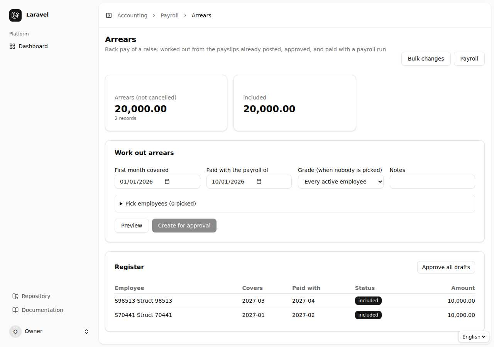

## 9.7 حاضری، چھٹی اور اوور ٹائم

**حاضری (`Attendance`):** مہینہ منتخب کر کے ہر ملازم کے لیے `Absent days` (آدھا دن بھی ممکن) اور `Overtime hours` لکھیں، `Save attendance` دبائیں۔ غیر حاضر دن اور بلا تنخواہ چھٹی بنیادی تنخواہ اور مقررہ الاؤنس سے **دن کے حساب** سے کٹتی ہے؛ فیصد الاؤنس بنیادی تنخواہ کے ساتھ گھٹتے ہیں۔ جس مہینے کی تنخواہ پوسٹ ہو چکی اس کی حاضری نہیں بدل سکتی۔

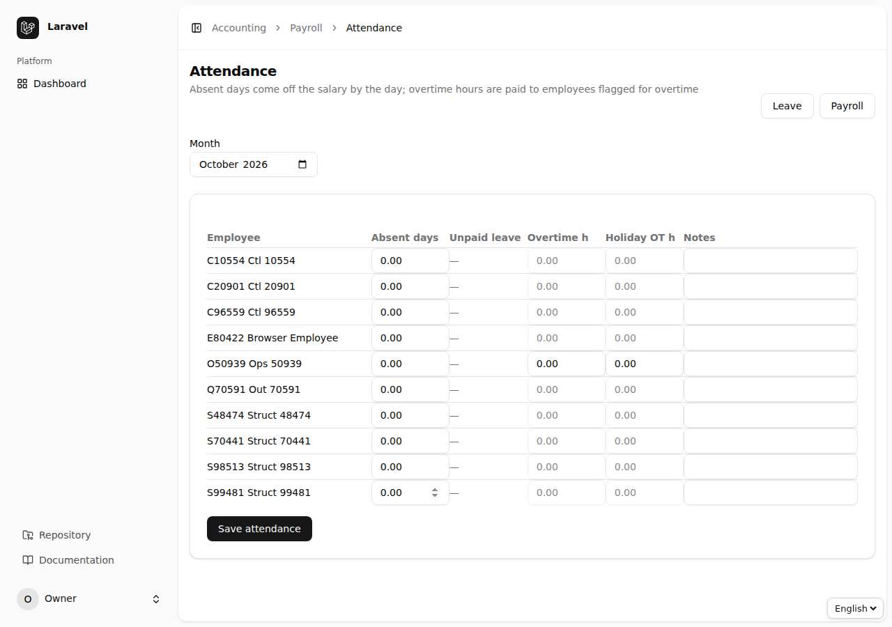

**چھٹیاں (`Leave`):** پہلے **Leave type** بنائیں (`Code`، `Name`، `Paid leave`، سالانہ حق `Annual days`)۔ پھر `Record leave` سے ملازم، قسم، تاریخیں اور آدھا دن لکھیں۔ سسٹم آپس میں ٹکراتی چھٹیاں اور Paid قسم کے بیلنس سے زیادہ چھٹی **مسترد** کرتا ہے۔ `Leave balances` میں ہر ملازم/قسم کا حق، لی گئی اور بقیہ چھٹیاں۔

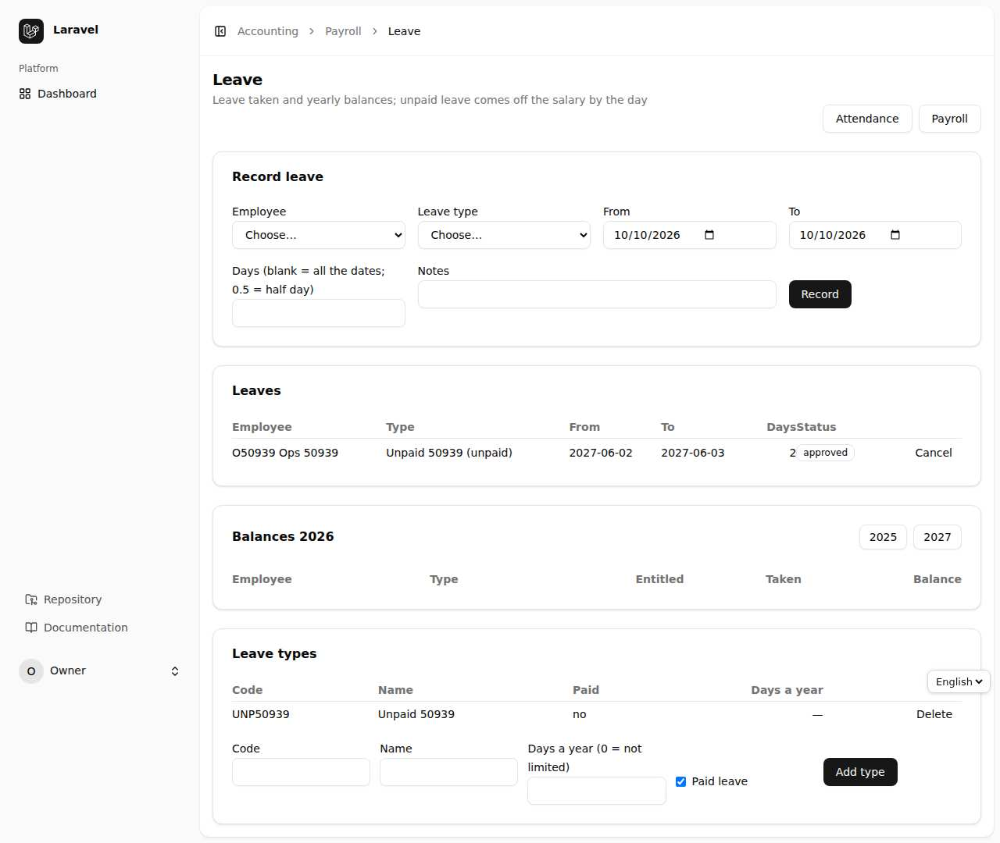

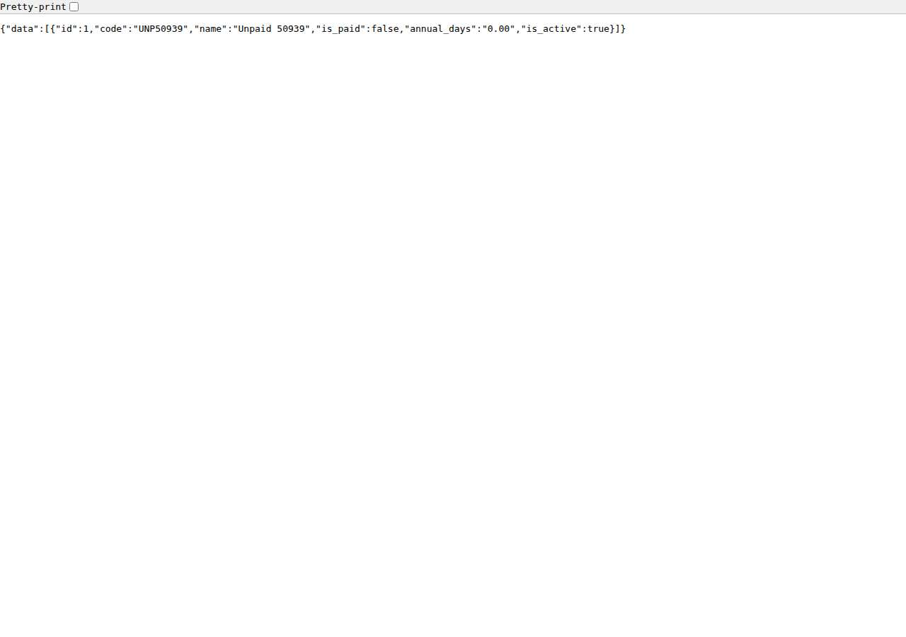

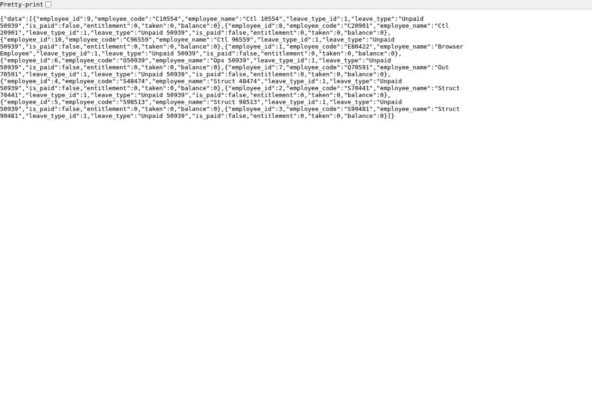

**اوور ٹائم:** جس ملازم پر `Paid overtime` نشان ہو اسے گھنٹے × (تنخواہ ÷ ماہانہ گھنٹے) × ضرب (عام دن کی الگ، چھٹی کے دن کی الگ) ملتا ہے؛ یہ پے سلپ پر **Overtime** کی قابل ٹیکس لائن بنتی ہے۔ ضرب اور ماہانہ گھنٹے ترتیب `accounting.payroll.overtime` میں۔

## 9.8 قرض اور پیشگی (Loans & Advances)

1. `Loans` ← نیا قرض: ملازم، قسم (`Loan` یا `Salary advance`)، رقم `Amount`، قسطوں کی تعداد `Instalments`، پہلی کٹوتی کا مہینہ `First salary it comes out of`۔
2. قسطیں برابر بنتی ہیں (آخری قسط پیسوں کا فرق سنبھالتی ہے)؛ قرض **Draft** ہے، کٹوتی ابھی شروع نہیں ہوتی۔
3. approver `Pay out` دبائے: اور بینک/کیش کھاتہ دے۔ Debit "Employee Advances" (1105)، Credit بینک۔ قرض **Active** ہو جاتا ہے۔
4. ہر Payroll Run واجب الادا قسط کو کٹوتی کے طور پر لے لیتا ہے ("Loan instalment 2/12")۔ Run حذف/Void/دوبارہ حساب ہو تو قسط واپس آ جاتی ہے۔
5. `Skip next` — اگلی قسط شیڈول کے آخر میں چلی جاتی ہے۔ `Settle` — ملازم بقیہ رقم نقد واپس کر دے۔ پوری وصولی پر قرض **Closed**۔
6. Draft قرض `Cancel` ہو سکتا ہے۔

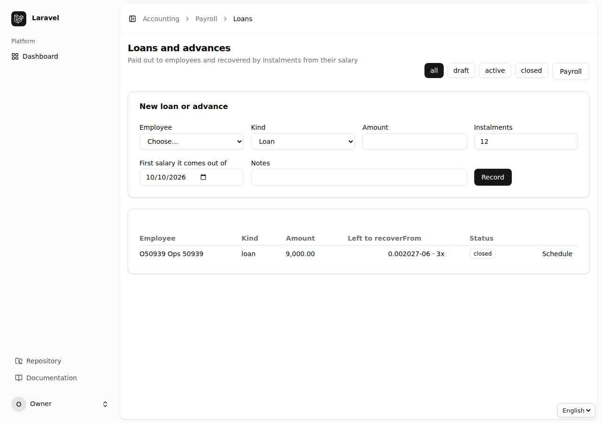

## 9.9 شراکتیں — EOBI، PESSI/SESSI، پراویڈنٹ فنڈ (Contributions)

ہر **Scheme** میں: بنیاد (`basic`، `gross` یا `fixed`)، ملازم کا فیصد/رقم، آجر کا فیصد/رقم، **حد** `Ceiling` (بنیاد کی زیادہ سے زیادہ رقم جو گنی جائے)، اور تین کھاتے۔

- **ملازم کا حصہ:** تنخواہ سے کٹوتی؛ جس واجب کھاتے کو رقم جانی ہے وہ `Employee account` ہے۔
- **آجر کا حصہ:** ادارے کا خرچ (Employer expense) جو کسی واجب کھاتے (Employer liability) میں جاتا ہے؛ یہ ملازم کی خالص تنخواہ کا حصہ **نہیں** ہوتا لیکن Run کے ساتھ بُک ہوتا ہے اور پے سلپ پر "Employer contributions" میں دکھایا جاتا ہے۔
- `Applies to every employee` یا مخصوص ملازمین کو `Assign`؛ اختیاری طور پر بقایا جات پر بھی لاگو۔

> شرحیں آپ کے ہاتھ میں ہیں — انہیں موجودہ سرکاری قوانین سے ضرور ملا لیں۔

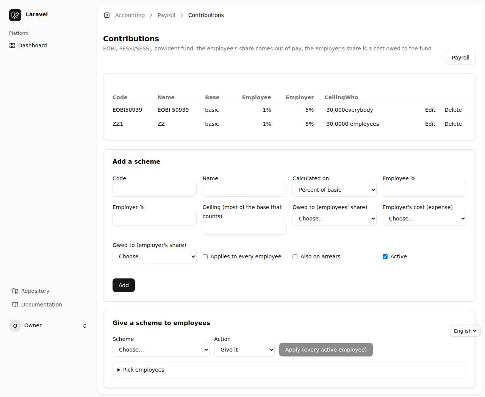

## 9.10 ایک بار کی ادائیگیاں اور بونس (Bonuses)

- **ایک ملازم:** ملازم، مہینہ، وجہ، رقم؛ قسم **Earning** (بونس/الاؤنس) یا **Deduction** (جرمانہ/وصولی)؛ Pay component اختیاری؛ `Taxable` کا نشان۔ Component نہ ہو تو سادہ بونس `accounting.payroll.bonus_account` میں (ڈیفالٹ: تنخواہ کا خرچ کھاتہ) جاتا ہے، اور جرمانے کے لیے وہ واجب کھاتہ دینا ہوتا ہے جسے رقم جائے گی۔
- **ہر فعال ملازم کو:** ایک ہی رقم، یا ہر ایک کی بنیادی تنخواہ کا فیصد (مثلاً عید بونس = بنیادی تنخواہ کا 50%)۔ جو ملازم اس مہینے ملازمت میں نہ ہو اسے چھوڑ دیا جاتا ہے اور فہرست "left out" میں بتائی جاتی ہے۔
- اسی مہینے کا Run انہیں خود شامل کرتا ہے۔ جو اندراج ابھی کسی Run میں نہیں گیا اسے `Cancel` کر سکتے ہیں۔ جس مہینے کا Run جمع/منظور/پوسٹ ہو چکا اس میں نیا اندراج نہیں بن سکتا۔

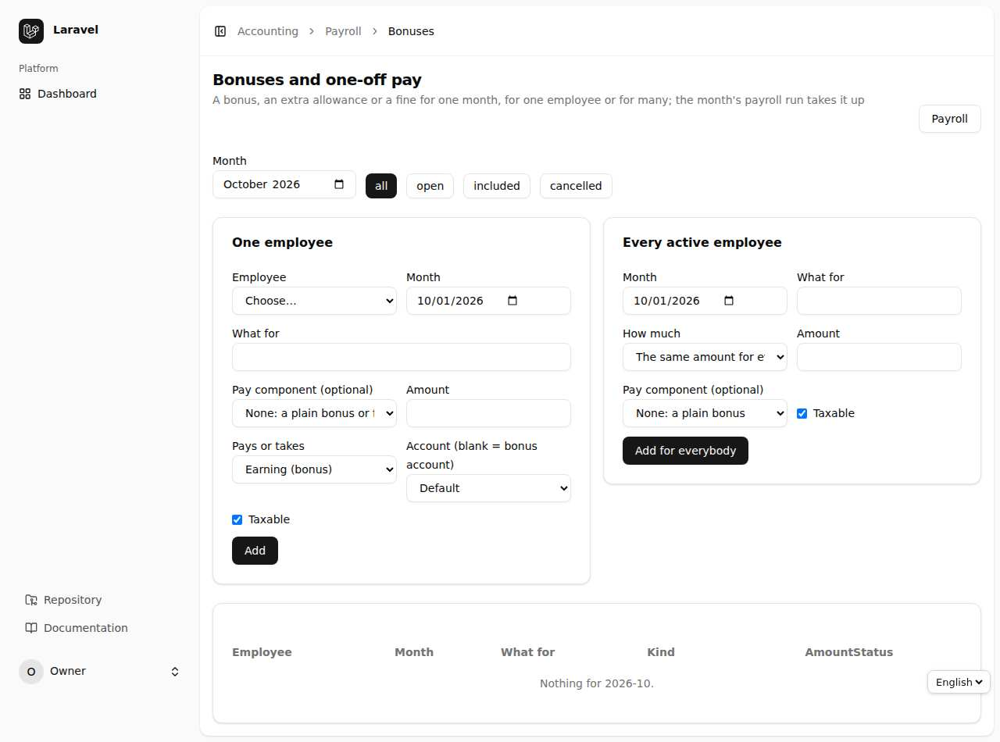

## 9.11 پے رول Run — بنانا، منظوری، پوسٹ، ادائیگی

`Payroll` پر مہینہ (`Month`) لکھ کر `Calculate` دبائیں۔ ایک مہینے کا ایک ہی Run ہو سکتا ہے۔ سسٹم ہر فعال ملازم کی پے سلپ بناتا ہے: نئے آنے/جانے والے کو ملازمت کے دن، فیصد الاؤنس، گریڈ، حاضری/چھٹی، اوور ٹائم، بقایا جات، شراکتیں، قرض کی قسطیں، بونس، اور انکم ٹیکس (`accounting.payroll.tax_slabs` کے سلیب سے؛ ڈیفالٹ مثال کے طور پر ہیں، انہیں موجودہ قوانین سے ملا لیں)۔ **منفی خالص تنخواہ** رد ہو جاتی ہے۔

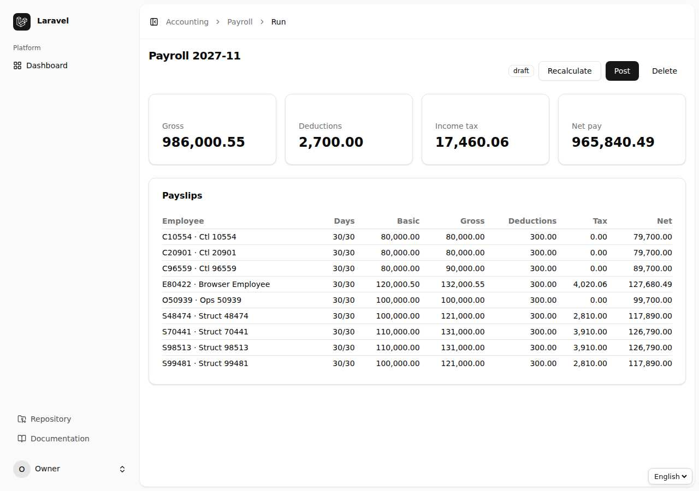

| بٹن | کب | کیا کرتا ہے |
|---|---|---|
| `Recalculate` | Draft | ملازمین/حاضری/الاؤنس بدلنے کے بعد پے سلپیں دوبارہ بناتا ہے |
| `Delete` | Draft | Run ہٹاتا ہے (قرض/بقایا/بونس واپس) |
| `Submit for approval` | Draft، منظوری کا نظام آن | Run کو فنانس کے پاس بھیج کر مقفل کرتا ہے |
| `Approve` / `Send back` | Submitted، `payroll.approve` | منظور، یا وجہ لکھ کر HR کو واپس |
| `Withdraw` | Submitted/Approved | Run کو Draft میں واپس لیتا ہے |
| `Post` | Draft (یا Approved) | حسابات میں اندراج: بنیادی تنخواہ و کمائیاں خرچ، کٹوتیاں/ٹیکس واجب، خالص تنخواہ `Net salary payable` (2103) میں |
| `Pay` | Posted | واجب تنخواہ کو بینک/کیش کھاتے سے ادا کرتا ہے |
| `Void` | Posted/Paid | ادائیگی اور تنخواہ کا اندراج الٹ دیتا ہے؛ مہینہ دوبارہ بن سکتا ہے |

**منظوری کا نظام (HR → فنانس):** ترتیب `accounting.payroll.require_approval` یا **Features** میں "Run approval" آن ہو تو HR (`payroll.run`) `Submit for approval` کرتا ہے، فنانس (`payroll.approve`) `Approve` یا `Send back` — وجہ لازمی؛ **جس نے Submit کیا وہ خود Approve نہیں کر سکتا**۔ منظوری کے بعد ہی `Post` ممکن ہے۔ ہر مرحلہ Audit Log میں درج ہوتا ہے۔

## 9.12 پے سلپ

Run میں ملازم کے نام پر کلک سے اس کی پے سلپ کھلتی ہے: کمائیاں (بنیادی، الاؤنس، اوور ٹائم، بقایا)، کٹوتیاں (ٹیکس، قرض، شراکتیں)، آجر کی شراکتیں اور **خالص تنخواہ**۔

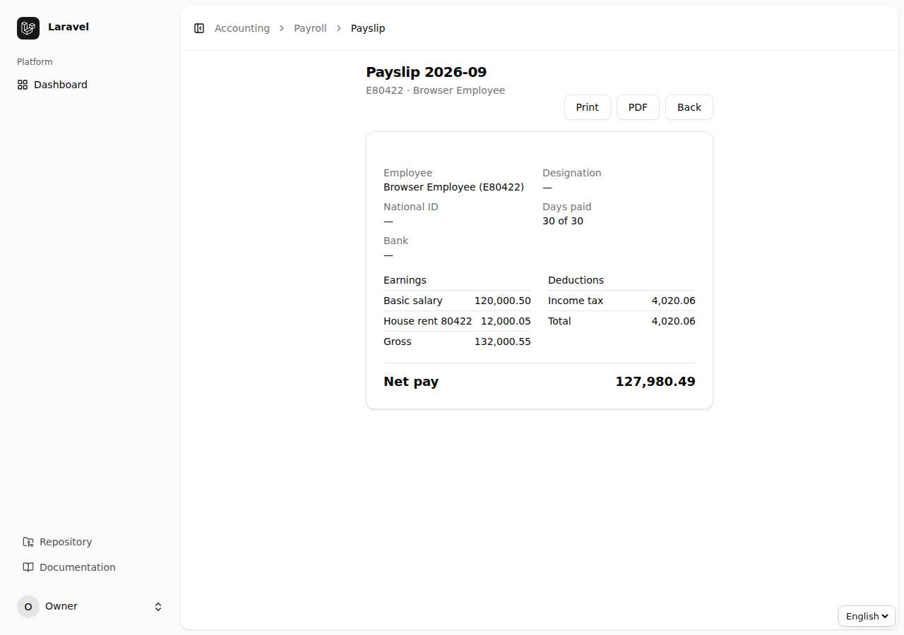

- `Print` — پرنٹ کے قابل صفحہ؛ `PDF` — PDF فائل (PDF لائبریری نہ ہو تو HTML)؛
- `E-mail` — ملازم کے ای میل پر؛ Run کے صفحے پر `E-mail payslips` سب کو ایک ساتھ بھیجتا ہے؛ جن ملازمین کا ای میل درج نہیں وہ "skipped" کی فہرست میں آتے ہیں۔

## 9.13 بینک تنخواہ فائل (Bank file)

Posted Run کے صفحے پر **Bank salary file**: اپنے بینک کے فارمیٹ (`standard`، `IBAN` یا آپ کا بنایا ہوا) کا `CSV` یا `Excel` ڈاؤن لوڈ کریں۔ جن ملازمین کا بینک اکاؤنٹ درج نہیں ان کا نام فائل سے باہر رہتا ہے اور اسکرین پر الگ دکھایا جاتا ہے۔ اس کے لیے `payroll.post` کی اجازت چاہیے۔

## 9.14 حتمی تصفیہ (Final Settlement)

ملازم ادارہ چھوڑے تو `Settlements` میں:

1. ملازم اور **آخری دن** منتخب کریں؛ اختیاری طور پر `Gratuity`، `Leave days paid` اور `Adjustment` (+ادائیگی/− وصولی) خود لکھیں۔
2. `Preview`: **گریجویٹی** = (سالانہ دن ÷ 30) × بنیادی تنخواہ × سالِ ملازمت (کم از کم مدت کے بعد)؛ **چھٹی کی ادائیگی** = بچی ہوئی چھٹیاں × روزانہ اجرت؛ **قرض** جو ملازم کے ذمہ ہے خود منہا؛ نتیجہ **Net settlement**۔
3. `Save draft` — پھر approver `Post` (حسابات میں اندراج، قرض Closed) اور `Pay`؛ غلطی ہو تو `Void` (قرض دوبارہ کھل جاتے ہیں)۔
4. ایک ملازم کا Posted/Paid تصفیہ ہو جائے تو دوسرا نہیں بن سکتا؛ Draft کی جگہ نیا Draft لے لیتا ہے۔

قواعد `accounting.payroll.gratuity` میں (دن فی سال، کم از کم سال، کھاتے، چھٹی کی قسم)۔

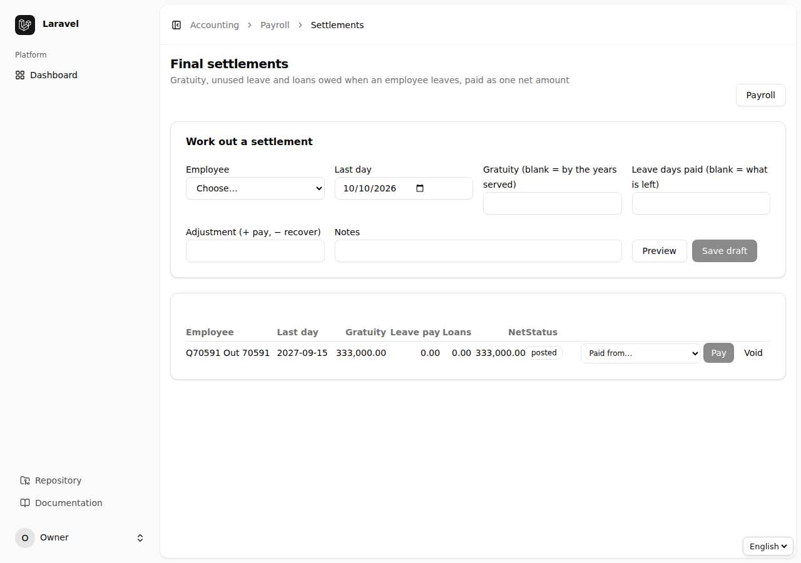

## 9.15 ٹیکس گوشوارہ اور سرٹیفکیٹ

`Tax` میں ٹیکس سال (ڈیفالٹ جولائی تا جون؛ `accounting.payroll.tax_year_start_month`) کے لیے ہر ملازم کی قابل ٹیکس آمدنی، کٹوتی شدہ ٹیکس اور خالص تنخواہ — Posted Run سے۔ `CSV`/`Excel`/`PDF` میں ایکسپورٹ۔ ملازم منتخب کر کے `Open certificate` سے اس کا **ٹیکس سرٹیفکیٹ** کھلتا ہے، جسے `Print` کیا جا سکتا ہے۔

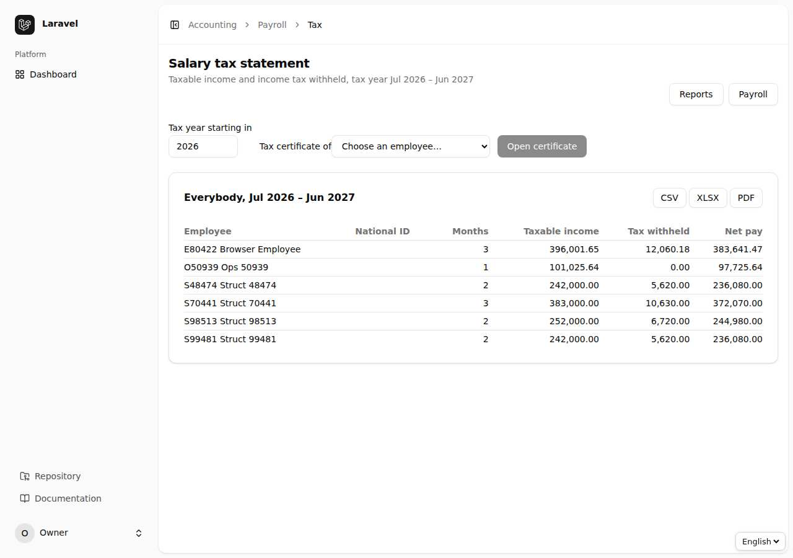

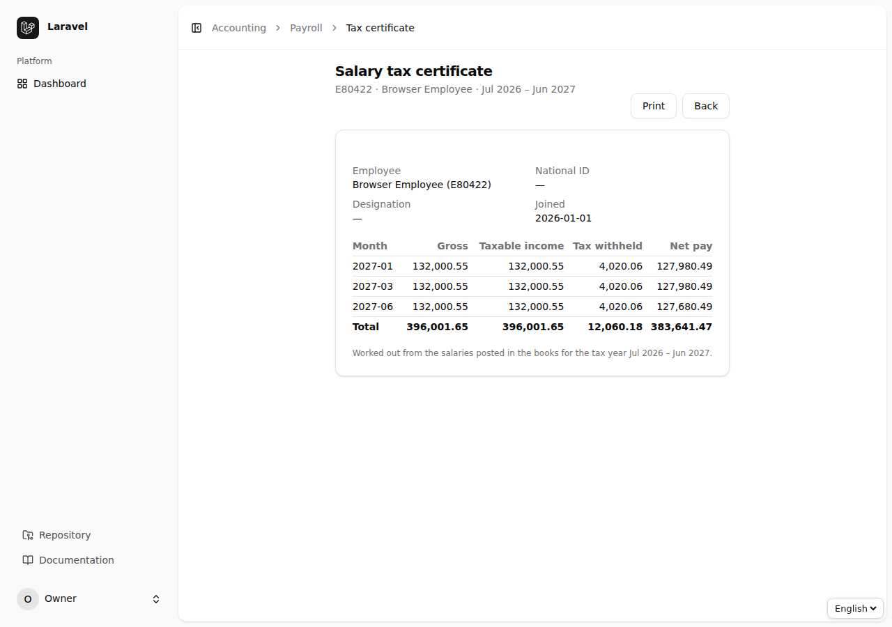

## 9.16 پے رول رپورٹیں

`Reports`: **مہینہ بہ مہینہ** (ملازمین، Gross، Tax، Net، آجر کی شراکتیں، کل لاگت، فی ملازم لاگت اور پچھلے مہینے سے تبدیلی)، **Cost center** کے حساب سے لاگت، اور **Headcount** (کتنے آئے، گئے، کتنے پے رول پر ہیں)۔ تینوں `CSV`/`Excel`/`PDF` میں۔

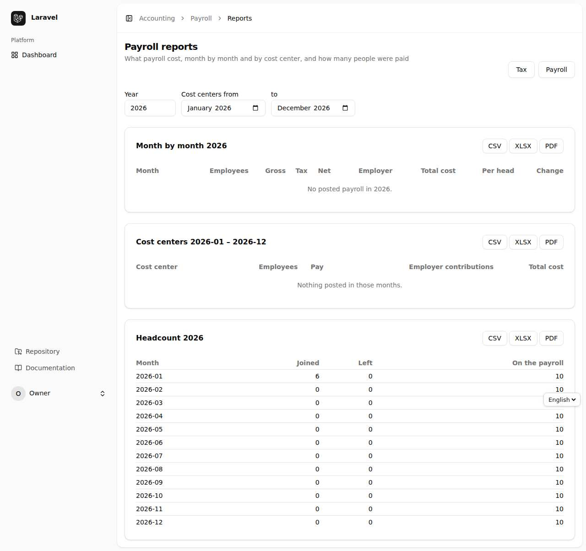

## 9.17 خودکار Run

ہر مہینے Run خود بنوانے کے لیے `php artisan accounting:payroll-run [--month=2026-10] [--company=1]` (ڈیفالٹ: پچھلا مہینہ؛ جس مہینے کا Run موجود ہو اسے چھوڑ دیتی ہے)۔ ہر ماہ خودکار چلانے کے لیے ترتیب `accounting.payroll.auto_run` آن کریں۔ Run **Draft** بنتا ہے — جانچ، منظوری اور Post پھر بھی آپ ہی کرتے ہیں۔

## 9.18 اجازتیں اور فرائض کی تقسیم

| اجازت | کیا |
|---|---|
| `payroll.view` | پے رول دیکھنا |
| `payroll.manage` | ملازمین، الاؤنس، گریڈ، حاضری، قرض، بونس وغیرہ میں ترمیم |
| `payroll.run` | Run بنانا/دوبارہ حساب/حذف/Submit |
| `payroll.approve` | Run منظور/واپس |
| `payroll.post` | Post، Pay، قرض کی ادائیگی، بقایا کی منظوری، بینک فائل |
| `payroll.void` | Void |

عام ترتیب: Accountant تیار کرتا ہے؛ Approver منظور، Post، Pay اور Void — تاکہ ایک ہی شخص پورا چکر خود نہ کر سکے۔

