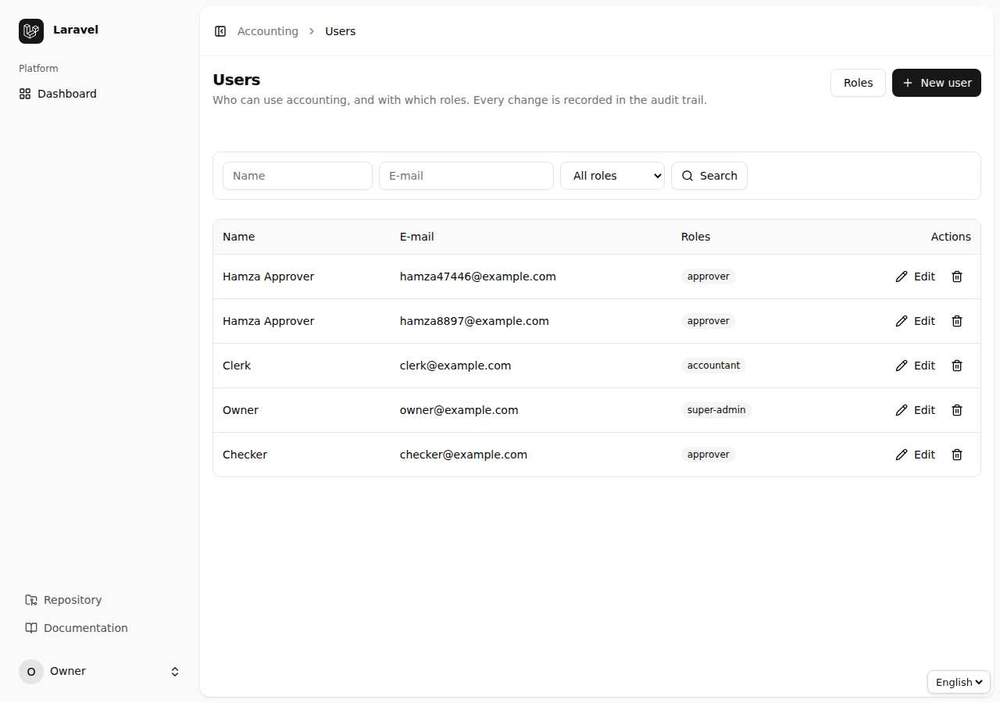
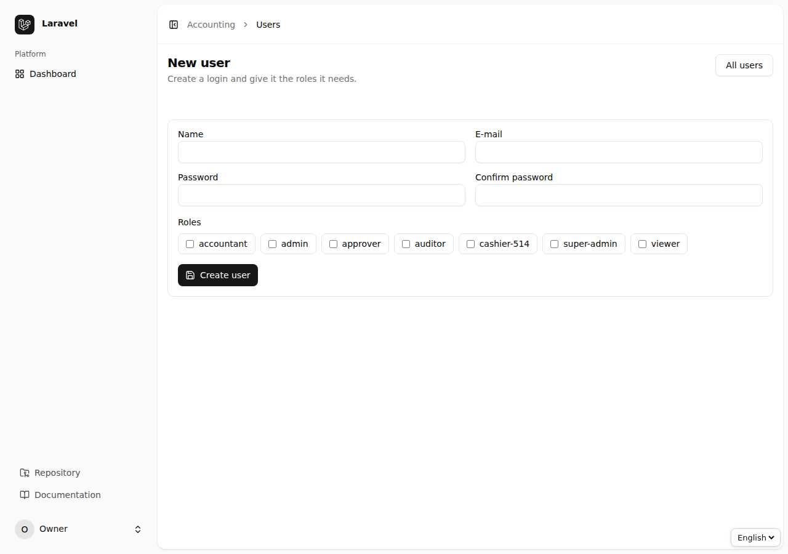
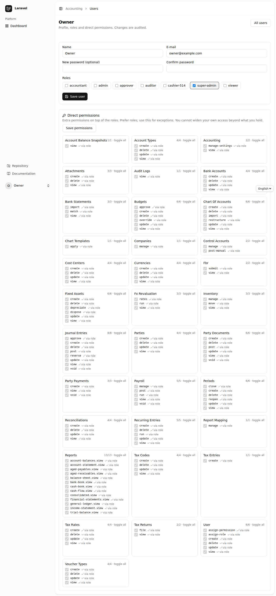
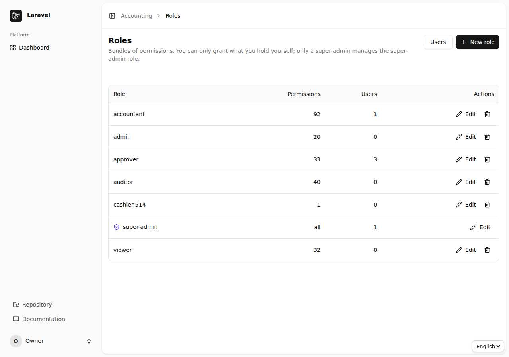
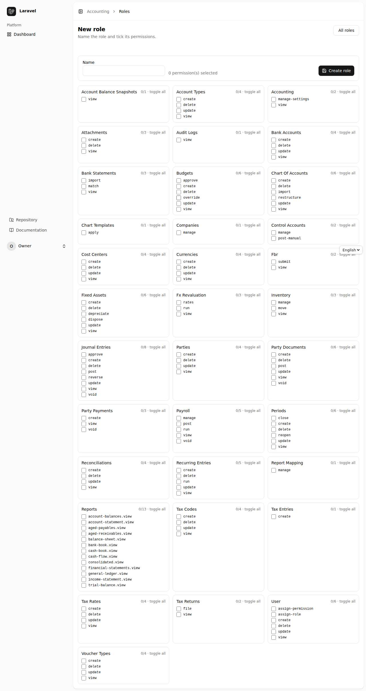
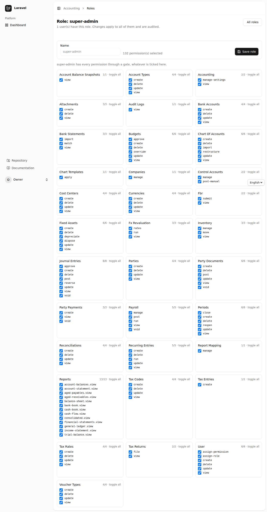
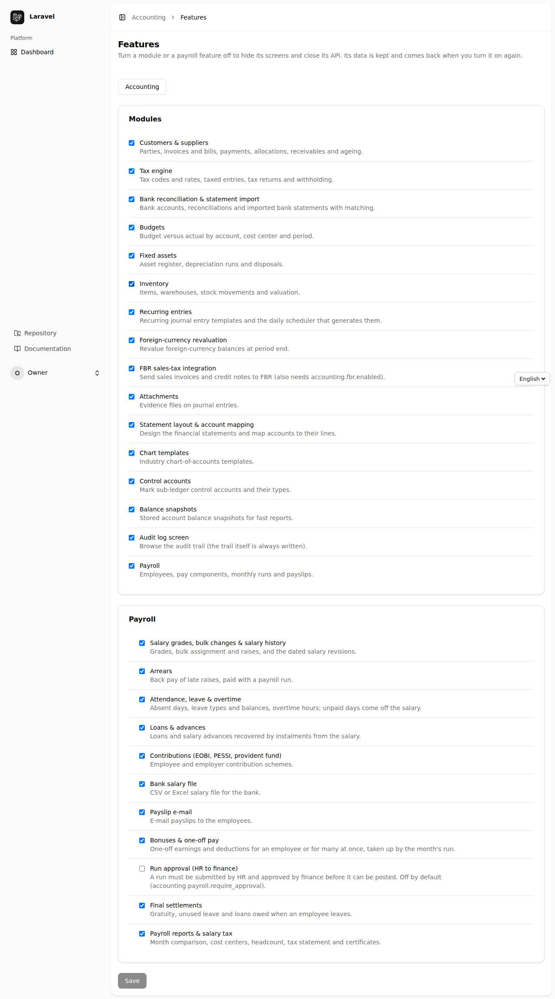
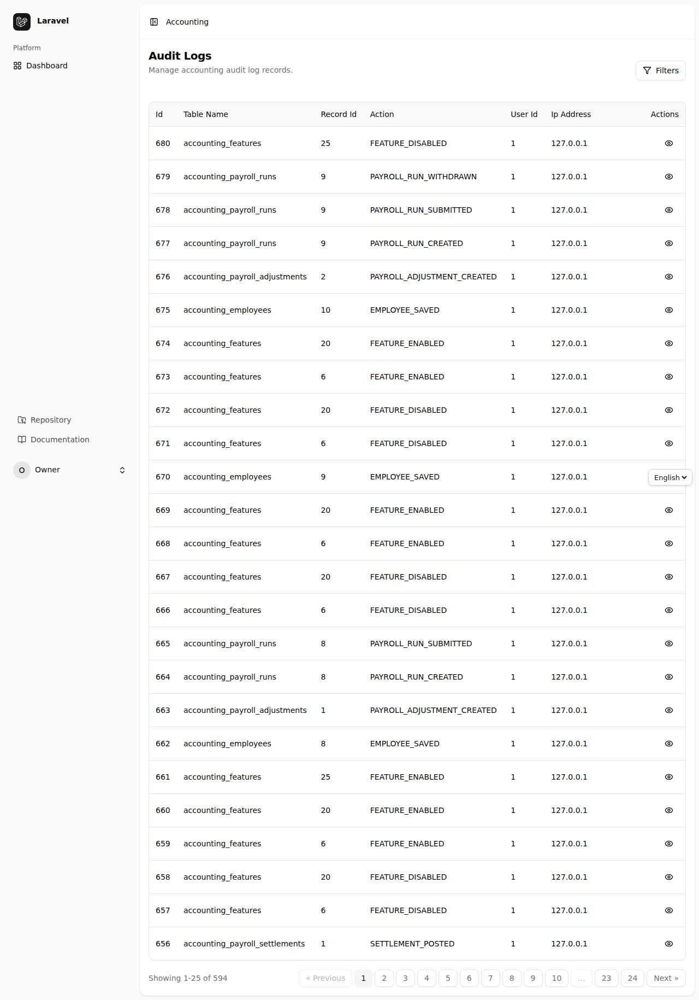
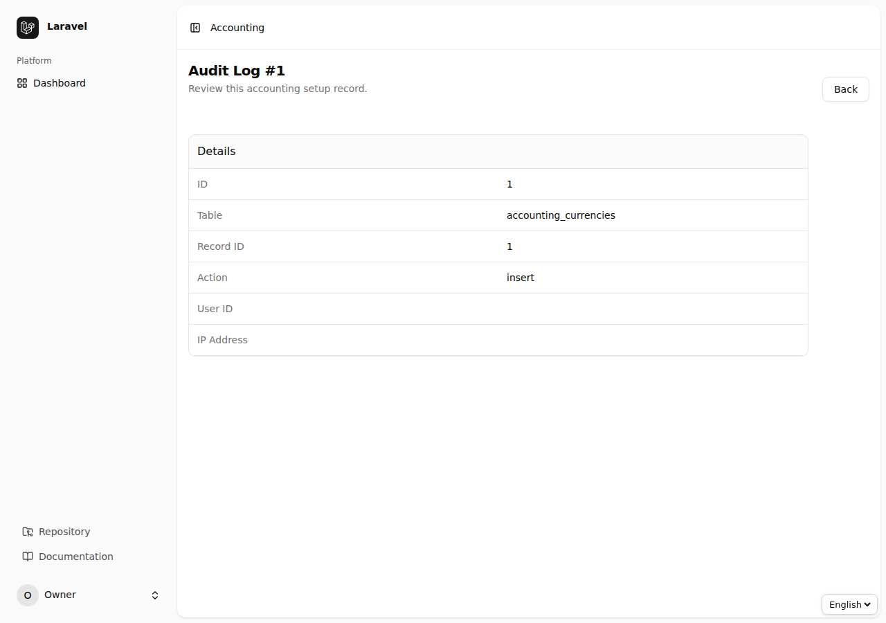
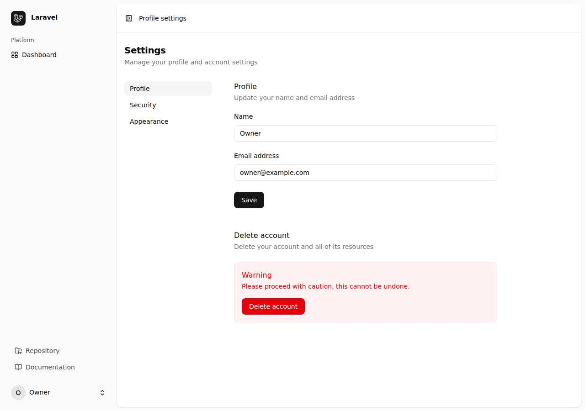

<div dir="rtl" align="right">

# باب 10: انتظامی ٹولز — صارفین، رولز، فیچرز، کمپنیاں اور آڈٹ

[← پچھلا باب](09-payroll.md) · [فہرست](README.md) · [اگلا باب: API گائیڈ →](11-api.md)

## 10.1 صارفین (Users)

`Users` میں تمام صارف ہیں۔ `New user` سے نام، ای میل، پاس ورڈ اور **رول** دے کر نیا صارف بنائیں۔ صارف کو **براہ راست اجازتیں** (Permissions) بھی دی جا سکتی ہیں، رول کے علاوہ۔ ہر تبدیلی Audit Log میں جاتی ہے۔







> صارف کو ڈیلیٹ کرنے کے بجائے اس کے رول ہٹا دینا زیادہ محفوظ ہے، تاکہ پرانا ریکارڈ (کس نے کیا بنایا) محفوظ رہے۔

## 10.2 رولز اور اجازتیں (Roles & Permissions)

`Roles` میں رولز کی فہرست، ہر رول کے ارکان کی تعداد اور اجازتیں ہیں۔ رول کھول کر **اجازتوں کا میٹرکس** نظر آتا ہے: ہر ماڈیول کی `view`، `create`، `update`، `delete`، `post`، `approve` وغیرہ کے خانے۔ `super-admin` کو حذف یا گھٹایا نہیں جا سکتا۔







**ڈیفالٹ رولز** کا خلاصہ باب 1 میں ہے۔ اپنے ادارے کی ضرورت کے مطابق نیا رول بنائیں (مثلاً "Payroll officer": `payroll.view`، `payroll.manage`، `payroll.run`)۔ کمانڈ لائن پر `php artisan accounting:roles` موجودہ رولز دکھاتی/لگاتی ہے۔

## 10.3 فیچرز — ہر چیز آن/آف (Feature Switches)

**مقصد:** جو ماڈیول آپ کے کام کا نہیں اسے بند کر دیں تاکہ مینو صاف رہے اور عملہ غلطی سے وہاں نہ جائے؛ ضرورت پڑے تو دوبارہ آن۔

`Features` (`/accounting/features`، Blade میں `/settings/features`) صرف `accounting.manage-settings` والے صارف کے لیے ہے۔ فہرست دو حصوں میں ہے: **Modules** (Customers & suppliers، Tax، Banking، Budgets، Fixed assets، Inventory، Recurring entries، FX revaluation، Attachments، Statement layout، Chart templates، Control accounts، Snapshots، Audit log، Payroll) اور **Payroll** کے ذیلی فیچر (Grades، Arrears، Attendance، Loans، Contributions، Bank file، Payslip e-mail، Bonuses، Run approval، Settlements، Reports & tax)۔



**طریقہ:** خانہ ہٹائیں/لگائیں ← `Save`۔

**بند کرنے کا اثر:**

- مینو اور Dashboard سے لنک غائب؛
- اس فیچر کی ہر ویب اسکرین اور API **404** دیتی ہے؛
- **ڈیٹا ڈیلیٹ نہیں ہوتا** — دوبارہ آن کرتے ہی سب واپس؛
- ذیلی فیچر اپنے والدین (Parent) کے بند ہونے پر خود بند ہو جاتا ہے (مثلاً Payroll بند تو Loans بھی)؛
- Payroll انجن بند فیچر کو چھوڑ دیتا ہے (قرض کی قسط، حاضری، شراکت، بقایا، بونس شامل نہیں ہوتے)؛
- Recurring اور Payroll کی کمانڈیں اپنا ماڈیول بند ہو تو کچھ نہیں کرتیں؛
- ہر تبدیلی Audit Log میں `FEATURE_ENABLED` / `FEATURE_DISABLED` کے طور پر۔

**Core** (چارٹ، واؤچر، پیرئیڈ، رپورٹیں، صارفین) بند نہیں ہو سکتا۔ منظوری کا نظام اور Multi-company کے اپنے سوئچ ترتیب (config) میں ہیں۔

**کمانڈ لائن سے:**

```bash
php artisan accounting:features                    # list
php artisan accounting:features disable inventory fixed_assets
php artisan accounting:features enable payroll_loans
php artisan accounting:features reset budgets      # back to the config default
```

**ڈیفالٹ بند رکھنے کے لیے:** `.env` میں `ACCOUNTING_FEATURES_DISABLED="inventory,fixed_assets"`۔ اسکرین/API/کمانڈ سے محفوظ کی گئی ترتیب اس پر غالب رہتی ہے۔

## 10.4 کمپنیاں (Companies)

Multi-company آن ہو (`ACCOUNTING_MULTI_COMPANY=true`) تو `Companies` میں کمپنیاں بنائیں اور ہر کمپنی کے صارف مقرر کریں۔ ہر کمپنی کا اپنا چارٹ، واؤچر، نمبرنگ، مدتیں اور رپورٹیں ہیں۔ کمانڈ: `php artisan accounting:create-company`۔

## 10.5 آڈٹ لاگ (Audit Logs)

`Audit Logs` میں ہر اہم عمل: کس صارف نے، کب، کس IP سے، کون سا ریکارڈ، پرانی اور نئی قدریں۔ فلٹر سے کھاتہ/صارف/عمل/تاریخ کے حساب سے تلاش کریں۔ لاگ میں ترمیم یا حذف کا کوئی بٹن نہیں — یہ صرف پڑھنے کے لیے ہے۔





## 10.6 ذاتی ترتیبات (Profile، Security، Appearance)

اوپر دائیں کونے سے اپنے نام پر کلک ← **Settings**: `Profile` (نام/ای میل)، `Security` (پاس ورڈ بدلنا اور سیکیورٹی کی ترتیبات)، `Appearance` (روشن/تاریک تھیم)۔



## 10.7 نیا ادارہ شروع کرنے کی ترتیب (تجویز)

1. چارٹ ٹیمپلیٹ لگائیں (باب 2.1)۔
2. بنیادی کرنسی اور شرحیں، پھر مالی سال کی مدتیں (`Generate monthly`)۔
3. Cost Centers، Voucher Types، بینک اکاؤنٹس۔
4. ابتدائی بیلنس کا ایک واؤچر (Opening Balance Equity کے ساتھ)۔
5. صارف اور رولز؛ غیر ضروری ماڈیول **Features** میں بند۔
6. `php artisan accounting:health-check` سے جانچ۔

</div>
