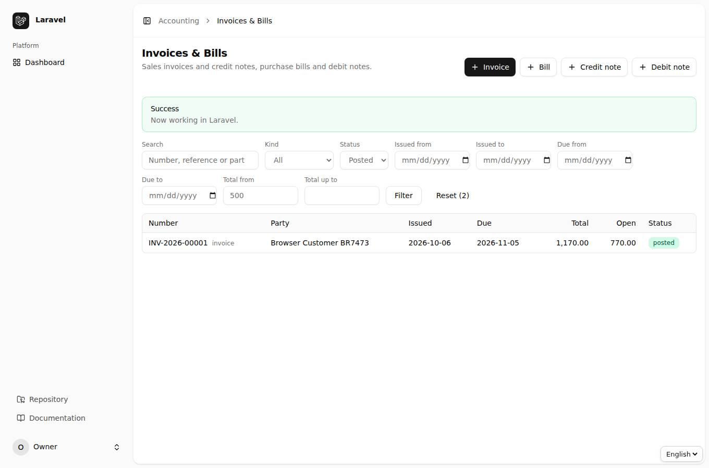
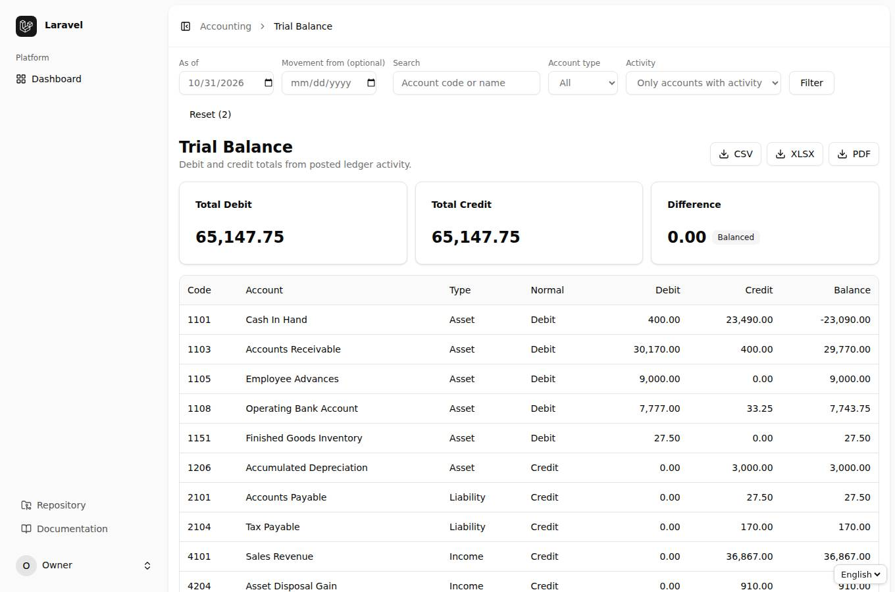
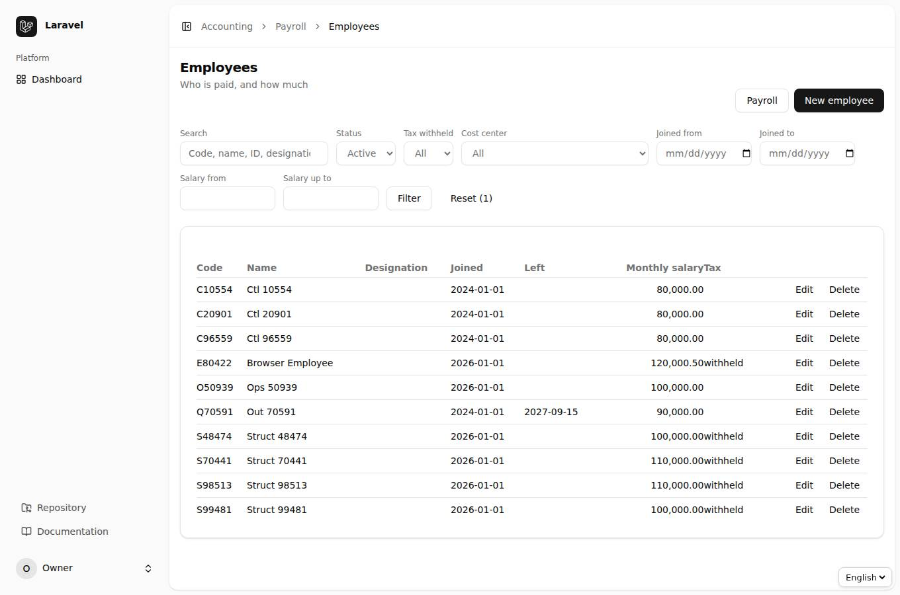
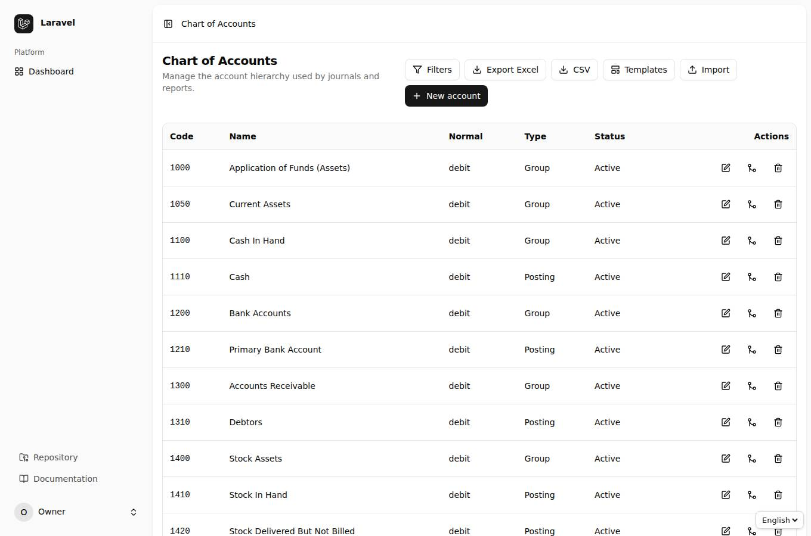
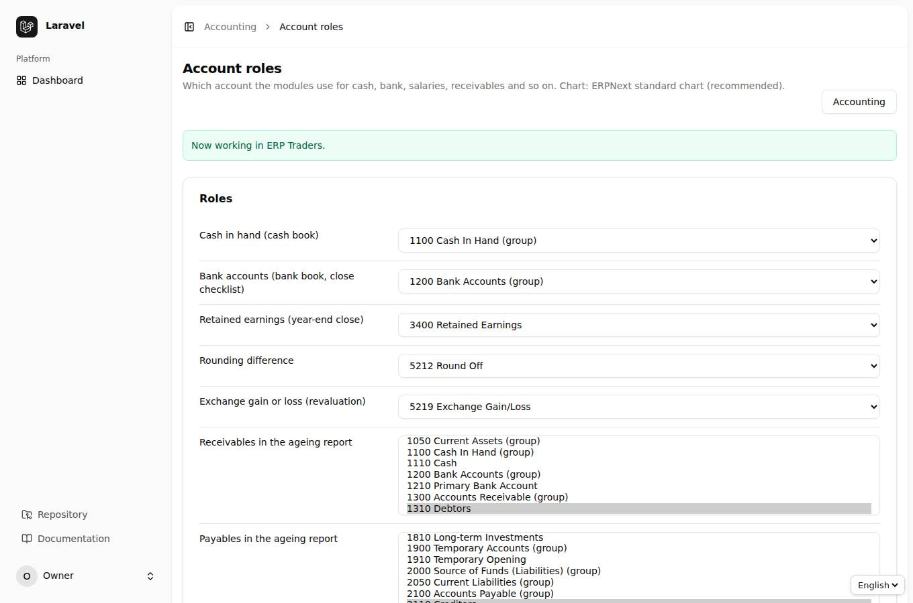

<div dir="rtl" align="right">

# باب 14: فلٹر اور تلاش، ERPNext کھاتوں کا چارٹ، اور Account Roles

[← پچھلا باب](13-zameema.md) · [فہرست](README.md)

## 14.1 ہر فہرست میں فلٹر اور تلاش

**مقصد:** ہزاروں ریکارڈ میں سے وہی نکالنا جو چاہیے — نام/نمبر سے، حالت سے، تاریخ یا رقم کی حد سے۔

ہر فہرست (گاہک و سپلائر، انوائس اور بل، وصولی/ادائیگی، فکسڈ اثاثے، انوینٹری، بجٹ، بینک اسٹیٹمنٹ، Recurring، پے رول کی تمام فہرستیں، صارفین، رولز، Voucher Types، کمپنیاں، ٹیکس، مدتیں وغیرہ) کے اوپر **فلٹر بار** ہے۔ خانے بھریں ← `Filter`۔ جتنے فلٹر لگے ہوں `Reset (تعداد)` اتنی تعداد دکھاتا ہے؛ اس پر دبانے سے سب ہٹ جاتے ہیں۔



- **Search** خانہ نام، کوڈ، نمبر یا حوالہ کا **کوئی بھی حصہ** ڈھونڈتا ہے، بڑے/چھوٹے حروف کا فرق نہیں۔ `100%` لکھیں تو واقعی `100%` والا ہی ملے گا (`%` اور `_` عام حروف ہیں)۔
- **تاریخ** (`Issued from`، `Due to` وغیرہ) اور **رقم** (`Total from`، `Total up to`) کی حد دی جا سکتی ہے۔
- **ایک سے زیادہ فلٹر ایک ساتھ** لگیں تو ریکارڈ کو **سب** شرطیں پوری کرنی ہوں گی۔
- پتے (URL) میں فلٹر نظر آتے ہیں، اس لیے فلٹر شدہ صفحے کا لنک کسی کو بھیجا جا سکتا ہے۔
- یہی نام API میں بھی چلتے ہیں: `GET /api/v1/accounting/party-documents?filter[search]=rent&filter[status]=posted&sort=-total` (مختصر شکل `?search=rent&status=posted` بھی چلتی ہے)۔ نامعلوم فلٹر پر `400` اور غلط تاریخ/رقم پر `422` آتا ہے تاکہ غلطی چھپے نہیں۔

**رپورٹیں** میں بھی تاریخ کا فلٹر ہے: Trial Balance میں `As of` (فلاں تاریخ تک) اور `Movement from` (صرف اس مدت کی حرکت)، Balance Sheet میں `As of`، Income Statement میں `From/To`، Aged Receivables/Payables میں `As of`۔ **CSV / XLSX / PDF** بٹن وہی تاریخ اور فلٹر ساتھ لے جاتے ہیں جو اسکرین پر ہیں۔





> **ہوشیار:** رپورٹ ایکسپورٹ کرنے سے پہلے اسکرین پر تاریخ دیکھ لیں۔ ایکسپورٹ وہی دکھاتا ہے جو اسکرین پر لگا ہے۔

## 14.2 نئی انسٹالیشن پر ERPNext کھاتوں کا چارٹ

نئی انسٹالیشن میں کھاتوں کا چارٹ **ERPNext کا معیاری چارٹ** (اکاؤنٹ نمبروں کے ساتھ) ہے: `1110 Cash`، `1210 Primary Bank Account`، `1310 Debtors`، `2110 Creditors`، `3400 Retained Earnings`، `4110 Sales`، `5213 Salary` وغیرہ۔ ERPNext جاننے والا اکاؤنٹنٹ ہر کھاتہ اپنی جگہ پائے گا، اور تمام ماڈیول (کیش بک، بینک بک، Ageing، پے رول، سال کی بندش) پہلے ہی ان سے جڑے ہوتے ہیں۔



انسٹال کے وقت دوسرا چارٹ چننا ہو تو:

```bash
php artisan accounting:install --chart=erpnext   # ڈیفالٹ
php artisan accounting:install --chart=general   # پیکیج کا اپنا عمومی چارٹ (1101 Cash In Hand ...)
php artisan accounting:install --chart=school    # اسکول کا چارٹ
php artisan accounting:create-company ERP "ERP Traders" --template=erpnext   # ایک اور کمپنی
```

چارٹ **ہر کمپنی کا الگ** ہوتا ہے۔ ایک ہی کمپنی میں ERPNext اور عمومی چارٹ ملانے کی اجازت نہیں (دونوں میں ایک جیسے نمبر مختلف چیزوں کے ہیں)۔ پرانی انسٹالیشن کی کمپنیاں جیسی تھیں ویسی رہتی ہیں۔

## 14.3 Account Roles — کون سا کھاتہ کس کام کے لیے

کوئی ماڈیول "کھاتہ 1101" نہیں مانگتا؛ وہ **رول** مانگتا ہے: "کیش بک کون سا کھاتہ ہے؟"، "Ageing میں وصولیاں کون سے کھاتے ہیں؟"، "تنخواہ کا خرچ کون سا ہے؟"۔ ہر کمپنی کے جواب الگ ہیں اور `Account roles` (`/accounting/account-roles`، Blade میں `/settings/account-roles`) سے بدلے جا سکتے ہیں۔ یہ صفحہ صرف `accounting.manage-settings` والے صارف کے لیے ہے۔



**طریقہ:** رول کے سامنے کھاتہ منتخب کریں (کچھ رول کئی کھاتے لیتے ہیں، مثلاً Ageing) ← `Save`۔ `— the chart's default —` کا مطلب ہے چارٹ کا اپنا طے شدہ کھاتہ۔ جو رول سیٹنگ فائل (`config/accounting.php`) میں طے ہو وہ "Fixed in the configuration" لکھ کر بند نظر آتا ہے۔

- کیش، بینک اور Ageing کے رول **گروپ کھاتہ** بھی لے سکتے ہیں (رپورٹ اس کے ذیلی کھاتے جمع کرتی ہے)؛ باقی رول صرف پوسٹ ہونے والے کھاتے لیتے ہیں۔
- جس کھاتے کے پاس کوئی رول ہو اسے ڈیلیٹ یا غیر فعال نہیں کیا جا سکتا۔ دو کھاتے **ضم (Merge)** کریں تو رول اس کھاتے کو منتقل ہو جاتا ہے جو بیلنس رکھتا ہے۔
- ہر تبدیلی Audit Log میں `ACCOUNT_ROLES_UPDATED` کے نام سے جاتی ہے۔

کمانڈ لائن سے:

```bash
php artisan accounting:account-roles                       # کون سا رول کس کھاتے کے پاس ہے
php artisan accounting:account-roles set cash 1110
php artisan accounting:account-roles seed erpnext --overwrite
```

API: `GET /api/v1/accounting/account-roles` اور `PUT /api/v1/accounting/account-roles` (`{"roles": {"cash": [12]}}`)۔


[اگلا باب: WhatsApp →](15-whatsapp.md)

</div>
