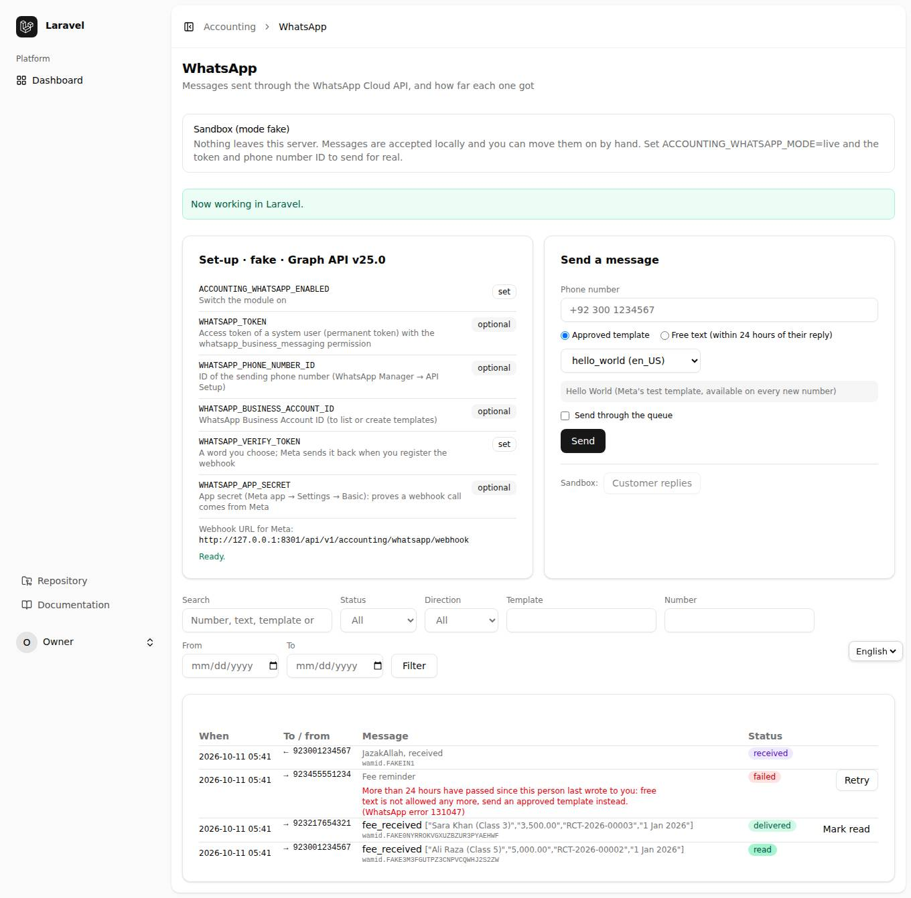
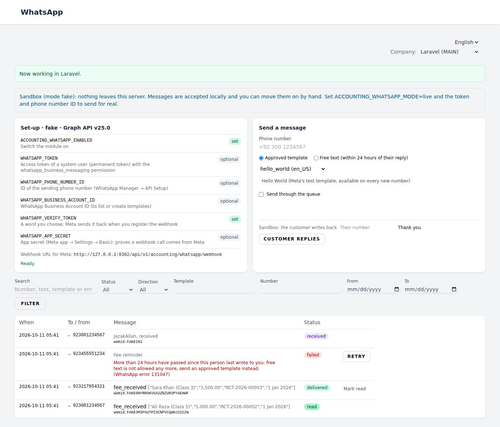
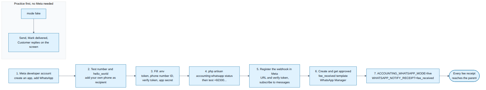
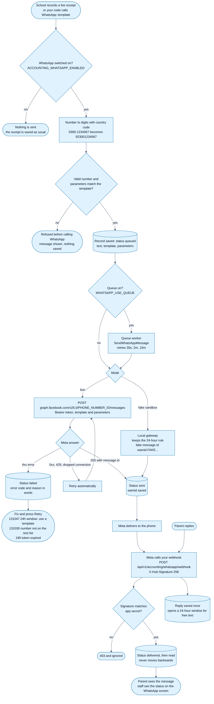

<div dir="rtl" align="right">

# باب 15: WhatsApp — ایک فنکشن کال سے پیغام

[← پچھلا باب](14-filter-chart-roles.md) · [فہرست](README.md)

## 15.1 یہ کیا کرتا ہے

سسٹم سے کسی کو بھی WhatsApp پیغام **ایک سطر** میں بھیجا جا سکتا ہے، اور سارے سیٹنگز `.env` میں ہیں۔ مثال: اسکول میں کسی بچے کی فیس جمع ہو تو والدین کو فوراً پیغام جائے۔ ہر پیغام کی حالت **sent ← delivered ← read** (یا **failed** وجہ کے ساتھ) `/accounting/whatsapp` پر نظر آتی ہے۔

> **ضروری نوٹ:** Meta کی اپنی ڈاکیومنٹیشن اس بلڈ ماحول سے براہِ راست نہیں کھل سکی اور نہ ہی اصل API کنجی تھی، اس لیے ٹیسٹ **سینڈ باکس (fake) موڈ** میں ہوا ہے۔ اصل نمبر لگانے سے پہلے Meta کی تازہ ڈاکیومنٹیشن (developers.facebook.com/docs/whatsapp) دیکھ لیں اور `accounting:whatsapp test` چلا لیں۔



اسکرین پر: اوپر **سیٹ اپ کی حالت** (کون سی چیز `.env` میں لگی ہے، کون سی رہ گئی)، دائیں **پیغام بھیجنے کا فارم**، نیچے **پیغامات کی فہرست** (فلٹر کے ساتھ)۔ ناکام پیغام پر **Retry** کا بٹن ہے۔ Blade ورژن بھی یہی ہے:



## 15.2 ایک سطر میں پیغام (کوڈ سے)

```php
use Alimarchal\LaravelChartOfAccounts\Support\WhatsApp;

WhatsApp::template('0300-1234567', 'fee_received', [
    'student' => 'Ali Raza', 'amount' => 'Rs 5,000', 'receipt' => 'RV-2026-00012', 'date' => '10 Oct 2026',
]);

WhatsApp::text('+92 300 1234567', 'آپ کی رسید تیار ہے۔');   // صرف جب اس شخص نے پچھلے 24 گھنٹوں میں آپ کو لکھا ہو
```

- نمبر جیسے بھی لکھیں (`+92 300 1234567`، `0300-1234567`) سسٹم خود `923001234567` بنا لیتا ہے۔
- غلطی ہو (غلط نمبر، 24 گھنٹے کا اصول، پیرامیٹر کم) تو صاف جملے میں غلطی آتی ہے۔
- قطار (queue) سے بھیجنا: `WhatsApp::queueTemplate(...)`۔

## 15.3 اسکول فیس کی مثال، شروع سے آخر تک

1. والدین کو **Customer** بنائیں اور **فون نمبر** لکھیں۔
2. `.env` میں: `ACCOUNTING_WHATSAPP_ENABLED=true` اور `WHATSAPP_NOTIFY_RECEIPT=fee_received`۔
3. فیس کو اس Customer کی **Receipt** کے طور پر درج کریں۔ محفوظ ہوتے ہی والدین کو پیغام جاتا ہے: *"محترم والدین، Ali Raza کی 5,000 فیس موصول ہوئی۔ رسید RCT-2026-00002، تاریخ 10 Oct 2026۔ شکریہ"* (الفاظ آپ کے منظور شدہ ٹیمپلیٹ کے ہوتے ہیں)۔
4. WhatsApp میں کوئی بھی مسئلہ ہو تو **رسید پھر بھی محفوظ** ہوتی ہے؛ پیغام فہرست میں *failed* نظر آتا ہے اور **Retry** سے دوبارہ بھیج سکتے ہیں۔

## 15.4 `.env` کی چابیاں

| چابی | مطلب |
|------|------|
| `ACCOUNTING_WHATSAPP_ENABLED` | `true` = چالو |
| `ACCOUNTING_WHATSAPP_MODE` | `fake` (آزمائشی، کچھ باہر نہیں جاتا) یا `live` (اصلی Meta) |
| `WHATSAPP_TOKEN` | System User کا مستقل Access Token (`whatsapp_business_messaging`) |
| `WHATSAPP_PHONE_NUMBER_ID` | بھیجنے والے نمبر کی ID (نمبر خود نہیں) |
| `WHATSAPP_BUSINESS_ACCOUNT_ID` | WhatsApp Business Account کی ID (ٹیمپلیٹ فہرست کے لیے) |
| `WHATSAPP_VERIFY_TOKEN` | آپ کا چنا ہوا کوئی لفظ، Meta کی webhook سیٹنگ میں وہی لکھیں |
| `WHATSAPP_APP_SECRET` | Meta ایپ ← Settings ← Basic؛ ثابت کرتا ہے کہ کال Meta ہی کی ہے |
| `WHATSAPP_API_VERSION` | Graph API ورژن (ابھی `v25.0`) |
| `WHATSAPP_DEFAULT_COUNTRY_CODE` | `92`: `0300…` ← `92300…` |
| `WHATSAPP_NOTIFY_RECEIPT` | رسید پر خود بخود جانے والے ٹیمپلیٹ کا نام |

`php artisan accounting:whatsapp status` بتاتا ہے کیا لگا ہے اور کیا رہ گیا۔ ٹیمپلیٹ کے نام اور پیرامیٹروں کی ترتیب `config/accounting.php` ← `whatsapp.templates` میں ہے۔

## 15.5 پہلے سینڈ باکس میں آزمائیں (Meta کے بغیر)

`ACCOUNTING_WHATSAPP_MODE=fake` میں کچھ باہر نہیں جاتا، مگر اصل جیسے اصول لاگو ہوتے ہیں: ٹیمپلیٹ چل جاتا ہے، جبکہ **عام متن اس نمبر کو نہیں جاتا جس نے 24 گھنٹوں میں آپ کو نہ لکھا ہو** (غلطی 131047)۔ اسکرین پر **Mark delivered / Mark read** (جو بعد میں Meta خود بتاتا ہے) اور **Customer replies** (جواب آنے پر 24 گھنٹے کی کھڑکی کھل جاتی ہے) کے بٹن ہیں۔

## 15.6 اصلی نمبر پر کیسے لے جائیں



1. **Meta:** developer اکاؤنٹ ← نئی Business ایپ ← WhatsApp پروڈکٹ شامل کریں۔ مفت **ٹیسٹ نمبر** اور `hello_world` ٹیمپلیٹ ملتا ہے؛ ٹیسٹ نمبر صرف ان نمبروں کو بھیجتا ہے جو آپ WhatsApp Manager میں شامل کریں (ورنہ غلطی 131030)۔
2. **Token:** Business settings میں System User بنائیں، ایپ اور `whatsapp_business_messaging` دیں، کبھی ختم نہ ہونے والا token بنائیں، اور `.env` میں Token، Phone number ID، Business Account ID اور App Secret لکھیں۔
3. **آزمائش:** `ACCOUNTING_WHATSAPP_MODE=live` کر کے `php artisan accounting:whatsapp test +92XXXXXXXXXX`۔
4. **Webhook:** Meta ← WhatsApp ← Configuration میں اسکرین پر دکھایا گیا پتہ (`https://آپ-کا-ڈومین/api/v1/accounting/whatsapp/webhook`، عوامی https ہونا لازم) اور اپنا verify token لکھیں، پھر **messages** سبسکرائب کریں۔ webhook کے بغیر پیغام *sent* ہی رہتا ہے، *delivered/read* نہیں بنتا۔
5. **ٹیمپلیٹ:** نئی گفتگو صرف **منظور شدہ ٹیمپلیٹ** سے شروع ہو سکتی ہے (WhatsApp Manager ← Message templates، قسم *Utility*)۔ `fee_received` چار پیرامیٹروں کے ساتھ بنائیں: طالب علم، رقم، رسید، تاریخ۔ منظوری میں منٹ سے ایک دن لگ سکتا ہے۔
6. **لائیو:** حقیقی کاروباری نمبر کے لیے تصدیق شدہ business اور ادائیگی کا طریقہ درکار ہے؛ پھر `WHATSAPP_NOTIFY_RECEIPT=fee_received` لگا دیں۔

## 15.7 پورا عمل (Flowchart)



## 15.8 عام غلطیاں

| غلطی | مطلب اور حل |
|------|-------------|
| 131047 | 24 گھنٹے گزر گئے: عام متن نہیں چلے گا، منظور شدہ ٹیمپلیٹ بھیجیں |
| 131030 | نمبر ٹیسٹ فہرست میں نہیں: WhatsApp Manager میں شامل کریں |
| 131026 | نمبر WhatsApp پر نہیں، یا شخص نے نئی شرائط قبول نہیں کیں |
| 132000 / 132001 | پیرامیٹر کی تعداد غلط، یا ٹیمپلیٹ اس زبان میں موجود/منظور نہیں |
| 132018 | پیرامیٹر میں نئی سطر، tab یا بہت سی خالی جگہیں (سسٹم خود صاف کرتا ہے) |
| 190 / 102 | Token ختم یا غلط: نیا System User token بنائیں |
| 130429 / 131056 / 80007 | بھیجنے کی حد: سسٹم بعد میں خود دوبارہ کوشش کرتا ہے |

API: `GET /api/v1/accounting/whatsapp`، `POST /api/v1/accounting/whatsapp/messages` (`{"to": "0300-1234567", "template": "fee_received", "parameters": {...}}`)، `POST .../messages/{id}/retry`۔ اجازتیں: `whatsapp.view` (دیکھنا) اور `whatsapp.send` (بھیجنا)۔


[اگلا باب: تنصیب →](16-tansib.md)

</div>
