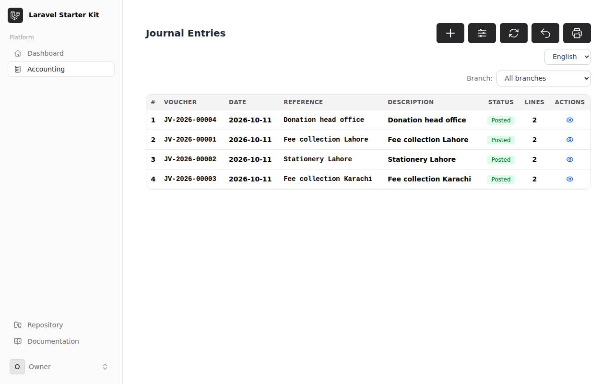
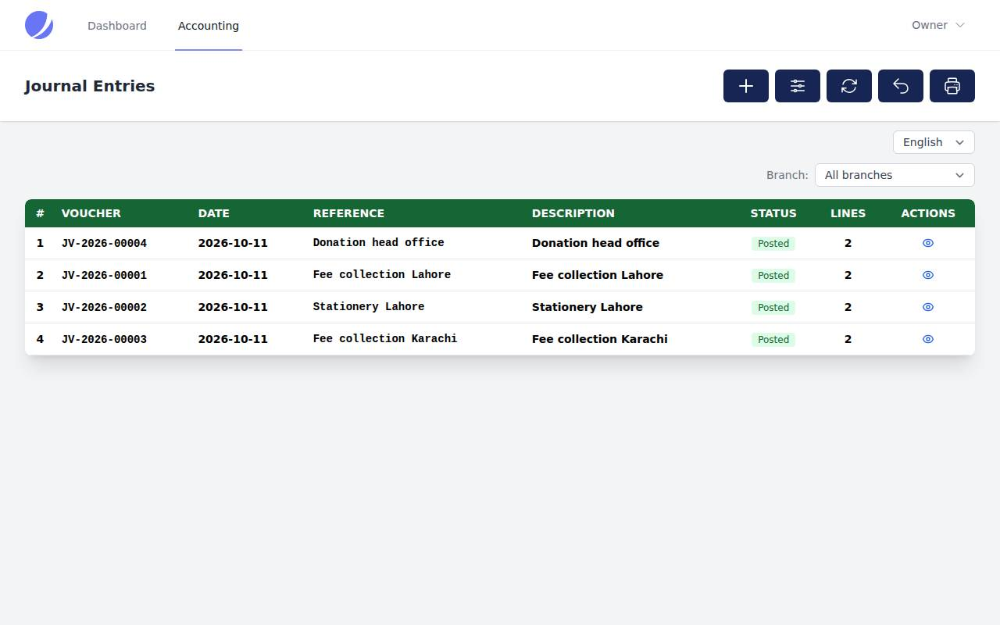
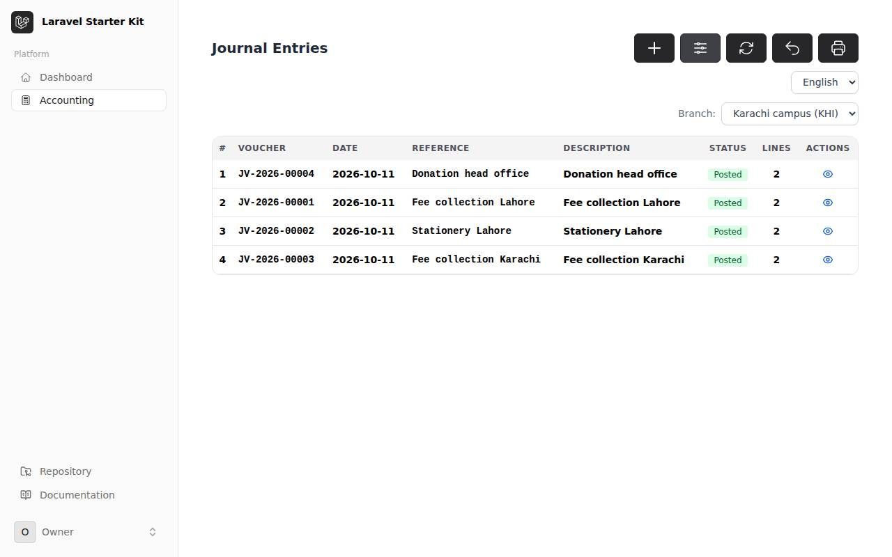
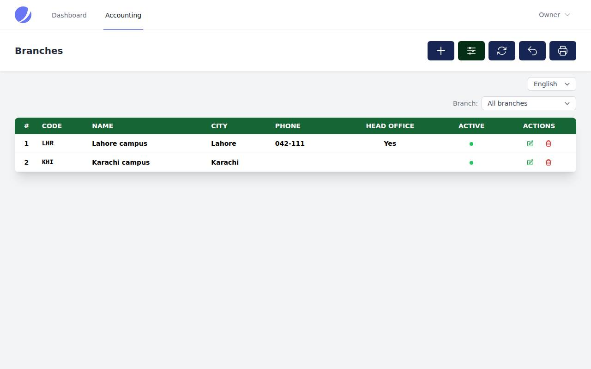
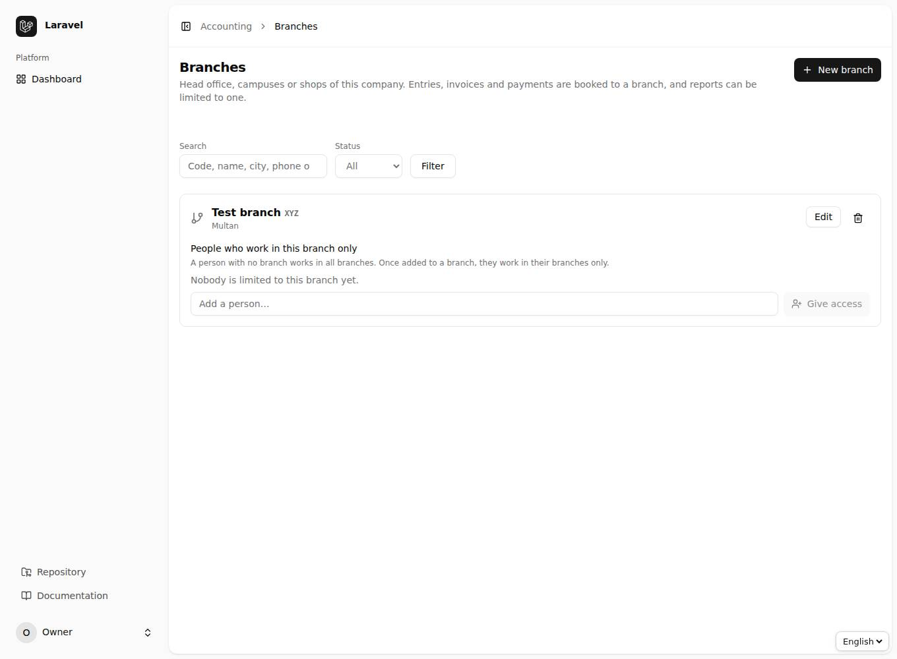

# باب 17: اسٹارٹر کٹس اور برانچیں

[← پچھلا باب](16-tansib.md) · [فہرست](README.md)

## 17.1 تین قسم کی اسکرینیں

انسٹالر تین قسم کی اسکرینیں پیش کرتا ہے (چوتھی صرف API ہے):

| انتخاب | کس کے لیے | کیسا لگتا ہے |
|--------|-----------|---------------|
| `--ui=livewire` | Laravel کا **Livewire اسٹارٹر کٹ** (Flux) | کٹ کی اپنی سائیڈ بار میں "Accounting"؛ سادہ سرحد والے کارڈ، Flux جیسے بٹن، پوری چوڑائی |
| `--ui=blade` | **Jetstream** یا **Breeze** | اوپر کی نیویگیشن میں "Accounting"؛ Jetstream کے کارڈ |
| `--ui=inertia` | **React** اسٹارٹر کٹ | سائیڈ بار میں "Accounting"، React صفحات |

Blade والی دونوں قسمیں ایک ہی صفحات ہیں؛ `.env` میں `ACCOUNTING_BLADE_KIT` (`auto`، `flux`، `jetstream`، `breeze`، `plain`) بتاتا ہے کہ کس کٹ جیسے دکھیں۔ `auto` خود پہچان لیتا ہے۔

یہ سب اصل ایپس میں چلا کر دیکھا گیا ہے (Livewire کٹ اور Jetstream پر اصل `accounting:install`): تمام 89 صفحات کھلتے ہیں، ہر فلٹر کا بٹن کھلتا اور لگتا ہے، "Add" فارم کھلتے ہیں، اور جرنل انٹری فارم سے بن جاتی ہے۔

## 17.2 ایک کمپنی، کئی برانچیں

`.env` میں `ACCOUNTING_BRANCHES=true` لکھیں (انسٹالر بھی پوچھتا ہے)۔ پھر **Accounting ← Branches** میں برانچیں بنائیں: ہیڈ آفس، لاہور کیمپس، کراچی کیمپس وغیرہ۔

- **جرنل انٹری، انوائس، بل اور ادائیگی** کسی برانچ میں بُک ہوتی ہے۔ انوائس/ادائیگی اپنی برانچ اپنی انٹری کو دیتی ہے؛ ریورس انٹری اصل انٹری کی برانچ میں جاتی ہے؛ سال کی بندش پوری کمپنی کی ہے۔
- اوپر **Branch** کا انتخاب ("کام کی برانچ"): چنتے ہی نئی انٹریاں اسی میں بنتی ہیں، اور فہرستیں اور رپورٹیں (ٹرائل بیلنس، جنرل لیجر، آمدنی و اخراجات، بیلنس شیٹ، کیش فلو، ایجنگ، ڈیش بورڈ) اسی برانچ کی ہو جاتی ہیں۔ "All branches" سے پوری کمپنی۔ API میں `X-Branch: LHR` ہیڈر۔ سب برانچوں کا مجموعہ کمپنی کے برابر آتا ہے۔
- **رسائی**: جس شخص کو برانچ دی جائے (برانچ کی ایڈٹ اسکرین ← *People who work in this branch*) وہ **صرف انہی** برانچوں میں کام کرتا ہے؛ دوسری برانچوں کی انٹریاں اسے نظر ہی نہیں آتیں۔ جسے کوئی برانچ نہ دی جائے (اور super-admin) وہ سب میں کام کرتا ہے۔ ایک سے زیادہ برانچ والا ہر انٹری کی برانچ خود چنتا ہے۔
- جس برانچ میں انٹریاں ہو چکی ہوں اسے مٹایا نہیں جا سکتا؛ اسے **غیر فعال** کریں۔
- اجازتیں: `branches.view`، `branches.create`، `branches.update`، `branches.delete`۔

> پرانی ایپ میں اپ ڈیٹ کے بعد `php artisan accounting:update` چلائیں تاکہ نئی اجازتیں بن جائیں۔

[← پچھلا باب](16-tansib.md) · [فہرست](README.md)

