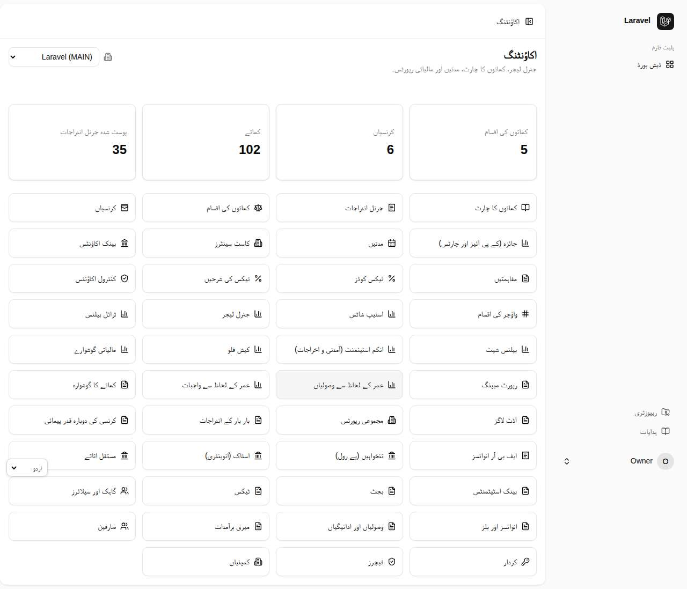

# اکاؤنٹنگ سسٹم — مکمل اردو استعمال گائیڈ

یہ گائیڈ **Laravel Chart of Accounts** پیکیج کی ہر اسکرین، ہر عمل اور API کو **اردو** میں (اسکرین شاٹس کے ساتھ) سمجھاتی ہے۔ زبان دائیں سے بائیں ہے؛ جہاں انگریزی بٹن، فیلڈ یا کوڈ کا نام ہے وہ انگریزی ہی میں `اس طرح` لکھا ہے تاکہ آپ اسکرین سے ملا سکیں۔

> **ایک ہی فائل میں پڑھنا چاہتے ہیں؟** [`guide.html`](guide.html) کھولیں (اپنے براؤزر میں ڈاؤن لوڈ کر کے)؛ یہ پوری گائیڈ ایک صفحے میں، دائیں سے بائیں اور موبائل پر پڑھنے کے قابل ہے۔

## فہرست

| باب | موضوع | کیا سیکھیں گے |
|---|---|---|
| [1](01-shuru.md) | شروعات | لاگ اِن، Dashboard، اردو/انگریزی، کمپنی، رولز |
| [2](02-buniyadi.md) | بنیادی ڈیٹا | کھاتوں کا چارٹ، امپورٹ، کرنسی، مدتیں اور کلوزنگ، Cost Center، Voucher Types |
| [3](03-voucher.md) | جرنل واؤچر | بنانا، پوسٹ، منظوری، دستاویزات، پرنٹ، Recurring، FX Revaluation |
| [4](04-reports.md) | رپورٹیں | Trial Balance سے Cash Flow تک، ایکسپورٹ |
| [5](05-bank.md) | بینک | بینک کھاتے، اسٹیٹمنٹ امپورٹ، Auto-match، مفاہمت |
| [6](06-parties.md) | گاہک و سپلائر | انوائس، بل، وصولی/ادائیگی، Ageing |
| [7](07-tax-fbr.md) | ٹیکس اور FBR | Tax Codes، Taxed Document، ٹیکس رپورٹ، FBR انوائسنگ |
| [8](08-planning.md) | بجٹ، اثاثے، انوینٹری | Budget vs Actual، فرسودگی، اسٹاک |
| [9](09-payroll.md) | پے رول | ملازمین، تنخواہ Run، بقایا جات، چھٹی، قرض، EOBI، منظوری، بونس، تصفیہ، ٹیکس سرٹیفکیٹ |
| [10](10-admin.md) | انتظامی ٹولز | صارفین، رولز، **Features آن/آف**، کمپنیاں، Audit Log |
| [11](11-api.md) | API گائیڈ | ٹوکن، curl مثالیں، تمام ماڈیولز کے endpoints |
| [12](12-commands-faq.md) | کمانڈیں اور سوالات | Artisan کمانڈیں، عام مسائل کا حل، اصطلاحات |
| [ضمیمہ](13-zameema.md) | بقیہ اسکرینیں | نیا/تفصیل/ترمیم کے عمومی صفحات |
| [14](14-filter-chart-roles.md) | فلٹر، چارٹ اور Account Roles | ہر فہرست میں فلٹر/تلاش، ERPNext چارٹ، کھاتوں کے رول |

## مزید وسائل

- **ہر اسکرین اور endpoint کی فہرست (Help Catalog):** [`docs/help-catalog.md`](../../help-catalog.md)
- **API کی مکمل تفصیل:** [`docs/openapi.yaml`](../../openapi.yaml) اور [Postman collection](../../postman_collection.json)
- **عملی ٹیسٹ فہرست (UAT):** [`docs/uat.md`](../../uat.md)
- **انگریزی README:** [`README.md`](../../../README.md)

## اردو انٹرفیس میں اسکرین

نیچے مرکزی صفحہ **اردو (دائیں سے بائیں)** انٹرفیس میں ہے — زبان مینو سے `اردو` منتخب کرنے پر پورا سسٹم ایسا نظر آتا ہے۔

